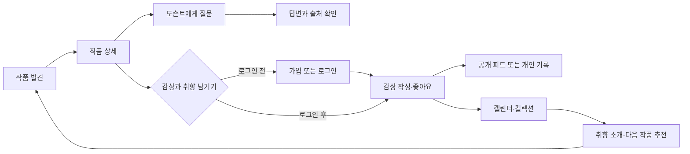
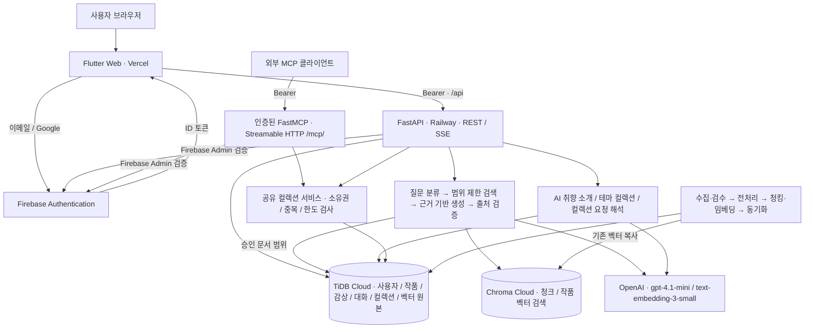
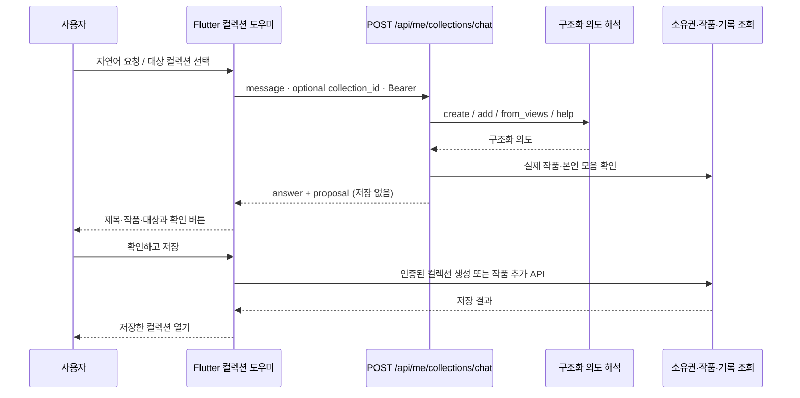

<div align="center">
  

# Docentalk

### 그림을 만나고, 이야기를 나누고, 나의 시선을 기록하다.

**자료에 근거한 AI 도슨트와 함께 작품을 이해하고, 감상과 취향을 쌓아가는 온라인 미술관**

[서비스 바로가기](https://artlog-skn35-1team.vercel.app) · [개발 코드](https://github.com/SKNETWORKS-FAMILY-AICAMP/SKN35-3rd-1Team/tree/dev) · [기획·진행 계획](https://github.com/SKNETWORKS-FAMILY-AICAMP/SKN35-3rd-1Team/blob/6f0b40a7be17d8f8704df364887b3d6b21d021a4/PLAN.md)

</div>


> SK Networks Family AI Camp 35기 · 3차 프로젝트 · 1팀<br />
> 문서 기준: 2026.10.15 · 화면: 운영 사이트 직접 캡처 · 기능·데이터 모델: dev `6f0b40a` 기준 · 프론트 정리·컬렉션 도우미: lsh 추가 구현<br />
> 화면 캡처는 운영 버전이며, 새 컬렉션 도우미 UI는 이번 lsh 구현에 포함됩니다. 기술·평가 수치는 아래 코드와 실행 기록을 기준으로 설명합니다.

## 목차

1. [서비스 소개](#1-서비스-소개)
2. [기획 배경과 목표](#2-기획-배경과-목표)
3. [주요 기능](#3-주요-기능)
4. [서비스 화면](#4-서비스-화면)
5. [사용자 흐름과 와이어프레임](#5-사용자-흐름과-와이어프레임)
6. [ERD와 데이터 설계](#6-erd와-데이터-설계)
7. [콘텐츠와 자료 운영](#7-콘텐츠와-자료-운영)
8. [검증 결과와 개선 과제](#8-검증-결과와-개선-과제)
9. [팀 소개](#9-팀-소개)
10. [실행·문서 안내](#10-실행문서-안내)
11. [기술 아키텍처와 기술 선택](#11-기술-아키텍처와-기술-선택)
12. [AI 컬렉션·채팅·MCP](#12-ai-컬렉션채팅mcp)
13. [프로젝트 폴더 구조](#13-프로젝트-폴더-구조)

## 1. 서비스 소개

**Docentalk**은 작품을 고르는 순간부터 감상을 남기는 순간까지 이어지는 미술 감상 서비스입니다. 오늘의 그림과 작가·사조별 목록에서 작품을 발견하고, 작품 상세에서 AI 도슨트에게 질문합니다. 답변에 연결된 자료의 제목·출처·이용 조건을 확인하며 해설을 살펴볼 수 있습니다.

감상이 끝나면 공개 또는 비공개로 생각을 남깁니다. 공개 감상 피드에서는 다른 감상가의 시선을 만나고, 내 피드에서는 좋아요한 그림·관심 작가·컬렉션·감상 캘린더를 모아 봅니다. 관심 기록에서 출발한 AI 취향 소개와 테마 컬렉션은 다음 작품을 발견하는 계기가 됩니다.

**서비스명**은 미술관 해설자 **Docent**와 대화 **Talk**를 연결했습니다. 일방적으로 설명을 읽는 감상에서, 질문하고 자신의 시선을 기록하는 감상으로 이어지는 경험을 지향합니다.

| 핵심 경험 | 사용자에게 제공하는 가치 |
| --- | --- |
| 발견 | 큰 작품 이미지와 간결한 탐색으로 첫 감상을 시작합니다. |
| 이해 | 궁금한 디테일을 질문하고, 설명 수준을 선택합니다. |
| 확인 | 도슨트 답변의 근거 자료와 원문 출처를 직접 확인합니다. |
| 기록 | 감상을 공개·비공개로 남기고 날짜별로 다시 찾습니다. |
| 연결 | 다른 사람의 감상과 자신의 관심 기록에서 다음 작품을 만납니다. |

## 2. 기획 배경과 목표

미술 감상을 시작할 때 작품의 배경과 기법을 어디부터 살펴볼지 막막할 수 있습니다. 정적인 해설은 관람객의 개별 질문에 바로 답하기 어렵고, 일반적인 AI 답변은 그 설명이 어떤 자료에 근거했는지 확인하기 어렵습니다. 좋아했던 작품과 그때의 생각도 여러 곳에 흩어지기 쉽습니다.

Docentalk은 **작품을 중심으로 질문·근거·감상 기록을 한 흐름에 연결**합니다.

| 해결하려는 문제 | 기획 방향 |
| --- | --- |
| 무엇부터 봐야 할지 모르겠음 | 오늘의 그림, 작가·사조별 탐색, 예시 질문 제공 |
| 설명이 너무 어렵거나 얕게 느껴짐 | Easy / Standard / Deep 설명 방식 선택 |
| AI 설명의 근거를 확인하기 어려움 | 수집·검수된 미술 자료와 출처 표시, 근거 부족 안내 |
| 감상 기록이 일회성으로 끝남 | 작품별 감상, 공개 범위 선택, 월별 감상 캘린더 |
| 자신의 미술 취향을 설명하기 어려움 | 좋아요·감상 기록 기반 추천, AI 한 줄 소개·테마 컬렉션 |
| 다른 관람객의 해석을 만나기 어려움 | 공개 감상 피드, 작성자 프로필, 감상가 팔로우 |

주요 대상은 **미술을 편하게 접하고 싶은 입문자**, **작품의 표현과 맥락을 더 깊이 알고 싶은 감상자**, **자신의 취향과 감상 기록을 모으고 싶은 사용자**입니다.

### 서비스 설계 원칙

- **작품이 먼저 보이는 화면**: 전시형 메인과 큰 이미지, 절제된 색상으로 작품에 집중합니다.
- **근거를 확인할 수 있는 해설**: 일반 지식만으로 빈 부분을 채우지 않고 자료의 범위와 한계를 안내하도록 설계합니다.
- **내가 정하는 공개 범위**: 공개 감상과 개인 기록을 구분하고 팔로우 목록 공개 여부를 선택합니다.
- **기록에서 이어지는 발견**: 좋아요와 감상 경험을 다음 작품·컬렉션 탐색에 연결합니다.

## 3. 주요 기능

| 영역 | 기능 | 주요 동작 |
| --- | --- | --- |
| 발견하기 | 오늘의 그림 | 3개 작품을 전환하는 전시형 메인, 작품 상세 진입 |
| 작품 탐색 | 검색·필터·더보기 | 작품 제목·작가 검색, 사조별 필터, 추가 목록 조회 |
| 작가 탐색 | 작가 목록·상세 | 작가 소개와 작품 모음, 작가 좋아요·관심 작가 관리 |
| 작품 상세 | 감상·정보 확인 | 작품 이미지 확대, 제목·연도·작가 정보, 감상 노트·출처, 관련 작품 |
| AI 도슨트 | 작품별 질의응답 | 예시 질문, 스트리밍 답변, Easy / Standard / Deep 선택, 로그인 사용자의 대화 복원·초기화 |
| 근거 확인 | 답변 출처 | 사용한 자료의 제목·기관·자료 유형·URL·라이선스, 편집 근거 확인 |
| 감상 기록 | 공개·비공개 감상 | 작품별 감상 작성·공개 범위 선택, 내 감상 삭제 |
| 감상 피드 | SNS형 감상 공유 | 공개 글의 작품 이미지·감상 요약, 전체 감상 읽기, 작성자 프로필 이동 |
| 감상가 연결 | 팔로우 | 사용자 팔로우, 팔로잉·팔로워 목록, 목록 공개 여부 설정 |
| 내 피드 | 감상·취향 모아보기 | 내 감상, AI 한 줄 취향 소개, 컬렉션·관심 작가·캘린더 탭 |
| 감상 캘린더 | 날짜별 기록 | 월 이동, 오늘 이동, 감상한 날짜와 선택 날짜의 작품·열람 횟수 확인 |
| 좋아요 | 좋아요한 작품 모음 | 작품의 하트와 기본 좋아요 컬렉션 연결 |
| 나만의 컬렉션 | 직접 구성하는 작품 모음 | 생성·이름/소개 편집·삭제, 작품 담기·꺼내기, 별도 상세 페이지 |
| AI 취향 컬렉션 | 관심에서 출발하는 테마 | 좋아요·열람 기록을 바탕으로 테마와 작품 모음 제안, 내 컬렉션으로 저장 |
| AI 컬렉션 도우미 | 자연어로 생성·담기 | 최근/작가/월별 열람 모음 요청, 대상 컬렉션 선택, 제안 확인 후 저장 · 이번 lsh 구현 |
| MCP | 외부 AI 도구 연동 | 인증된 6개 도구로 모음 조회·검색·생성·담기, REST와 소유권 서비스 공유 |
| 로그인 | 이메일·Google | 로그인·회원가입 구분, Google로 계속하기, 비밀번호 재설정 |
| 설정 | 계정·공개 범위 | 내 피드 이동, 팔로잉/팔로워 공개 전환, 로그아웃 |

외부 도구 연동용으로 컬렉션 조회·작품 검색·컬렉션 생성·작품 담기·감상 기록 기반 모음 도구도 제공합니다. 연결·도구·인증·검증 범위는 아래 [AI 컬렉션·채팅·MCP](#12-ai-컬렉션채팅mcp)에 정리했습니다.

> **이용 범위:** 작품 탐색·공개 감상 읽기·도슨트 질문은 로그인 없이 시작할 수 있습니다. 개인 기록 저장과 좋아요·팔로우·컬렉션은 로그인한 계정에 연결됩니다. 직접 저장한 컬렉션은 계정당 최대 10개, 컬렉션당 최대 30점입니다.

## 4. 서비스 화면

아래 이미지는 **2026.10.15 운영 사이트에서 직접 캡처한 화면**입니다. 로그인 전 화면은 별도 브라우저에서, 로그인 후 화면은 기존 로그인 세션에서 확인했습니다. 브라우저 탭·도구 영역과 설정의 계정 이메일은 캡처 범위에서 제외했습니다. 화면의 작품·감상·추천 결과는 이용 시점과 계정에 따라 달라질 수 있습니다.

### 4.1 작품과 작가를 발견하기

검색창과 사조 필터로 작품을 좁혀 보고, 작가 목록에서 소개와 대표 작품으로 이어집니다.

| 작품 목록 | 작가 목록 |
| --- | --- |
|  |  |

<details>
<summary>작가 상세 화면 보기</summary>


</details>

### 4.2 작품을 보면서 도슨트와 대화하기

작품 이미지와 대화를 함께 배치했습니다. 설명 방식을 고르고 질문한 뒤, 답변의 출처 칩에서 실제 근거 자료를 확인합니다.


<details>
<summary>실제 답변과 출처 확인 화면 보기</summary>

**질문:** “이 그림의 구도에서 눈여겨볼 점을 알려주세요.”


이 캡처는 실제 서비스 응답 예시이며, 개별 답변의 품질을 전체 질문에 대한 보장으로 제시하지 않습니다.

</details>

### 4.3 감상을 나누고, 내 시선을 모으기

공개 감상은 다른 감상가가 읽을 수 있고, 작성자 프로필에서 관심을 이어갈 수 있습니다. 내 피드에서는 자신의 감상과 AI 취향 소개를 모아 봅니다.

| 감상 피드 | 로그인 후 내 피드 |
| --- | --- |
|  |  |

<details>
<summary>감상 기록과 공개 범위</summary>

- 작품 상세에서 감상을 작성하며 공개·비공개를 선택합니다.
- 공개 글은 감상 피드와 공개 프로필에 연결됩니다. 비공개 글은 본인에게만 표시합니다.
- 본인이 남긴 감상은 삭제할 수 있습니다.
- 설정에서 팔로잉·팔로워 목록과 수의 공개 여부를 선택합니다.


</details>

### 4.4 감상 캘린더로 다시 찾기

감상한 날짜에 작품 이미지와 개수를 표시합니다. 날짜를 선택하면 해당 날짜에 감상한 작품과 열람 횟수를 확인하고 상세로 돌아갈 수 있습니다.


### 4.5 내 취향을 컬렉션으로 만들기

좋아요한 작품은 기본 모음에 담깁니다. 직접 컬렉션을 만들거나 AI가 관심 기록에서 제안한 테마를 살펴보고 저장할 수 있습니다. 모음은 팝업이 아닌 **새 페이지**에서 정렬된 작품으로 펼쳐집니다.


<details>
<summary>좋아요 모음·컬렉션 생성·관심 작가 화면 보기</summary>

**좋아요한 작품**


**새 컬렉션**


**관심 작가**


</details>

### 4.6 로그인 전과 모바일 경험

로그인 전에도 작품과 공개 감상을 둘러볼 수 있습니다. 개인 기록 공간에 진입하면 로그인 안내를 제공하며, 이메일과 Google 계정으로 이어갈 수 있습니다.

| 개인 공간의 로그인 안내 | 로그인·회원가입 |
| --- | --- |
|  |  |

<details>
<summary>모바일 화면 보기</summary>

<p align="center">
  
  
</p>

모바일에서는 하단 탐색 메뉴를 사용하고, 작품·대화와 카드 목록은 화면 너비에 맞춰 배치합니다.

</details>

## 5. 사용자 흐름과 와이어프레임

### 첫 방문부터 기록까지




### 정보 구조

| 메뉴 | 연결되는 화면 |
| --- | --- |
| 발견하기 | 오늘의 그림 → 작품 상세 / 작가 이야기 / 전시 작품 / 로그인 시 맞춤 추천 |
| 작품 리스트 | 그림 리스트 / 작가 리스트 → 작품·작가 상세 |
| 감상 피드 | 공개 감상 목록 → 전체 감상 / 작성자 공개 프로필·팔로우 |
| 내 피드 | 공개 감상 / 내 컬렉션 / 관심 작가 / 감상 캘린더 |
| 컬렉션 상세 | 좋아요 모음 / 직접 저장한 모음 / AI 취향 테마 → 작품 상세·편집·저장 |
| 설정 | 계정 안내 / 내 피드 / 팔로우 목록 공개 여부 / 로그아웃 |

### 주요 화면 배치

아래는 현재 기능의 정보 배치를 단순화한 **구조 와이어프레임**입니다. 실제 시각 디자인과 콘텐츠는 위 운영 캡처를 참고합니다.


## 6. ERD와 데이터 설계

**최신 dev 코드 모델 기준 서비스 테이블 22개**, 마이그레이션 head는 `20261014_0011`입니다. 아래 ERD는 모델의 실제 외래 키와 키 제약을 바탕으로 생성했습니다. 운영 DB에 동일 revision이 적용됐는지를 별도로 점검한 결과라는 뜻은 아닙니다.


[컬럼·PK/FK·자료형을 포함한 전체 ERD 크게 보기](https://raw.githubusercontent.com/SKNETWORKS-FAMILY-AICAMP/SKN35-3rd-1Team/fa19b03165ed6d7e7f4903f0db348c0df06fb55d/docs/readme-2026-10-15/diagrams/full-erd.svg) · [Mermaid 원본](https://raw.githubusercontent.com/SKNETWORKS-FAMILY-AICAMP/SKN35-3rd-1Team/fa19b03165ed6d7e7f4903f0db348c0df06fb55d/docs/readme-2026-10-15/diagrams/full-erd.mmd) · [스키마 기준 정보](https://raw.githubusercontent.com/SKNETWORKS-FAMILY-AICAMP/SKN35-3rd-1Team/fa19b03165ed6d7e7f4903f0db348c0df06fb55d/docs/readme-2026-10-15/diagrams/schema-snapshot.json)

| 영역 | 테이블 | 설계 목적 |
| --- | --- | --- |
| 계정·설정 · 3개 | `users`, `social_accounts`, `user_preferences` | 로그인 사용자 식별, 소셜 계정, 개인 설정과 취향 소개 |
| 작품 카탈로그 · 4개 | `art_movements`, `artists`, `artworks`, `artwork_embeddings` | 사조·작가·작품 및 작품 추천용 데이터 |
| 감상·관계·컬렉션 · 10개 | `artwork_likes`, `artist_follows`, `artwork_views`, `user_follows`, `diary_entries`, `collections`, `collection_items`, `chat_sessions`, `chat_messages`, `theme_collection_cache` | 관심·열람·팔로우, 감상 공개 범위, 저장 컬렉션·AI 테마, 작품별 대화 |
| 문서·근거 · 5개 | `documents`, `document_artists`, `document_artworks`, `document_basis_documents`, `document_chunks` | 자료와 작가·작품 연결, 편집 근거, 검색 단위 |

핵심 관계는 **작가 → 작품**, **사용자 → 감상·좋아요·컬렉션·대화**, **작품 → 해설 문서·감상·대화**, **문서 → 검색 청크·편집 근거**입니다. 사용자 팔로우는 사용자 간 관계로, AI 테마 캐시는 사용자가 직접 저장한 컬렉션과 분리합니다.

- 감상은 사용자×작품 기준으로 관리하며, 하루에 여러 작품의 감상을 남길 수 있습니다.
- 컬렉션의 작품 연결은 컬렉션×작품 복합 키로 중복 담기를 방지합니다.
- 공개 프로필은 내부 사용자 ID나 Firebase UID 대신 별도 공개 식별자를 사용합니다.
- 생년월일 등 개인 설정 컬럼이 존재하더라도 현재 화면에서 제공되는 입력 기능과는 구분합니다.

## 7. 콘텐츠와 자료 운영

2026.10.15 dev 전처리 산출물 기준 **작가 10명 · 작품 277점 · 문서 427건**입니다. 운영 작품 목록에서도 277점을 확인했습니다. 문서 건수는 운영 DB를 새로 집계한 값이 아닌 저장소 산출물 기준입니다.

| 범위 | 작가 |
| --- | --- |
| 바로크 | 카라바조, 렘브란트 판 레인 |
| 인상주의·후기 인상주의 | 클로드 모네, 폴 세잔, 빈센트 반 고흐, 폴 고갱 |
| 빈 분리파·표현주의 | 구스타프 클림트, 에곤 실레 |
| 조선 후기 회화 | 김홍도, 정선 |

자료는 작품 해설, 작가 생애·연표, 기법·관계·비교 자료 등으로 구성합니다. 원문과 출처 메타데이터를 관리하고, 검수 상태와 작품·작가 연결을 정리해 검색 근거로 사용합니다. 자료에는 국립중앙박물관, 박물관·미술관의 공식 작품 페이지, 한국학중앙연구원 등 미술 자료가 포함됩니다.

**작품 이미지와 원문의 권리는 각 소장 기관·저작권자에게 있습니다.** 문서·이미지별 출처와 이용 조건을 따르며, 서비스의 출처 표시가 모든 자료의 자유로운 재사용을 의미하지는 않습니다.

[데이터 수집 기준](https://github.com/SKNETWORKS-FAMILY-AICAMP/SKN35-3rd-1Team/blob/6f0b40a7be17d8f8704df364887b3d6b21d021a4/docs/data-collection.md) · [전처리 산출물](https://github.com/SKNETWORKS-FAMILY-AICAMP/SKN35-3rd-1Team/tree/6f0b40a7be17d8f8704df364887b3d6b21d021a4/data/processed)

## 8. 검증 결과와 개선 과제

### 최신 6차 배포 환경 평가 · 2026.10.15

Railway 배포 채팅 API에 **45문항**(고정 회귀 30 + 프롬프트 정확도 9 + 보완 6)을 실행한 결과입니다. 문서 검색은 23문항, raw 청크 검색은 18문항으로 별도 평가했습니다. 아래 응답 시간은 API 응답 완료 기준이며 **SSE 최초 토큰 시간·브라우저 렌더링 시간·동시 부하 성능과는 다른 지표**입니다.

| 영역 | 지표 | 6차 결과 | 목표·판정 |
| --- | --- | ---: | --- |
| API | HTTP 성공 | 45/45 · 100% | 통과 |
| 종합 | 문항 통과 | 43/45 · 95.6% | 90% 이상 · 통과 |
| 검색 | 문서 Hit@5 | 23/23 · 100% | 90% 이상 · 통과 |
| 답변·출처 | 정상 질문 응답·출처 포함·출처 정합·필드 완전성 | 각각 37/37 · 100% | 통과 |
| 생성 | Faithfulness | 0.9865 | 0.90 이상 · 통과 |
| 생성 | Answer Relevancy / Correctness | 각각 1.0000 | 각각 0.85 이상 · 통과 |
| 안전성 | 범위 밖 질문 거절 | 3/3 · 100% | 통과 |
| 안전성 | 거절 필요 질문에서 환각 없음 | 8/8 · 100% | 해당 문항에서 통과 |
| 계약 | `refused` 상태값 정합성 | 6/8 · 75% | **개선 필요** |
| 응답 시간 | P50 / P95 | 4.395초 / 5.858초 | P95 10초 이하 · 통과 |
| 출처 링크 | 페이지 확인 | 37/38 · 97.4% | 95% 이상 · 통과, 1개 수동 확인 필요 |
| raw 청크 | Hit@5 / Recall@5 | 83.3% / 0.7870 | Recall 목표 0.85 **미달** |
| raw 청크 | MRR / nDCG@5 | 0.7778 / 0.7514 | 0.80 / 0.80 **미달** |

거절 문항 2건은 사실을 만들어 낸 것이 아니라 본문에서 확인 불가를 설명하면서 `refused=false`를 반환한 불일치입니다. 문서 검색과 raw 청크 지표는 서로 다른 평가입니다. 높은 문서 Hit@5가 모든 청크 검색 지표의 통과를 의미하지 않습니다. 생성 점수는 RAGAS 정의를 적용한 구조화 LLM Judge 결과로, 동일 모델 평가의 편향 가능성을 고려해 실제 답변·출처·기대 조건을 함께 확인했습니다.

[6차 결과서](https://github.com/SKNETWORKS-FAMILY-AICAMP/SKN35-3rd-1Team/blob/6f0b40a7be17d8f8704df364887b3d6b21d021a4/docs/test-result.md) · [질문·답변·지표 원본](https://github.com/SKNETWORKS-FAMILY-AICAMP/SKN35-3rd-1Team/blob/6f0b40a7be17d8f8704df364887b3d6b21d021a4/docs/eval/rag-round6-deployment-2026-10-15.json)

### MCP 검증 범위

| 환경 | 확인 결과 | 확인하지 못한 항목 |
| --- | --- | --- |
| 5차 로컬 · `AUTH_MODE=dev` | initialize·도구 6개 조회·작품 검색·컬렉션 생성/추가·중복 처리·입력 검증·테스트 정리 | 실제 Firebase A/B 계정 격리 |
| 6차 운영 · Firebase 인증 경계 | 무토큰/잘못된 토큰 401, `WWW-Authenticate: Bearer`, `no-store, private` | 유효 Firebase 토큰의 도구 조회·쓰기·두 계정 격리 |

[로컬 MCP 실행 기록](https://github.com/SKNETWORKS-FAMILY-AICAMP/SKN35-3rd-1Team/blob/6f0b40a7be17d8f8704df364887b3d6b21d021a4/docs/eval/mcp-round5-local-2026-10-15.json) · [운영 MCP 인증 경계 기록](https://github.com/SKNETWORKS-FAMILY-AICAMP/SKN35-3rd-1Team/blob/6f0b40a7be17d8f8704df364887b3d6b21d021a4/docs/eval/mcp-round6-deployment-2026-10-15.json)

### 프론트 확인과 후속 작업

이번 lsh 프론트 검증은 **Flutter 분석 이슈 없음, 새 회귀 테스트 10개 통과**입니다. 컬렉션 채팅의 **확인 전 저장 방지, 중복 저장 방지, 이전 제안 무효화, 오류 재시도, 계정 변경 시 늦은 응답 폐기**, 320/1280px UI, 도슨트 제안의 작품 포함 단일 생성 요청, 데모 이미지 보존 회귀 테스트를 포함합니다. 운영 캡처를 만들 때는 기존 로그인 계정의 내 피드·캘린더·AI 테마와 공개 도슨트 답변·출처를 확인했습니다. 테스트 서버 모의 응답과 운영에서 실제 개인 정보를 쓰는 검증은 구분합니다.

남은 항목은 `refused` 상태값 보정, raw 청크 검색 개선, 출처 1개 수동 확인, 승인된 두 계정의 운영 저장·삭제·MCP 소유권 검증, 브라우저별 최초 토큰·긴 글·스크롤 성능 계측입니다. 제한된 질문셋에서의 환각 0건을 모든 질문에 대한 보장으로 설명하지 않습니다.

## 9. 팀 소개

**SKN35 3rd Project · 1Team** — 전원이 담당 작가의 미술 자료를 수집하고, 각 전문 영역을 맡아 구현했습니다.

| 팀원 | 담당 영역 | 수집 작가 |
| --- | --- | --- |
| 박수휘 | RAG 검색·청킹·임베딩·질문 분류, MCP, 발표 | 클로드 모네, 폴 세잔 |
| 고태민 | 데이터 전처리, API·DB 설계·연동, 백엔드 배포·컬렉션 | 렘브란트, 카라바조 |
| 김연주 | 프롬프트 엔지니어링, 거절·근거·말투 규칙 | 구스타프 클림트, 에곤 실레 |
| 이승희 | 서비스 UI/UX, Flutter 프론트엔드, 인증 연동·프론트 배포 | 김홍도, 정선 |
| 차윤정 | RAG·LLM·프롬프트 품질 평가, 운영 통합 테스트 | 빈센트 반 고흐, 폴 고갱 |

## 10. 실행·문서 안내

서비스를 바로 사용하려면 [운영 사이트](https://artlog-skn35-1team.vercel.app)를 방문하세요. **통합 개발 코드는 `dev`, 이번 프론트 정리·컬렉션 도우미 코드는 `lsh` 브랜치**를 기준으로 확인합니다.

### 프론트엔드 미리보기

Flutter SDK가 설치된 환경에서 실행합니다. 기본 미리보기는 운영 데이터·AI 응답과 구분되는 데모 모드입니다.

```bash
git clone --branch lsh https://github.com/SKNETWORKS-FAMILY-AICAMP/SKN35-3rd-1Team.git
cd SKN35-3rd-1Team/frontend
flutter pub get
flutter run -d chrome
```

실제 API 연결·인증·백엔드 실행은 각 문서의 설정 절차를 따릅니다. 비밀번호·API 키·서버 인증 키는 README나 클라이언트 소스에 넣지 않습니다.

| 문서 | 내용 |
| --- | --- |
| [프론트엔드 안내](https://github.com/SKNETWORKS-FAMILY-AICAMP/SKN35-3rd-1Team/blob/886ba642514131418157b2d048aeface2b60edad/frontend/README.md) | 실행·환경 설정·배포 안내 |
| [API 명세](https://github.com/SKNETWORKS-FAMILY-AICAMP/SKN35-3rd-1Team/blob/6f0b40a7be17d8f8704df364887b3d6b21d021a4/docs/api.md) | 화면과 서버 간 요청·응답 계약 |
| [데이터 수집 기준](https://github.com/SKNETWORKS-FAMILY-AICAMP/SKN35-3rd-1Team/blob/6f0b40a7be17d8f8704df364887b3d6b21d021a4/docs/data-collection.md) | 원자료·메타데이터·출처 관리 |
| [프롬프트 기록](https://github.com/SKNETWORKS-FAMILY-AICAMP/SKN35-3rd-1Team/blob/6f0b40a7be17d8f8704df364887b3d6b21d021a4/docs/prompts.md) | 설명 스타일·근거·거절 규칙 |
| [품질 평가 결과](https://github.com/SKNETWORKS-FAMILY-AICAMP/SKN35-3rd-1Team/blob/6f0b40a7be17d8f8704df364887b3d6b21d021a4/docs/test-result.md) | 실행 환경·지표·실패 사례 |
| [화면·도식 자료](https://github.com/SKNETWORKS-FAMILY-AICAMP/SKN35-3rd-1Team/tree/fa19b03165ed6d7e7f4903f0db348c0df06fb55d/docs/readme-2026-10-15) | 운영 캡처·와이어프레임·최신 모델 ERD |

평가·서버 코드 링크와 기존 화면·도식은 기준 커밋으로 고정했습니다. 프론트 실행 안내와 새 캡처는 이번 코드 커밋 `886ba64`을 가리킵니다. main에는 서비스 README를, 개발 코드는 작업 브랜치를 통해 관리합니다.

## 11. 기술 아키텍처와 기술 선택

### 전체 구성

최신 dev의 FastAPI·인증·RAG·MCP 코드와 Flutter 배포 설정을 기준으로 그렸습니다. TiDB 모델·마이그레이션의 존재와 운영 DB의 적용 상태는 구분하며, 실제 인증 후 MCP 쓰기 검증 범위는 위 평가 표를 따릅니다.



**브라우저는 TiDB·Chroma·OpenAI에 직접 연결하지 않습니다.** Firebase 공개 웹 설정만 프론트에 주입하고 DB 비밀번호·모델 키·Admin 서비스 계정은 서버에 둡니다. MCP 클라이언트는 같은 FastAPI 안의 인증된 별도 전송 경로로 접근합니다.

### 기술 구성과 선택 이유

| 계층 | 기술 | 적용 이유·역할 |
| --- | --- | --- |
| 프론트 | Flutter Web 3.47.2 / Dart 3.13.2 | 작품·채팅·피드·캘린더를 일관된 반응형 UI로 구현. React 목업 제거 |
| 화면·상태 | GoRouter, ChangeNotifier, SharedPreferences | 해시 라우팅, 작품/계정별 상태·요청 재사용, 데모 기록 저장 |
| 인증 | Firebase Auth / Firebase Admin | 이메일·Google 로그인과 서버 ID 토큰 검증·UID 사용자 매핑 |
| API | FastAPI, Pydantic | 요청·응답 검증, REST·SSE, 권한·오류 계약 |
| DB | TiDB Cloud, SQLAlchemy, Alembic | 카탈로그·개인 기록·원문/청크/벡터 원본, 관계 제약·마이그레이션 |
| 검색 | Chroma, LangChain Chroma | 승인된 작품/작가 범위 안의 cosine 벡터 검색 |
| 임베딩 | OpenAI `text-embedding-3-small` / 1536차원 | 문서 청크·작품·질문을 공통 벡터 공간으로 연결 |
| 생성 | LangChain OpenAI, `gpt-4.1-mini` 기본 모델 | 근거 기반 답변·구조화 출력·설명 난이도·AI 컬렉션 |
| 외부 도구 | 공식 MCP Python SDK / FastMCP | 컬렉션 검색·생성·추가를 인증된 도구로 노출 |
| 배포 | Vercel / Railway / Docker | Flutter 정적 결과물과 Python API를 분리 운영 |
| 품질 | pytest, Flutter test, Ruff, 구조화 LLM Judge | 계약·회귀·검색·답변·거절·근거·지연 평가 |

SDK 버전은 프론트 설치 스크립트, 서버 라이브러리 범위는 `pyproject.toml`·실제 고정 버전은 `uv.lock`이 기준입니다. 모델 이름은 서버 환경변수로 변경할 수 있습니다.

### RAG 답변의 흐름

1. 질문 분류에서 작품 관련 질문·범위 밖 질문·서비스 기능 요청을 나눕니다. 프론트는 글자 수와 전송 상태만 검사하며 실제 질문을 의미에 따라 먼저 거절하지 않습니다.
2. TiDB에서 선택한 작품·작가에 연결된 **승인 문서**로 검색 범위를 좁힙니다.
3. 질문 임베딩으로 Chroma를 검색합니다. 일반 Top-K 외에 작품 자체 해설·비교 문서의 자리를 보장하고, 연표·오류 정정 근거를 추가합니다.
4. 근거와 최근 대화, 설명 난이도로 답변을 생성합니다. 자료의 사실과 감상 해석을 구분하고 부족한 근거를 만들어 채우지 않도록 지시합니다.
5. 문서 ID·출처·보정 규칙을 검증한 최종 답변을 반환합니다. 로그인 사용자의 질문·답변·출처를 작품별로 저장합니다.

TiDB는 문서 청크·임베딩의 원본, Chroma는 검색용 사본입니다. 동기화 시 저장된 벡터를 복사하므로 동일 벡터 복원을 위해 임베딩 API를 다시 호출할 필요가 없습니다.

### 응답 지연과 화면 처리

Flutter는 POST SSE의 `token`·`replace`로 텍스트를 먼저 표시하고 `done`에서 최종 답변·출처·제안을 확정합니다. 글자별 인위적인 대기를 없애고 받은 텍스트 단위로 갱신합니다. history는 최근 12개로 제한하고 전송 중 중복 요청을 막습니다.

서버는 동기 검색·DB 작업을 thread pool에서 순서대로 실행해 비동기 스트림의 이벤트 루프를 막지 않도록 합니다. SSE 경로 미지원에만 JSON으로 전환하며 중간 실패를 자동 재전송하지 않아 중복 생성·저장을 줄입니다. 이 설계는 체감 대기를 줄이는 방법이며 모델 생성 속도·동시 처리량에 대한 실측 보장은 아닙니다.

## 12. AI 컬렉션·채팅·MCP

### 세 가지 컬렉션 경험

| 방식 | 출발점 | 결과와 저장 |
| --- | --- | --- |
| 좋아요·기록 자동 모음 | 좋아요·최근/반복 열람·작가·월 | 서버가 기록을 집계. 좋아요 모음은 즉시 구성, 저장 자동 모음은 사용자 선택 |
| AI 취향 테마 | 좋아요·열람한 서로 다른 작품 3점 이상 | 실제 작품 설명의 분위기로 2~4개 목표·각 3~8점 모음. 확인 후 내 컬렉션으로 저장 |
| 채팅 요청·제안 | 자연어 요청 또는 같은 작품의 실질 질문 3회 이후 | 컬렉션 생성·작품 추가를 제안하고 사용자 확인 시 CRUD로 저장 |

AI 테마는 작가·사조별 기계적인 묶음 대신 **빛·시간·장면·정서가 이어지는 작은 전시**를 제안합니다. 실제 후보 작품 ID만 사용하고 서버가 관심 작품 포함·작가 다양성·중복·최소 작품 수를 검사합니다. 검증을 통과한 결과가 적으면 목표 개수보다 적을 수 있습니다.

캐시는 사용자별로 보관합니다. 좋아요 변경·새 작품 3점 이상 열람·생성 버전 변경 등 의미 있는 변화가 있을 때 갱신하며, 재시도 포함 최소 30분 간격을 적용합니다. 시간이 지났다는 이유만으로 매번 AI를 호출하지 않습니다. 사용자가 직접 저장한 모음은 최대 10개·각 30점이며 캐시와 구분합니다.

AI 취향 소개는 **공개 감상과 좋아요 작품**에서 한 줄 소개를 생성합니다. 비공개 감상·토큰·이메일로 성격이나 신상을 추론하도록 보내지 않습니다. 테마는 작품과 좋아요·열람 신호를 사용합니다.

### 채팅으로 컬렉션 만들기·작품 담기

작품 채팅의 **컬렉션 요청** 버튼 또는 내 컬렉션의 **AI와 컬렉션 만들기**에서 도우미를 엽니다. 이번 lsh 구현에 포함되며 기존 운영 캡처의 자동 제안과 구분합니다.

- “최근 본 작품으로 컬렉션 만들어줘” → 서버의 실제 열람 기록으로 작품을 고른 새 모음 제안
- “고요한 풍경 컬렉션 만들어줘” → 해당 이름의 빈 컬렉션 생성 제안
- 컬렉션을 선택하고 “씨름을 담아줘” → 작품 검색·대상 소유권 확인 후 추가 제안
- “10월에 본 그림 모아줘” → 해당 월의 본 작품으로 모음 제안



모델이 문자열만으로 DB를 바꾸지 않습니다. 프론트는 최신 제안만 적용하고 중복 클릭을 막으며 계정 변경 후 이전 응답·제안을 버립니다. 새 요청을 보내거나 취소하면 이전 제안은 종료됩니다. 도우미 요청은 각각 독립적이며 창의 대화는 영구 대화 기록으로 저장하지 않습니다.

기존 작품 도슨트는 같은 작품에 **실질 질문 3회 이상·현재 답변이 거절 아님·아직 컬렉션에 없는 작품**일 때 저장을 제안합니다. 단순 말투 수정·무관한 대화는 관심 횟수에서 제외하고 대화당 한 번만 제안합니다. 기존 모음에 담기 또는 새 모음 만들기를 선택하며, 새 모음은 작품 ID와 함께 한 생성 요청으로 저장합니다.

### 컬렉션 채팅 화면

**작품 도슨트의 저장 제안 — 사용자 제공 운영 화면.** 제안만으로 저장되지 않고 기존 모음 또는 새 모음을 선택합니다.


**새 컬렉션 도우미 — 이번 lsh의 로컬 release 미리보기.** 아래는 진입 화면이며 실제 AI 생성 결과를 꾸며 넣지 않았습니다. 제안·확인 저장 흐름은 모의 API 회귀 테스트로 검증했습니다.


### MCP: 외부 AI에서도 같은 컬렉션 기능

**MCP(Model Context Protocol)**는 외부 AI 클라이언트가 정해진 도구 스키마로 서비스를 사용할 수 있게 하는 연결 규약입니다. Docentalk은 **Streamable HTTP `/mcp/`**로 다음 6개 도구를 제공합니다.

| 도구 | 기능 | 변경 여부 |
| --- | --- | --- |
| `list_collections` | 현재 인증 사용자의 모음·작품 수·미리보기 | 읽기 |
| `search_artworks` | 제목·작가 검색, 최대 8개 | 읽기 |
| `create_collection` | 명시적으로 요청한 이름의 비공개 모음 생성 | 쓰기 |
| `add_artwork_to_collection` | 본인 모음에 작품 추가, 중복 추가 멱등 처리 | 쓰기 |
| `list_auto_collections` | 최근·반복·작가·월별 열람 기반 모음 조회 | 읽기 |
| `create_collection_from_views` | 실제 열람 기록을 채운 비공개 모음 생성 | 쓰기 |

MCP는 Firebase Bearer 토큰에서 사용자를 결정하며 `user_id`를 도구 입력으로 받지 않습니다. REST와 같은 소유권·중복·10개/30점 한도 서비스를 사용합니다. 인증 실패는 401, 개인 응답은 `private, no-store`입니다. 현재 도구에는 모음 삭제나 AI 테마 재생성 도구가 없습니다.

**Flutter 내 채팅은 REST로 제안·확인하고, 외부 MCP 클라이언트는 MCP 도구를 호출합니다.** 같은 서비스를 공유하지만 브라우저 채팅이 직접 MCP를 거치는 것으로 설명하지 않습니다. 외부 클라이언트의 쓰기 도구는 명시적인 사용자 요청/승인 정책 아래 실행해야 하며, 도구의 설명·힌트 자체가 서버의 추가 확인창을 대신하지 않습니다.

[도구·인증 코드](https://github.com/SKNETWORKS-FAMILY-AICAMP/SKN35-3rd-1Team/blob/6f0b40a7be17d8f8704df364887b3d6b21d021a4/backend/app/rag/collection_mcp.py) · [AI 테마 코드](https://github.com/SKNETWORKS-FAMILY-AICAMP/SKN35-3rd-1Team/blob/6f0b40a7be17d8f8704df364887b3d6b21d021a4/backend/app/services/theme_collections.py) · [컬렉션 의도 해석](https://github.com/SKNETWORKS-FAMILY-AICAMP/SKN35-3rd-1Team/blob/6f0b40a7be17d8f8704df364887b3d6b21d021a4/backend/app/services/collection_assistant.py)

## 13. 프로젝트 폴더 구조

```text
SKN35-3rd-1Team/
├── frontend/                   Flutter Web 단일 앱
│   ├── lib/
│   │   ├── main.dart           시작·GoRouter
│   │   ├── api/                REST·SSE·오류·토큰
│   │   ├── auth/               Firebase SDK 어댑터
│   │   ├── conversations/      도슨트·컬렉션 대화 상태
│   │   ├── pages/              탐색·상세·피드·컬렉션 화면
│   │   ├── ui/                 공통 UI·채팅·캘린더·도우미
│   │   └── state*.dart         공유 상태·계정·개인 기록
│   ├── assets/                 데모 카탈로그·작품·현재 폰트·로고
│   ├── web/                    로더·파비콘·박물관 정적 이미지
│   ├── scripts/                Flutter Vercel 설치·빌드
│   ├── test/                   이번 컬렉션 회귀·반응형·자산 검증
│   ├── docs/                   API·ERD·배포·인수인계
│   └── verification/           날짜별 과거 검증 기록
├── backend/
│   ├── app/api/                FastAPI 라우팅·요청/응답
│   ├── app/services/           도슨트·감상·컬렉션·AI 테마
│   ├── app/rag/                분류·청킹·검색·MCP 전송
│   ├── app/repositories/       TiDB 조회·저장
│   ├── app/models/             SQLAlchemy 서비스 모델 22개
│   ├── app/clients/            임베딩·Chroma 연결
│   ├── app/core/               설정·Firebase 검증·공통 처리
│   ├── alembic/                DB migration, head 20261014_0011
│   └── tests/                  서버 단위·계약·회귀 검증
├── data/                       원자료·전처리 산출물
├── docs/                       설계·API·프롬프트·평가
├── infra/                      Docker·배포
└── pyproject.toml / uv.lock     Python 의존성
```

React·Vite 소스와 npm 패키지·TypeScript 설정·HTML 단일 목업 export는 제거했습니다. Node는 Vercel의 공개 빌드 설정 생성 스크립트에만 사용하며 React 런타임 의존성이 아닙니다. 사용하지 않는 목업 폰트도 제거하고 현재 Chiron Sung HK와 라이선스를 유지합니다.
