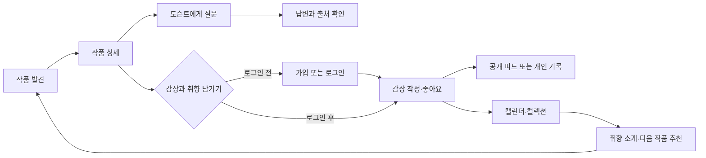

<div align="center">
  

# Docentalk

### 그림을 만나고, 이야기를 나누고, 나의 시선을 기록하다.

**자료에 근거한 AI 도슨트와 함께 작품을 이해하고, 감상과 취향을 쌓아가는 온라인 미술관**

[서비스 바로가기](https://artlog-skn35-1team.vercel.app) · [개발 코드](https://github.com/SKNETWORKS-FAMILY-AICAMP/SKN35-3rd-1Team/tree/dev) · [기획·진행 계획](https://github.com/SKNETWORKS-FAMILY-AICAMP/SKN35-3rd-1Team/blob/af7cea883db7874b8cf12d7d832b567aa9580ed0/PLAN.md)

</div>


> SK Networks Family AI Camp 35기 · 3차 프로젝트 · 1팀<br />
> 문서 기준: 2026.10.15 · 화면: 운영 사이트 직접 캡처 · 기능·데이터 모델: dev `af7cea8` 기준<br />
> 기술 아키텍처는 최종 구성 확인 후 별도로 보완합니다.

## 목차

1. [서비스 소개](#1-서비스-소개)
2. [기획 배경과 목표](#2-기획-배경과-목표)
3. [주요 기능](#3-주요-기능)
4. [서비스 화면](#4-서비스-화면)
5. [사용자 흐름과 와이어프레임](#5-사용자-흐름과-와이어프레임)
6. [ERD와 데이터 설계](#6-erd와-데이터-설계)
7. [콘텐츠와 자료 운영](#7-콘텐츠와-자료-운영)
8. [검증 결과와 개선 과제](#8-검증-결과와-개선-과제)
9. [팀 소개](#9-팀-소개)
10. [실행·문서 안내](#10-실행문서-안내)
11. [기술 아키텍처](#11-기술-아키텍처)

## 1. 서비스 소개

**Docentalk**은 작품을 고르는 순간부터 감상을 남기는 순간까지 이어지는 미술 감상 서비스입니다. 오늘의 그림과 작가·사조별 목록에서 작품을 발견하고, 작품 상세에서 AI 도슨트에게 질문합니다. 답변에 연결된 자료의 제목·출처·이용 조건을 확인하며 해설을 살펴볼 수 있습니다.

감상이 끝나면 공개 또는 비공개로 생각을 남깁니다. 공개 감상 피드에서는 다른 감상가의 시선을 만나고, 내 피드에서는 좋아요한 그림·관심 작가·컬렉션·감상 캘린더를 모아 봅니다. 관심 기록에서 출발한 AI 취향 소개와 테마 컬렉션은 다음 작품을 발견하는 계기가 됩니다.

**서비스명**은 미술관 해설자 **Docent**와 대화 **Talk**를 연결했습니다. 일방적으로 설명을 읽는 감상에서, 질문하고 자신의 시선을 기록하는 감상으로 이어지는 경험을 지향합니다.

| 핵심 경험 | 사용자에게 제공하는 가치 |
| --- | --- |
| 발견 | 큰 작품 이미지와 간결한 탐색으로 첫 감상을 시작합니다. |
| 이해 | 궁금한 디테일을 질문하고, 설명 수준을 선택합니다. |
| 확인 | 도슨트 답변의 근거 자료와 원문 출처를 직접 확인합니다. |
| 기록 | 감상을 공개·비공개로 남기고 날짜별로 다시 찾습니다. |
| 연결 | 다른 사람의 감상과 자신의 관심 기록에서 다음 작품을 만납니다. |

## 2. 기획 배경과 목표

미술 감상을 시작할 때 작품의 배경과 기법을 어디부터 살펴볼지 막막할 수 있습니다. 정적인 해설은 관람객의 개별 질문에 바로 답하기 어렵고, 일반적인 AI 답변은 그 설명이 어떤 자료에 근거했는지 확인하기 어렵습니다. 좋아했던 작품과 그때의 생각도 여러 곳에 흩어지기 쉽습니다.

Docentalk은 **작품을 중심으로 질문·근거·감상 기록을 한 흐름에 연결**합니다.

| 해결하려는 문제 | 기획 방향 |
| --- | --- |
| 무엇부터 봐야 할지 모르겠음 | 오늘의 그림, 작가·사조별 탐색, 예시 질문 제공 |
| 설명이 너무 어렵거나 얕게 느껴짐 | Easy / Standard / Deep 설명 방식 선택 |
| AI 설명의 근거를 확인하기 어려움 | 수집·검수된 미술 자료와 출처 표시, 근거 부족 안내 |
| 감상 기록이 일회성으로 끝남 | 작품별 감상, 공개 범위 선택, 월별 감상 캘린더 |
| 자신의 미술 취향을 설명하기 어려움 | 좋아요·감상 기록 기반 추천, AI 한 줄 소개·테마 컬렉션 |
| 다른 관람객의 해석을 만나기 어려움 | 공개 감상 피드, 작성자 프로필, 감상가 팔로우 |

주요 대상은 **미술을 편하게 접하고 싶은 입문자**, **작품의 표현과 맥락을 더 깊이 알고 싶은 감상자**, **자신의 취향과 감상 기록을 모으고 싶은 사용자**입니다.

### 서비스 설계 원칙

- **작품이 먼저 보이는 화면**: 전시형 메인과 큰 이미지, 절제된 색상으로 작품에 집중합니다.
- **근거를 확인할 수 있는 해설**: 일반 지식만으로 빈 부분을 채우지 않고 자료의 범위와 한계를 안내하도록 설계합니다.
- **내가 정하는 공개 범위**: 공개 감상과 개인 기록을 구분하고 팔로우 목록 공개 여부를 선택합니다.
- **기록에서 이어지는 발견**: 좋아요와 감상 경험을 다음 작품·컬렉션 탐색에 연결합니다.

## 3. 주요 기능

| 영역 | 기능 | 주요 동작 |
| --- | --- | --- |
| 발견하기 | 오늘의 그림 | 3개 작품을 전환하는 전시형 메인, 작품 상세 진입 |
| 작품 탐색 | 검색·필터·더보기 | 작품 제목·작가 검색, 사조별 필터, 추가 목록 조회 |
| 작가 탐색 | 작가 목록·상세 | 작가 소개와 작품 모음, 작가 좋아요·관심 작가 관리 |
| 작품 상세 | 감상·정보 확인 | 작품 이미지 확대, 제목·연도·작가 정보, 감상 노트·출처, 관련 작품 |
| AI 도슨트 | 작품별 질의응답 | 예시 질문, 스트리밍 답변, Easy / Standard / Deep 선택, 로그인 사용자의 대화 복원·초기화 |
| 근거 확인 | 답변 출처 | 사용한 자료의 제목·기관·자료 유형·URL·라이선스, 편집 근거 확인 |
| 감상 기록 | 공개·비공개 감상 | 작품별 감상 작성·공개 범위 선택, 내 감상 삭제 |
| 감상 피드 | SNS형 감상 공유 | 공개 글의 작품 이미지·감상 요약, 전체 감상 읽기, 작성자 프로필 이동 |
| 감상가 연결 | 팔로우 | 사용자 팔로우, 팔로잉·팔로워 목록, 목록 공개 여부 설정 |
| 내 피드 | 감상·취향 모아보기 | 내 감상, AI 한 줄 취향 소개, 컬렉션·관심 작가·캘린더 탭 |
| 감상 캘린더 | 날짜별 기록 | 월 이동, 오늘 이동, 감상한 날짜와 선택 날짜의 작품·열람 횟수 확인 |
| 좋아요 | 좋아요한 작품 모음 | 작품의 하트와 기본 좋아요 컬렉션 연결 |
| 나만의 컬렉션 | 직접 구성하는 작품 모음 | 생성·이름/소개 편집·삭제, 작품 담기·꺼내기, 별도 상세 페이지 |
| AI 취향 컬렉션 | 관심에서 출발하는 테마 | 좋아요·열람 기록을 바탕으로 테마와 작품 모음 제안, 내 컬렉션으로 저장 |
| 로그인 | 이메일·Google | 로그인·회원가입 구분, Google로 계속하기, 비밀번호 재설정 |
| 설정 | 계정·공개 범위 | 내 피드 이동, 팔로잉/팔로워 공개 전환, 로그아웃 |

외부 도구 연동용으로 컬렉션 조회·작품 검색·컬렉션 생성·작품 담기·감상 기록 기반 모음 도구도 제공합니다. 구체적인 MCP 연결과 배포 구성은 최종 기술 아키텍처에서 정리할 예정입니다.

> **이용 범위:** 작품 탐색·공개 감상 읽기·도슨트 질문은 로그인 없이 시작할 수 있습니다. 개인 기록 저장과 좋아요·팔로우·컬렉션은 로그인한 계정에 연결됩니다. 직접 저장한 컬렉션은 계정당 최대 10개, 컬렉션당 최대 30점입니다.

## 4. 서비스 화면

아래 이미지는 **2026.10.15 운영 사이트에서 직접 캡처한 화면**입니다. 로그인 전 화면은 별도 브라우저에서, 로그인 후 화면은 기존 로그인 세션에서 확인했습니다. 브라우저 탭·도구 영역과 설정의 계정 이메일은 캡처 범위에서 제외했습니다. 화면의 작품·감상·추천 결과는 이용 시점과 계정에 따라 달라질 수 있습니다.

### 4.1 작품과 작가를 발견하기

검색창과 사조 필터로 작품을 좁혀 보고, 작가 목록에서 소개와 대표 작품으로 이어집니다.

| 작품 목록 | 작가 목록 |
| --- | --- |
|  |  |

<details>
<summary>작가 상세 화면 보기</summary>


</details>

### 4.2 작품을 보면서 도슨트와 대화하기

작품 이미지와 대화를 함께 배치했습니다. 설명 방식을 고르고 질문한 뒤, 답변의 출처 칩에서 실제 근거 자료를 확인합니다.


<details>
<summary>실제 답변과 출처 확인 화면 보기</summary>

**질문:** “이 그림의 구도에서 눈여겨볼 점을 알려주세요.”


이 캡처는 실제 서비스 응답 예시이며, 개별 답변의 품질을 전체 질문에 대한 보장으로 제시하지 않습니다.

</details>

### 4.3 감상을 나누고, 내 시선을 모으기

공개 감상은 다른 감상가가 읽을 수 있고, 작성자 프로필에서 관심을 이어갈 수 있습니다. 내 피드에서는 자신의 감상과 AI 취향 소개를 모아 봅니다.

| 감상 피드 | 로그인 후 내 피드 |
| --- | --- |
|  |  |

<details>
<summary>감상 기록과 공개 범위</summary>

- 작품 상세에서 감상을 작성하며 공개·비공개를 선택합니다.
- 공개 글은 감상 피드와 공개 프로필에 연결됩니다. 비공개 글은 본인에게만 표시합니다.
- 본인이 남긴 감상은 삭제할 수 있습니다.
- 설정에서 팔로잉·팔로워 목록과 수의 공개 여부를 선택합니다.


</details>

### 4.4 감상 캘린더로 다시 찾기

감상한 날짜에 작품 이미지와 개수를 표시합니다. 날짜를 선택하면 해당 날짜에 감상한 작품과 열람 횟수를 확인하고 상세로 돌아갈 수 있습니다.


### 4.5 내 취향을 컬렉션으로 만들기

좋아요한 작품은 기본 모음에 담깁니다. 직접 컬렉션을 만들거나 AI가 관심 기록에서 제안한 테마를 살펴보고 저장할 수 있습니다. 모음은 팝업이 아닌 **새 페이지**에서 정렬된 작품으로 펼쳐집니다.


<details>
<summary>좋아요 모음·컬렉션 생성·관심 작가 화면 보기</summary>

**좋아요한 작품**


**새 컬렉션**


**관심 작가**


</details>

### 4.6 로그인 전과 모바일 경험

로그인 전에도 작품과 공개 감상을 둘러볼 수 있습니다. 개인 기록 공간에 진입하면 로그인 안내를 제공하며, 이메일과 Google 계정으로 이어갈 수 있습니다.

| 개인 공간의 로그인 안내 | 로그인·회원가입 |
| --- | --- |
|  |  |

<details>
<summary>모바일 화면 보기</summary>

<p align="center">
  
  
</p>

모바일에서는 하단 탐색 메뉴를 사용하고, 작품·대화와 카드 목록은 화면 너비에 맞춰 배치합니다.

</details>

## 5. 사용자 흐름과 와이어프레임

### 첫 방문부터 기록까지




### 정보 구조

| 메뉴 | 연결되는 화면 |
| --- | --- |
| 발견하기 | 오늘의 그림 → 작품 상세 / 작가 이야기 / 전시 작품 / 로그인 시 맞춤 추천 |
| 작품 리스트 | 그림 리스트 / 작가 리스트 → 작품·작가 상세 |
| 감상 피드 | 공개 감상 목록 → 전체 감상 / 작성자 공개 프로필·팔로우 |
| 내 피드 | 공개 감상 / 내 컬렉션 / 관심 작가 / 감상 캘린더 |
| 컬렉션 상세 | 좋아요 모음 / 직접 저장한 모음 / AI 취향 테마 → 작품 상세·편집·저장 |
| 설정 | 계정 안내 / 내 피드 / 팔로우 목록 공개 여부 / 로그아웃 |

### 주요 화면 배치

아래는 현재 기능의 정보 배치를 단순화한 **구조 와이어프레임**입니다. 실제 시각 디자인과 콘텐츠는 위 운영 캡처를 참고합니다.


## 6. ERD와 데이터 설계

**최신 dev 코드 모델 기준 서비스 테이블 22개**, 마이그레이션 head는 `20261014_0011`입니다. 아래 ERD는 모델의 실제 외래 키와 키 제약을 바탕으로 생성했습니다. 운영 DB에 동일 revision이 적용됐는지를 별도로 점검한 결과라는 뜻은 아닙니다.


[컬럼·PK/FK·자료형을 포함한 전체 ERD 크게 보기](https://raw.githubusercontent.com/SKNETWORKS-FAMILY-AICAMP/SKN35-3rd-1Team/fa19b03165ed6d7e7f4903f0db348c0df06fb55d/docs/readme-2026-10-15/diagrams/full-erd.svg) · [Mermaid 원본](https://raw.githubusercontent.com/SKNETWORKS-FAMILY-AICAMP/SKN35-3rd-1Team/fa19b03165ed6d7e7f4903f0db348c0df06fb55d/docs/readme-2026-10-15/diagrams/full-erd.mmd) · [스키마 기준 정보](https://raw.githubusercontent.com/SKNETWORKS-FAMILY-AICAMP/SKN35-3rd-1Team/fa19b03165ed6d7e7f4903f0db348c0df06fb55d/docs/readme-2026-10-15/diagrams/schema-snapshot.json)

| 영역 | 테이블 | 설계 목적 |
| --- | --- | --- |
| 계정·설정 · 3개 | `users`, `social_accounts`, `user_preferences` | 로그인 사용자 식별, 소셜 계정, 개인 설정과 취향 소개 |
| 작품 카탈로그 · 4개 | `art_movements`, `artists`, `artworks`, `artwork_embeddings` | 사조·작가·작품 및 작품 추천용 데이터 |
| 감상·관계·컬렉션 · 10개 | `artwork_likes`, `artist_follows`, `artwork_views`, `user_follows`, `diary_entries`, `collections`, `collection_items`, `chat_sessions`, `chat_messages`, `theme_collection_cache` | 관심·열람·팔로우, 감상 공개 범위, 저장 컬렉션·AI 테마, 작품별 대화 |
| 문서·근거 · 5개 | `documents`, `document_artists`, `document_artworks`, `document_basis_documents`, `document_chunks` | 자료와 작가·작품 연결, 편집 근거, 검색 단위 |

핵심 관계는 **작가 → 작품**, **사용자 → 감상·좋아요·컬렉션·대화**, **작품 → 해설 문서·감상·대화**, **문서 → 검색 청크·편집 근거**입니다. 사용자 팔로우는 사용자 간 관계로, AI 테마 캐시는 사용자가 직접 저장한 컬렉션과 분리합니다.

- 감상은 사용자×작품 기준으로 관리하며, 하루에 여러 작품의 감상을 남길 수 있습니다.
- 컬렉션의 작품 연결은 컬렉션×작품 복합 키로 중복 담기를 방지합니다.
- 공개 프로필은 내부 사용자 ID나 Firebase UID 대신 별도 공개 식별자를 사용합니다.
- 생년월일 등 개인 설정 컬럼이 존재하더라도 현재 화면에서 제공되는 입력 기능과는 구분합니다.

## 7. 콘텐츠와 자료 운영

2026.10.15 dev 전처리 산출물 기준 **작가 10명 · 작품 277점 · 문서 427건**입니다. 운영 작품 목록에서도 277점을 확인했습니다. 문서 건수는 운영 DB를 새로 집계한 값이 아닌 저장소 산출물 기준입니다.

| 범위 | 작가 |
| --- | --- |
| 바로크 | 카라바조, 렘브란트 판 레인 |
| 인상주의·후기 인상주의 | 클로드 모네, 폴 세잔, 빈센트 반 고흐, 폴 고갱 |
| 빈 분리파·표현주의 | 구스타프 클림트, 에곤 실레 |
| 조선 후기 회화 | 김홍도, 정선 |

자료는 작품 해설, 작가 생애·연표, 기법·관계·비교 자료 등으로 구성합니다. 원문과 출처 메타데이터를 관리하고, 검수 상태와 작품·작가 연결을 정리해 검색 근거로 사용합니다. 자료에는 국립중앙박물관, 박물관·미술관의 공식 작품 페이지, 한국학중앙연구원 등 미술 자료가 포함됩니다.

**작품 이미지와 원문의 권리는 각 소장 기관·저작권자에게 있습니다.** 문서·이미지별 출처와 이용 조건을 따르며, 서비스의 출처 표시가 모든 자료의 자유로운 재사용을 의미하지는 않습니다.

[데이터 수집 기준](https://github.com/SKNETWORKS-FAMILY-AICAMP/SKN35-3rd-1Team/blob/af7cea883db7874b8cf12d7d832b567aa9580ed0/docs/data-collection.md) · [전처리 산출물](https://github.com/SKNETWORKS-FAMILY-AICAMP/SKN35-3rd-1Team/tree/af7cea883db7874b8cf12d7d832b567aa9580ed0/data/processed)

## 8. 검증 결과와 개선 과제

### 최신 기록: 5차 로컬 평가

최신 결과서는 **2026.10.15 로컬 코드·실제 데이터 연결 환경에서 수행한 평가**입니다. 아래 수치는 운영 사이트에서 이번 화면 캡처와 함께 전체 재평가한 결과가 아닙니다.

| 지표 | 결과 |
| --- | ---: |
| 전체 문항 통과 | 43/45 · 95.6% |
| 문서 Hit@5 | 23/23 · 100% |
| 정상 질문의 답변·출처 포함·출처 정합 | 각 37/37 · 100% |
| 거절 정확도 | 6/8 · 75.0% |
| P95 응답 시간 | 7.285초 |
| 명확한 환각 | 해당 평가에서 0건 |

평가에는 사실 확인, 세부 관찰·해석, 비교, 범위 밖 질문, 근거 부족, 멀티턴, 설명 스타일과 청크 경계 문항을 포함합니다. 두 문항은 본문에서 확인 불가를 설명했지만 `refused=false`를 반환해 기대 상태와 불일치했습니다.

[5차 결과서와 질문별 판정](https://github.com/SKNETWORKS-FAMILY-AICAMP/SKN35-3rd-1Team/blob/af7cea883db7874b8cf12d7d832b567aa9580ed0/docs/test-result.md)

### 최종 보완할 항목

- 거절 본문과 `refused` 상태값의 판정 일관성 개선
- 최신 서버 배포 후 동일 질문셋으로 운영 환경 재평가
- 개인 기능의 계정 간 분리와 저장·수정·삭제에 대한 운영 회귀 검증
- 모바일·브라우저별 긴 텍스트, 이미지 로딩, 채팅·캘린더 화면 점검
- 실제 배포·인증·검색·MCP 구성을 확인한 최종 기술 아키텍처 작성

이번 README 작성에서는 운영 화면 탐색, 비로그인 도슨트 질문과 출처 확인, 기존 로그인 계정의 내 피드·캘린더·컬렉션·AI 테마 표시를 확인했습니다. 계정 생성·공개 글 게시·개인 기록 삭제로 전체 기능을 새로 검증한 결과는 아닙니다.

## 9. 팀 소개

**SKN35 3rd Project · 1Team** — 전원이 담당 작가의 미술 자료를 수집하고, 각 전문 영역을 맡아 구현했습니다.

| 팀원 | 담당 영역 | 수집 작가 |
| --- | --- | --- |
| 박수휘 | RAG 검색·청킹·임베딩·질문 분류, MCP, 발표 | 클로드 모네, 폴 세잔 |
| 고태민 | 데이터 전처리, API·DB 설계·연동, 백엔드 배포·컬렉션 | 렘브란트, 카라바조 |
| 김연주 | 프롬프트 엔지니어링, 거절·근거·말투 규칙 | 구스타프 클림트, 에곤 실레 |
| 이승희 | 서비스 UI/UX, Flutter 프론트엔드, 인증 연동·프론트 배포 | 김홍도, 정선 |
| 차윤정 | RAG·LLM·프롬프트 품질 평가, 운영 통합 테스트 | 빈센트 반 고흐, 폴 고갱 |

## 10. 실행·문서 안내

서비스를 바로 사용하려면 [운영 사이트](https://artlog-skn35-1team.vercel.app)를 방문하세요. **현재 개발 코드는 `dev` 브랜치**를 기준으로 확인합니다.

### 프론트엔드 미리보기

Flutter SDK가 설치된 환경에서 실행합니다. 기본 미리보기는 운영 데이터·AI 응답과 구분되는 데모 모드입니다.

```bash
git clone --branch dev https://github.com/SKNETWORKS-FAMILY-AICAMP/SKN35-3rd-1Team.git
cd SKN35-3rd-1Team/frontend
flutter pub get
flutter run -d chrome
```

실제 API 연결·인증·백엔드 실행은 각 문서의 설정 절차를 따릅니다. 비밀번호·API 키·서버 인증 키는 README나 클라이언트 소스에 넣지 않습니다.

| 문서 | 내용 |
| --- | --- |
| [프론트엔드 안내](https://github.com/SKNETWORKS-FAMILY-AICAMP/SKN35-3rd-1Team/blob/af7cea883db7874b8cf12d7d832b567aa9580ed0/frontend/README.md) | 실행·환경 설정·배포 안내 |
| [API 명세](https://github.com/SKNETWORKS-FAMILY-AICAMP/SKN35-3rd-1Team/blob/af7cea883db7874b8cf12d7d832b567aa9580ed0/docs/api.md) | 화면과 서버 간 요청·응답 계약 |
| [데이터 수집 기준](https://github.com/SKNETWORKS-FAMILY-AICAMP/SKN35-3rd-1Team/blob/af7cea883db7874b8cf12d7d832b567aa9580ed0/docs/data-collection.md) | 원자료·메타데이터·출처 관리 |
| [프롬프트 기록](https://github.com/SKNETWORKS-FAMILY-AICAMP/SKN35-3rd-1Team/blob/af7cea883db7874b8cf12d7d832b567aa9580ed0/docs/prompts.md) | 설명 스타일·근거·거절 규칙 |
| [품질 평가 결과](https://github.com/SKNETWORKS-FAMILY-AICAMP/SKN35-3rd-1Team/blob/af7cea883db7874b8cf12d7d832b567aa9580ed0/docs/test-result.md) | 실행 환경·지표·실패 사례 |
| [화면·도식 자료](https://github.com/SKNETWORKS-FAMILY-AICAMP/SKN35-3rd-1Team/tree/fa19b03165ed6d7e7f4903f0db348c0df06fb55d/docs/readme-2026-10-15) | 운영 캡처·와이어프레임·최신 모델 ERD |

문서 링크와 이미지 자료는 작성 시점의 커밋으로 고정해 이후 브랜치 변경과 구분했습니다. main에는 이 README만 갱신하고, 화면·도식 파일은 별도 문서 자료 브랜치에 보관했습니다.

## 11. 기술 아키텍처

**최종 구성 확인 후 작성 예정입니다.**

실제 운영 배포, 인증, 검색·생성 경로, 데이터 저장·동기화 및 MCP 연결을 최종 점검한 뒤 아키텍처 다이어그램과 기술 선택 이유를 추가할 예정입니다.
