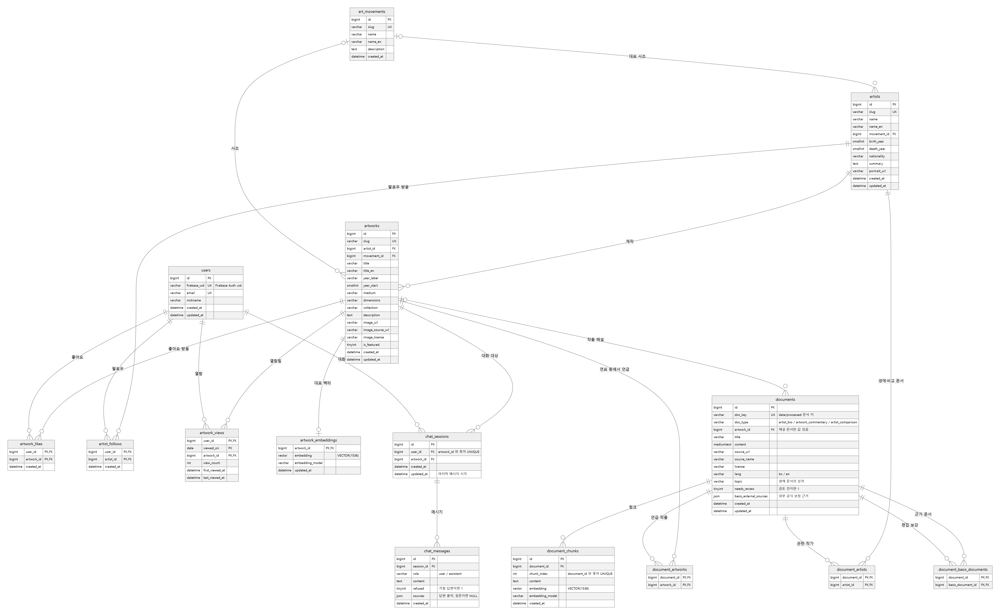

# ERD 읽는 법

테이블 15개는 "화면에 보이는 것", "사용자가 한 일", "챗봇과 추천의 재료" 세 덩어리로 나뉩니다. 이 문서는 그림의 기호를 읽는 법과 각 선이 왜 그어져 있는지를 설명합니다.



## 1. 기호 읽는 법

상자 하나가 테이블 하나이고, 선 하나가 관계 하나입니다. 선 양쪽 끝의 모양이 "몇 개와 연결되는가"를 뜻합니다.

| 선 끝 모양 | 뜻 | 예시 |
| --- | --- | --- |
| 세로줄 두 개 | 반드시 1개 | 작품은 작가가 반드시 1명 있음 |
| 동그라미 + 세 갈래 | 0개 이상 (없어도 되고 여러 개여도 됨) | 작가는 작품이 0개 이상 |
| 동그라미 + 세로줄 | 0개 또는 1개 | 작품의 대표 벡터는 없거나 1개 |

상자 안 오른쪽 칸의 글자는 키 종류입니다.

| 표시 | 뜻 |
| --- | --- |
| PK | 행을 구분하는 기본 키 |
| FK | 다른 테이블의 행을 가리키는 외래 키 |
| PK,FK | 둘 다. 다른 테이블을 가리키면서 동시에 이 테이블의 기본 키 |
| UK | 중복될 수 없는 값 (이메일, slug) |

읽는 요령은 "세 갈래가 붙은 쪽이 여러 개인 쪽"입니다. `artists`와 `artworks` 사이 선은 `artworks` 쪽에 세 갈래가 있으므로 "작가 1명에 작품 여러 개"로 읽습니다.

## 2. 세 덩어리로 보기

| 덩어리 | 테이블 | 그림에서의 위치 | 맡은 일 |
| --- | --- | --- | --- |
| 카탈로그 | `art_movements`, `artists`, `artworks` | 위쪽과 가운데 | 목록과 상세 화면에 보이는 정보 |
| 사용자 활동 | `users`, `artwork_likes`, `artist_follows`, `artwork_views`, `chat_sessions`, `chat_messages` | 왼쪽과 왼쪽 아래 | 누가 무엇을 좋아하고 팔로우하고 봤는지, 어떤 작품에 무엇을 물었는지 |
| 문서와 벡터 | `documents`, `document_artists`, `document_artworks`, `document_chunks`, `artwork_embeddings` | 아래쪽과 오른쪽 아래 | 챗봇 답변의 근거, 추천 계산의 재료 |

`artworks`가 가운데 있는 이유는 세 덩어리가 모두 작품을 거쳐 이어지기 때문입니다. 좋아요도, 열람도, 해설 문서도, 추천 벡터도 작품에 붙습니다.

## 3. 카탈로그 덩어리

**`artists` → `artworks` (제작)**: 작가 1명에 작품 여러 개입니다. `artworks.artist_id`가 작가를 가리킵니다. 작가 없는 작품은 만들 수 없습니다.

**`art_movements` → `artists` (대표 사조)**: 작가에게 사조를 하나 붙입니다. 사조 쪽 끝이 "0개 또는 1개"인 것은 사조를 모르는 작가도 저장할 수 있다는 뜻입니다.

**`art_movements` → `artworks` (사조)**: 작품에도 사조를 따로 붙입니다. 한 작가가 시기에 따라 다른 사조의 작품을 그릴 수 있어서, 사조별 목록은 작가가 아니라 작품의 사조로 뽑습니다.

## 4. 사용자 활동 덩어리

좋아요, 팔로우, 열람은 모두 "사용자와 무언가를 잇는 테이블"입니다. 사용자 1명이 여러 작품을 좋아하고 작품 1개를 여러 사용자가 좋아하므로, 둘 사이에 연결 테이블이 필요합니다.

| 테이블 | 잇는 것 | 기본 키 | 기본 키가 막아 주는 것 |
| --- | --- | --- | --- |
| `artwork_likes` | 사용자 ↔ 작품 | (`user_id`, `artwork_id`) | 같은 작품을 두 번 좋아요 |
| `artist_follows` | 사용자 ↔ 작가 | (`user_id`, `artist_id`) | 같은 작가를 두 번 팔로우 |
| `artwork_views` | 사용자 ↔ 작품 ↔ 날짜 | (`user_id`, `viewed_on`, `artwork_id`) | 같은 날 같은 작품의 열람 행이 여러 개 생기는 것 |

세 테이블에 별도 `id` 컬럼이 없는 이유가 여기 있습니다. 두세 컬럼의 조합 자체가 행을 구분하므로, 그 조합을 기본 키로 삼으면 중복이 DB에서 막힙니다.

`artwork_views`만 날짜가 기본 키에 들어갑니다. 같은 작품을 오늘도 보고 내일도 볼 수 있으니 날짜까지 합쳐야 한 행이 정해집니다. 같은 날 다시 보면 행이 늘지 않고 `view_count`만 올라갑니다.

**채팅 기록 (`chat_sessions` → `chat_messages`)**: 로그인한 사용자가 작품 도슨트와 나눈 대화입니다. `chat_sessions`는 사용자와 작품을 잇는 테이블이라 좋아요와 모양이 비슷하지만, 질문과 답변을 여러 개 매달아야 해서 별도 `id`를 두고 (`user_id`, `artwork_id`)에 UNIQUE를 겁니다. 작품 하나에 대화가 하나뿐이라 작품을 다시 열면 이전 대화가 이어집니다. 메시지마다 `role`(질문/답변)이 있고, 답변의 출처는 `sources` JSON에 그대로 담습니다. 출처를 `document_chunks`에 FK로 묶지 않는 이유는 다시 청킹하면 청크 id가 바뀌어 지난 대화의 출처가 사라지기 때문입니다.

## 5. 문서와 벡터 덩어리

**`artworks` → `documents` (작품 해설)**: 작품 해설 문서는 `documents.artwork_id`로 작품을 가리킵니다. 문서 쪽에서 본 작품이 "0개 또는 1개"인 것은 생애 문서와 비교 문서에는 이 값이 비어 있기 때문입니다.

**`documents` ↔ `artists` (`document_artists`를 거침)**: 생애 문서는 작가 1명, 비교 문서는 작가 2명 이상과 연결됩니다. 문서 하나가 작가 여러 명과 이어져야 해서 `documents`에 `artist_id` 컬럼을 두지 않고 연결 테이블로 뺐습니다.

**`documents` ↔ `artworks` (`document_artworks`를 거침)**: 연표 사건처럼 해설이 아닌 문서가 여러 작품을 언급할 때 연결합니다. 작품을 고르면 그 작품이 나오는 생애 이야기를 찾을 수 있습니다. 해설 문서의 '해설 대상 작품'은 그대로 `documents.artwork_id` 하나로 둡니다.

**`documents` → `document_chunks` (청크)**: 문서 1개를 여러 조각으로 자른 것입니다. 조각마다 본문과 벡터가 함께 들어 있고, 챗봇은 이 조각을 검색합니다.

**`artworks` → `artwork_embeddings` (대표 벡터)**: 작품 1개에 벡터 1개입니다. 추천은 이 벡터끼리의 거리를 비교합니다. 선 끝이 "0개 또는 1개"인 것은 아직 벡터를 만들지 않은 작품이 있을 수 있기 때문입니다.

벡터가 두 테이블에 있는 이유는 쓰임이 다르기 때문입니다.

| 테이블 | 벡터 1개가 나타내는 것 | 쓰는 기능 |
| --- | --- | --- |
| `document_chunks` | 문서의 한 조각 | 챗봇이 질문과 가까운 문단 찾기 |
| `artwork_embeddings` | 작품 하나 전체 | 비슷한 작품, 맞춤 추천 |

## 6. 기능을 그림에서 따라가 보기

선을 따라가 보면 각 기능이 어떤 테이블을 거치는지 보입니다.

**작품 도슨트 챗봇**: 선택한 작품에서 두 갈래로 내려갑니다.

```text
artworks ──(작품 해설)──────────────────────→ documents ──→ document_chunks
artworks ──→ artists ──→ document_artists ──→ documents ──→ document_chunks
```

첫 줄은 그 작품의 해설 문서, 둘째 줄은 그 작가의 생애 문서와 비교 문서입니다. 이렇게 모은 문서의 청크 안에서만 질문과 가까운 조각을 찾습니다. 답변의 출처는 찾은 청크가 속한 `documents`의 `title`과 `source_url`입니다.

로그인한 상태라면 질문과 답변이 남습니다.

```text
users ──→ chat_sessions ←── artworks
               └──→ chat_messages (질문, 답변 + 출처 JSON)
```

**좋아요 기반 맞춤 추천**:

```text
users ──→ artwork_likes ──→ artworks ──→ artwork_embeddings
```

사용자가 좋아요한 작품의 벡터를 꺼내, 다른 작품의 벡터와 거리를 비교합니다. 추천 작가는 그렇게 나온 후보 작품을 `artworks.artist_id`로 묶어서 구하고, `artist_follows`에 이미 있는 작가는 뺍니다.

**내 서재 캘린더**:

```text
users ──→ artwork_views ──→ artworks
```

`artwork_views`에서 한 사용자의 한 달 치 행을 날짜별로 세면 달력이 됩니다.

## 7. 자주 나오는 질문

| 질문 | 답 |
| --- | --- |
| 작품 벡터를 `artworks`의 컬럼으로 두면 안 되나 | 목록을 조회할 때마다 큰 벡터가 함께 딸려 나옵니다. 1:1 테이블로 빼면 필요할 때만 읽습니다. |
| 좋아요 수는 어디에 있나 | 컬럼으로 두지 않습니다. `artwork_likes`의 행을 세어 구합니다. |
| 채팅 내용은 어디에 저장되나 | 지금 구조에는 없습니다. 대화 이력은 화면이 들고 있고, 저장이 필요해지면 `03_schema_later.sql`의 테이블을 추가합니다. |
| 작품을 지우면 어떻게 되나 | 그 작품의 벡터, 좋아요, 열람 기록, 해설 문서와 청크가 함께 지워집니다. |
| 작품이 남아 있는 작가를 지울 수 있나 | 없습니다. DB가 거부합니다. |

컬럼별 타입과 NULL 허용 여부는 `db-design.md` 3장에 있습니다.
