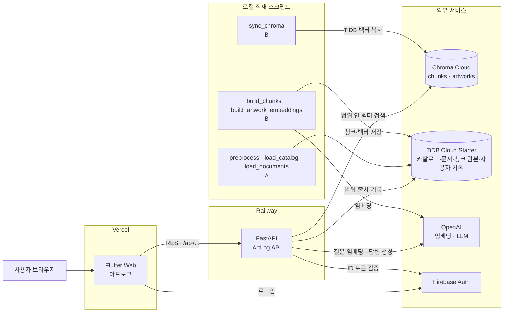
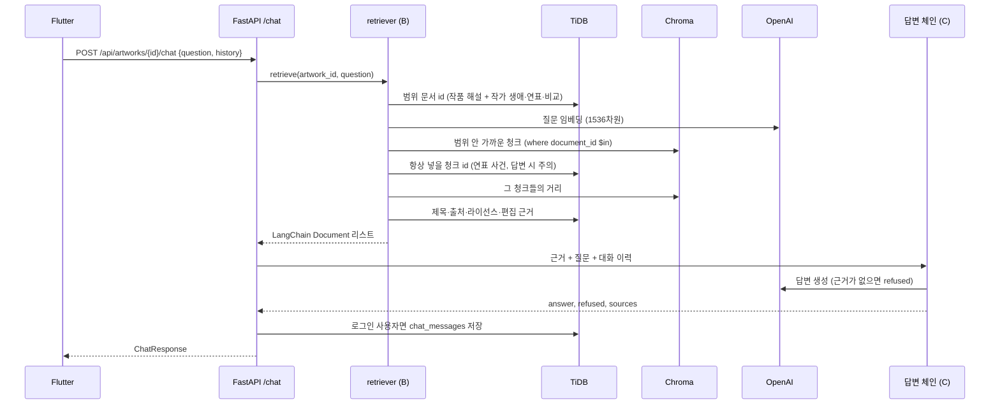

# 시스템 아키텍처

미술관 도슨트 "아트로그"의 구성도, 요청 흐름, 그리고 검색 계층(B)의 설계와 평가 결과를 정리한 문서입니다.

- 작성: 2026-10-13 · 담당: 박수휘 (검색 · Retrieval)
- 기준 데이터: 작가 8명 · 작품 219점 · 문서 361건 · 청크 1,622개 (`data/processed/_SUCCESS.json` 2026-10-12)
- 관련 문서: 데이터 인계 [`rag-handoff.md`](rag-handoff.md), DB 설계 [`db/db-design.md`](db/db-design.md), API [`api.md`](api.md), 평가 기준 [`test-plan.md`](test-plan.md)

## 1. 한눈에 보기

사용자가 작품을 고르고 질문하면, **그 작품과 작가에 관한 문서 안에서만** 근거를 찾아 답하고 출처를 함께 보여 줍니다. 범위 밖 질문(피카소, 미수집 작가 클림트·실레)은 "자료에 없다"고 답합니다.

| 결정 | 내용 | 이유 |
| --- | --- | --- |
| 검색 범위를 SQL로 먼저 좁힘 | 고른 작품의 해설 + 그 작가의 생애·연표·비교 문서만 검색 | 다른 작가 문서가 근거로 섞이면 환각이 생김 |
| 벡터 원본은 TiDB, 검색은 Chroma | 청크·벡터를 TiDB에 저장하고 Chroma로 복사해 검색 | Chroma가 날아가도 OpenAI 재호출 없이 복원(비용 0원), 두 결과를 비교해 동기화 확인 가능 |
| 거리로 거절하지 않음 | 거절은 답변 단계의 프롬프트 규칙으로 판단 | 범위 밖 질문의 거리가 정상 질문 거리 범위 안에 들어감 (7절) |
| 일부 청크는 순위와 상관없이 항상 넣음 | 그 작품을 언급한 연표 사건, `답변 시 주의` 보정문 | 질문 벡터만으로는 이야기 배경과 오류 정정이 상위에 오지 않음 (7절) |

## 2. 시스템 구성도



적재·임베딩 스크립트는 배포 서버가 아니라 로컬에서 한 번 실행합니다. 배포 서버는 질문 임베딩(질문 1개당 1회)과 답변 생성만 OpenAI에 요청합니다.

## 3. 배포 구성

| 구성 요소 | 위치 | 상태 | 접속·설정 |
| --- | --- | --- | --- |
| 프론트 | Vercel `artlog-skn35-1team.vercel.app` | 배포됨 | 빌드 때 `ARTLOG_DEMO=false`, `API_BASE_URL=<Railway 주소>` |
| 백엔드 | Railway `skn35-3rd-1team-production.up.railway.app` | 배포됨 (`/api/health` 정상) | `TIDB_*`, `OPENAI_API_KEY`, `CHROMA_*`, Firebase, `CORS_ORIGINS` |
| 벡터 검색 | Chroma Cloud (trychroma.com, DB `SKN_artlog`) | 적재 완료 (청크 1,622 · 작품 219) | `CHROMA_API_KEY`(비밀값) · `CHROMA_TENANT` · `CHROMA_DATABASE`. 백엔드 Railway 환경변수 연결 요청함 |
| DB | TiDB Cloud Starter `3rd_project` | 운영 중 (Alembic `20261013_0006`) | TLS 필수, `pool_recycle=300`, `pool_pre_ping` |
| 임베딩 | OpenAI `text-embedding-3-small` (1536차원) | 사용 중 | `OPENAI_API_KEY`, `EMBEDDING_MODEL` |

Chroma는 Railway에 직접 띄우는 대신 **Chroma Cloud**를 씁니다. 직접 띄운 Chroma 1.x에는 자체 인증이 없어 공개 주소를 열면 누구나 데이터를 지울 수 있지만, Cloud는 API 키로 보호되고 서버를 관리할 필요가 없습니다. TiDB에 원본이 있으므로 Cloud가 비거나 다른 곳으로 옮겨도 `sync_chroma`로 복원됩니다. 코드는 Cloud, 직접 띄운 서버(`CHROMA_HOST`), 로컬 폴더(`CHROMA_PATH`)를 모두 지원합니다.

## 4. 요청 흐름: 챗봇 질문 하나



## 5. 저장소 역할: TiDB와 Chroma

```text
documents ─(build_chunks: 자르기·임베딩)──→ TiDB document_chunks ──(sync_chroma)──→ Chroma chunks
artworks  ─(build_artwork_embeddings)────→ TiDB artwork_embeddings ─(sync_chroma)──→ Chroma artworks
```

| | TiDB (원본) | Chroma (검색용 사본) |
| --- | --- | --- |
| 청크 | `document_chunks` 1,622행: `content`(머리말 포함), `embedding VECTOR(1536)`, `embedding_model` | `chunks` 컬렉션, id = `document_chunks.id` |
| 작품 벡터 | `artwork_embeddings` 219행 | `artworks` 컬렉션, id = `artwork_id` |
| 메타데이터 | 문서·작가·작품 관계 전부 | 범위 필터에 필요한 값만: `document_id`, `doc_key`, `doc_type`, `artwork_id`(없으면 0), `chunk_index` / 작품은 `artist_id`, `movement_id` |
| 거리 함수 | `VEC_COSINE_DISTANCE` | `hnsw:space = cosine` (Chroma 기본값 l2를 바꿈) |

제목·출처·라이선스는 Chroma에 넣지 않고 검색 결과의 `document_id`로 TiDB에서 조회합니다. 출처가 바뀌어도 Chroma를 다시 만들 필요가 없습니다. 같은 질문으로 Chroma와 TiDB를 각각 검색해 상위 5개의 문서와 거리가 소수점 셋째 자리까지 같은 것을 확인했고, 로컬 Chroma와 Chroma Cloud의 평가 결과도 질문 단위로 같았습니다.

## 6. 검색 계층 상세 (B)

### 6-1. 청킹 (`app/rag/chunking.py`)

문서 길이가 종류마다 크게 달라서(131자 연표 ~ 33,056자 위키 원문), 한 가지 길이로 자르지 않고 종류별 규칙을 씁니다.

| 규칙 | 값 | 이유 |
| --- | --- | --- |
| 통째로 둠 | 본문 1,200자 이하 (덧붙인 절 제외) | 연표 사건, 고흐·고갱 팀 작성 해설(최대 1,103자), 모네·세잔 주제 문서는 이야기 하나가 청크 하나에 온전히 남아야 함 |
| 섹션 단위 | `## 제목` 경계에서 먼저 나눔 | 위키 문서의 문맥 경계 |
| 다시 자르기 | 섹션이 500자를 넘으면 줄(문단) 경계, 800자를 넘는 한 줄은 문장 경계 | 검색 단위를 질문 하나가 겨냥하는 크기로 |
| 합치기 | 150자 미만 조각은 옆 조각에 붙임 | 제목만 바뀌는 짧은 섹션이 따로 검색되지 않게 |
| 덧붙인 절 분리 | `## 감상 포인트`(편집 보충문), `## 답변 시 주의`(보정문)는 항상 별도 청크 | LLM이 원문과 구분하고, 출처 표시에서 편집 근거를 함께 보여 줄 청크를 골라낼 수 있어야 함 |
| 머리말 | 청크 앞에 `문서 제목 > 섹션 > 하위 섹션` | 짧은 조각도 맥락을 잃지 않음. 임베딩과 프롬프트에 같은 글을 씀 |

결과: 문서 361건 → 청크 1,622개, 본문 길이 최소 91 / 중앙값 368 / 최대 1,192자. 연표 71건은 모두 청크 1개, 덧붙인 절 청크는 91개(감상 포인트 86, 답변 시 주의 5), 고흐·고갱 해설 43건은 "본문 1 + 감상 포인트 1"입니다. 청크는 문서 하나만 보고 만들기 때문에 새 문서가 추가되면 그 문서만 처리하면 됩니다.

### 6-2. 임베딩과 TiDB 적재 (`scripts/build_chunks.py`, `app/clients/embedding_client.py`)

- 모델 `text-embedding-3-small`, 1536차원. 차원은 DB 컬럼 정의(`EMBEDDING_DIMENSION`)가 기준이고, 결과 차원이 다르면 DB에 넣기 전에 멈춥니다.
- 분량은 약 69만 토큰(청크당 최대 1,284토큰, 모델 한도 8,191)이고, 100건씩 묶어 API를 17번 호출합니다.
- `embedding_model` 컬럼에 모델 이름을 기록합니다. 모델이 섞이면 거리 값이 의미가 없어지기 때문입니다.
- **다시 실행해도 안전합니다.** 문서마다 지금 규칙으로 자른 청크와 DB 청크를 비교해 `최신 / 새로 / 다시 만들기`로 나누고, 바뀐 문서만 다시 임베딩합니다. 본문이 바뀐 경우, 청킹 규칙이 바뀐 경우, 다른 모델로 만든 경우가 모두 자동으로 잡힙니다.
- API를 먼저 호출한 뒤 DB를 바꾸므로 API가 실패해도 DB는 그대로입니다. 문서 20건마다 커밋하므로 중간에 멈춰도 다시 실행하면 이어서 처리합니다.
- 완료 기준 확인: 모든 문서에 청크 1개 이상, 재실행 시 0건 처리.

### 6-3. Chroma 동기화 (`scripts/sync_chroma.py`, `app/clients/chroma_client.py`)

- **청크**: Chroma id와 TiDB id 집합만 비교해, 새 청크는 넣고 TiDB에서 사라진 청크는 지웁니다. `build_chunks`가 바뀐 문서를 새 id로 다시 넣으므로 id 비교만으로 본문 변경까지 따라갑니다.
- **작품**: 219건을 매번 upsert합니다. 벡터가 같은 id로 덮어써지기 때문입니다.
- 임베딩을 다시 만들지 않습니다(OpenAI 비용 0원, 약 10초).
- 컬렉션이 다른 모델이나 다른 거리 함수로 만들어졌으면 섞어 넣지 않고 멈춥니다. 그때는 `--reset`으로 다시 만듭니다.
- 접속 우선순위: Cloud 세 값(`CHROMA_API_KEY`·`CHROMA_TENANT`·`CHROMA_DATABASE`) → `CHROMA_HOST`(서버) → `CHROMA_PATH`(로컬 폴더). 일부만 넣으면 멈추고, 실행 로그에 API 키는 찍지 않습니다. 개발용과 발표용은 컬렉션 이름으로 나눕니다(`CHROMA_CHUNKS_COLLECTION` 등).
- **Chroma Cloud의 제한 (실제로 겪고 고친 것)**
  - 한 번에 넣을 수 있는 건수가 300개라 250개씩 나눠 넣습니다. 서버의 `get_max_batch_size()`는 1,000을 알려 주지만 실제 쿼터와 다릅니다.
  - `get()`이 한 번에 300개까지만 돌려주므로 id 목록은 나눠서 끝까지 읽습니다. 안 그러면 1,622개 중 300개만 있다고 보고 다시 넣으려 합니다.
  - `query(ids=[...])`는 근사 검색 후보 밖의 id를 결과에서 뺍니다. 그래서 "항상 넣는 청크"는 `get()`으로 가져오고 거리를 직접 계산합니다 (6-4).

### 6-4. 검색 함수 (`app/rag/retriever.py`, `app/repositories/document_repository.py`)

`retrieve(session, artwork_id, question)`은 아래 순서로 근거를 모읍니다.

| 단계 | 내용 | 기본값 |
| --- | --- | --- |
| ① 범위 | TiDB에서 범위 문서 id: 그 작품의 해설 + 그 작가와 연결된 생애·연표·비교 문서 | 예: 『야경』 28건 |
| ② 거리 순위 | Chroma에서 범위 안 가까운 청크 | 5개 |
| ③ 작품 자리 | 고른 작품 자신의 해설에서 | 3개 |
| ④ 비교 자리 | 질문에 "비교·차이·달라·관계" 등이 있으면 범위 안 비교 문서에서 | 2개 |
| ⑤ 항상 넣음 (`pinned`) | 그 작품을 언급한 연표 사건(`document_artworks`) + 범위 안 `답변 시 주의` 보정문. `get()`으로 가져와 거리는 직접 계산 | 거리와 무관 |
| ⑥ 출처 | 제목·출처·라이선스, 덧붙인 절이면 편집 근거(`document_basis_documents`, `basis_external_sources`) | TiDB 조회 |

③④ 자리는 **고르게 나눕니다**: 주제마다 1개 → 아직 안 뽑힌 문서마다 1개 → 나머지 거리순. 주제는 한국어 원문과 영문 번역본을 하나로 봅니다(`doc_key`의 `.en` 앞부분). 그래서 『야경』처럼 원문·번역본이 함께 있는 작품도 원문이 자리를 받고, 비교 자리 2개를 테네브리즘 원문·번역본이 나눠 갖지 않고 테네브리즘·키아로스쿠로가 하나씩 받습니다.

②~④는 같은 질문 벡터로 Chroma를 몇 번 더 조회하는 것이라 추가 비용이 없습니다. 중복은 제거하고 거리순으로 정렬하며, 질문당 평균 6.1개(최대 11개) 청크를 돌려줍니다. 범위가 비면(없는 작품) 임베딩 API를 부르지 않고 빈 리스트를 돌려줍니다.

**결과 형식 (기획서 v2 약속 2)**: LangChain `Document` 리스트입니다. `page_content`는 머리말이 붙은 청크 본문이라 프롬프트에 그대로 넣을 수 있습니다. 순서는 거리로 고른 청크(②~④, 오름차순) 다음에 항상 넣는 청크(⑤)입니다.

| `metadata` | 설명 | 쓰는 곳 |
| --- | --- | --- |
| `chunk_id`, `chunk_index`, `document_id`, `doc_key`, `doc_type` | 청크와 문서 식별 | 로그, 앞뒤 청크 확장 |
| `title`, `source_name`, `source_url`, `license` | 출처 (`ChatResponse.sources`의 `Source`와 같은 필드) | 답변 아래 출처 표시 |
| `distance` | 코사인 거리 (작을수록 가까움) | 로그·튜닝 |
| `pinned` | 규칙(⑤)으로 들어온 청크 | 거리 통계에서 제외 |
| `annotation` | `None` / `"감상 포인트"` / `"답변 시 주의"` | 프롬프트 규칙 7(보정문 우선)·8(보충문 표시) |
| `basis_sources` | 덧붙인 절의 편집 근거 `[{source_name, source_url}]` | 출처 표시 |

### 6-5. 작품 벡터 (`scripts/build_artwork_embeddings.py`)

- 작품마다 `제목 (영문 제목) / 사조 / 재료·기법 / 설명`을 한 덩어리로 임베딩해 219행을 넣었습니다. 추천 기능(`recommendation_repository`, 유사 작품·개인 추천)이 이 벡터를 씁니다.
- 작가 이름은 기본으로 넣지 않습니다(`--with-artist` 옵션 있음). 작품 설명 219개 중 153개에 이미 작가 이름이 들어 있어 같은 작가 작품끼리 가까워지는데, 이름까지 넣으면 그 쏠림이 더 커지기 때문입니다. 추천 서비스는 작가당 1개씩 고르므로 화면에서는 쏠림이 드러나지 않습니다.
- 예: 「별이 빛나는 밤」과 가장 가까운 작품은 정선 「봄날 달밤의 정취」, 고흐 「밤의 카페 테라스」·「밤의 카페」였습니다. 작가를 넘어 "밤 풍경" 주제로 묶입니다.

### 6-6. 질문 분류 · 수퍼바이저 (`app/rag/classifier.py`)

검색 전에 질문을 규칙으로 분류합니다. LLM을 부르지 않아 비용과 지연이 없습니다.

| 분류 | 조건 | 처리 |
| --- | --- | --- |
| `rag` (기본) | 고른 작가가 나오거나, "이 그림"처럼 고른 작품을 가리키거나, 관계·영향·비교를 묻거나, 범위 밖 작가라도 고른 작품의 범위 문서에 그 이름이 나옴 | 검색 → 답변 |
| `other_artist` | 데이터에 있는 다른 작가만 물음 | 그 작가의 작품을 골라 물어보라고 안내 |
| `refuse` | 미수집 작가(클림트·실레), 다루지 않는 작가(피카소·마네 등), 날씨·오늘 시세·구매 사이트 | LLM 없이 거절 |
| `recommend_similar` | "이 작품과 비슷한 작품 추천해 줘" | 고른 작품 기준 추천 |
| `recommend_personal` | "내 취향에 맞는 작품 추천해 줘" | 로그인 사용자 맞춤 추천 (비로그인은 작품 기준으로 대신) |

작가 이름은 `artist_aliases.jsonl`의 별칭으로 알아봅니다. 지명·동명이인(강원도 정선, 테오 반 고흐)은 지우고 찾고, 낱말 일부(마네킹)는 이름으로 보지 않습니다. **애매하면 `rag`로 보내는 것이 원칙**입니다. 예를 들어 세잔 작품에서 "피사로와는 어떤 관계였어?"는 세잔 생애 문서에 답이 있습니다. 관계 표현이 없어도 범위 문서를 확인합니다: 『현대의 올랭피아』에서 "마네의 올랭피아를 패러디한 거야?"는 세잔 문서에 마네가 나와 rag로, 『야경』에서 같은 마네 질문은 렘브란트 문서에 마네가 없어 거절로 갑니다. rag로 간 질문은 답변 프롬프트의 거절 규칙이 한 번 더 거릅니다. 검증 결과, E 평가셋에서 답해야 할 질문을 하나도 막지 않았고 범위 밖 4문항은 모두 막았으며, 9절 27문항은 전부 맞게 분류했습니다.

## 7. 평가 결과 (검색 단계)

LLM 없이 검색 결과만 평가했습니다. 재현 방법:

```bash
uv run python -m scripts.eval_retrieval
```

질문별 결과는 [`eval/retrieval-2026-10-13.json`](eval/retrieval-2026-10-13.json)에 있습니다.

| 질문셋 | 지표 | ① 순위 5 + 항상 넣음 | ② + 작품·비교 자리 | ③ + 자리 고르게 나누기 | 목표 |
| --- | --- | --- | --- | --- | --- |
| E 평가셋 30문항 (`tests/questions/rag-eval.json`) | 검색 근거 적중률 | 20/23 (87%) | 22/23 (96%) | **23/23 (100%)** | 90% 이상 |
| 〃 | 기대 문서가 전부 들어온 질문 | — | 20 | **23** | — |
| 인계 문서 9절 27문항 | 기대 문서가 하나 이상 들어온 질문 | 24/25 | 25/25 | **25/25** | — |
| 〃 | 기대 문서가 전부 들어온 질문 | 20 | 20 | **22** | — |

적중률은 기대 `target_doc_keys` 중 하나 이상이 근거에 들어온 비율이고, 거절을 기대하는 질문은 대상에서 뺐습니다. 한국어 원문과 영문 번역본은 같은 근거로 셉니다. ③은 Chroma Cloud에서 잰 값입니다.

**질문셋 수정 (2026-10-13)**: E 평가셋에서 기대값 3건을 고쳤습니다. compare-004에서는 다른 작품의 해설이라 설계상 범위 밖인 `commentary-sunflowers-arles`를 뺐습니다(1887년 해설 안에 아를 해바라기와의 차이가 설명돼 있어 질문은 그대로 답할 수 있음). detail-008·fact-004(야경)과 compare-003(명암)에는 같은 내용의 영문 번역본 키를 추가했습니다.

**규칙별 효과**
- **항상 넣는 연표 사건 (⑤)**: 9절의 1·2·3·15·16·17번이 기대하는 연표 사건은 거리 순위만으로는 모두 5위 밖이었습니다. 예를 들어 『야경』의 "그때 렘브란트에게 무슨 일이?"는 사스키아의 죽음 사건이 근거로 들어와야 하는데, 이 규칙으로만 들어왔습니다.
- **작품 자리 (③)**: 세잔 「사과와 오렌지가 있는 정물」의 화면 구성 질문에서 그 작품 해설이 9위에서 근거 안으로 들어왔습니다.
- **비교 자리 (④)**: "렘브란트와 카라바조의 명암 차이" 질문에서 테네브리즘(17위)과 키아로스쿠로(55위)가 모두 근거 안으로 들어왔습니다. 자리를 고르게 나누기 전에는 테네브리즘 원문·번역본이 두 자리를 다 가져갔습니다.
- **작품 자리 고르게 나누기**: 『야경』 "인물 배치" 질문에서 자리 3개를 영문 번역 해설이 다 가져가던 것을, 한국어 원문 해설도 한 자리를 받게 바꿨습니다.
- **보정문 (⑤)**: 「인왕제색도」의 "지금 어디에 소장돼 있어?"에서 `답변 시 주의` 보정문(삼성미술관이 아니라 국립중앙박물관)이 1위로 나왔습니다.

**남은 부분 적중** (9절, 기대 문서 중 일부만 들어옴)
| 질문 | 들어온 것 | 빠진 것과 원인 |
| --- | --- | --- |
| 3번 돌아온 탕자 · 가족 | 연표 14 (항상 넣음) | 연표 13은 49위. 그 작품과 연결된 연표가 아니라 항상 넣기 대상이 아님 |
| 5번 자화상 · 파산 | 연표 8, 생애 | 연표 4는 54위 |
| 7번 성 마태오 · 로마 탈출 | 생애 | 연표 7은 28위 |

세 질문 모두 근거 문서는 하나 이상 들어와 답할 재료는 있습니다. 작품과 직접 연결되지 않은 연표까지 넣으려면 질문의 사건 키워드를 보고 연표를 고르는 방법이 필요합니다(다음 작업).

**질문 앞에 작품 제목을 붙이는 방법은 쓰지 않았습니다.** 실험해 보니 "왜 파산했어?" 같은 작가 질문에서 그 작품 해설만 상위를 차지해 결과가 나빠졌습니다(9절 기준, 하나도 못 찾은 질문 1 → 2).

**거리로는 거절할 수 없습니다.** 거절해야 할 질문의 최상위 거리(E 평가셋 0.64~0.82, 9절 피카소 0.68·클림트 0.70)가 답할 질문의 거리 범위(0.45~0.82, 0.33~0.84) 안에 들어갑니다. 그래서 거절은 답변 단계(C)에서 "근거에 없으면 모른다고 답한다"는 프롬프트 규칙으로 판단하고, 거리 값은 로그와 튜닝에만 씁니다.

## 8. 코드 위치

| 파일 | 역할 |
| --- | --- |
| `backend/app/rag/chunking.py` | 청킹 규칙, `annotation_section()` |
| `backend/app/clients/embedding_client.py` | OpenAI 임베딩 (`embed_texts`, `embed_query`), 차원 검사 |
| `backend/app/clients/chroma_client.py` | Chroma 접속, 컬렉션 열기와 모델·거리 함수 검사 |
| `backend/app/repositories/document_repository.py` | 범위 문서 id, 항상 넣을 청크, 출처·편집 근거 (TiDB) |
| `backend/app/rag/classifier.py` | 질문 분류 `classify()`, 기본 안내 문구 `refusal_message()` |
| `backend/app/rag/retriever.py` | 검색 함수 `retrieve()` |
| `backend/scripts/build_chunks.py` | 청킹 → 임베딩 → TiDB `document_chunks` |
| `backend/scripts/build_artwork_embeddings.py` | 작품 벡터 → TiDB `artwork_embeddings` |
| `backend/scripts/sync_chroma.py` | TiDB → Chroma 동기화 |
| `backend/scripts/eval_retrieval.py` | 검색 근거 적중률 평가 |
| `backend/tests/test_chunking.py` 외 6개 | 청킹·적재·접속·동기화·검색·분류 테스트 (메모리 Chroma 사용, DB·API 불필요) |

## 9. 운영

**처음 적재와 데이터가 바뀔 때** (`backend/`에서 순서대로)

```bash
uv run python -m scripts.build_chunks              # 바뀐 문서만 다시 임베딩
uv run python -m scripts.build_artwork_embeddings  # 219건 전부 다시 (1원 미만)
uv run python -m scripts.sync_chroma               # TiDB → Chroma (비용 0원)
```

| 상황 | 할 일 |
| --- | --- |
| 문서 추가·수정 (예: 클림트·실레 수집) | A가 적재한 뒤 위 세 명령을 실행. 새로 바뀐 것만 처리됨 |
| 청킹 규칙 변경 | `build_chunks`가 바뀐 청크를 자동으로 다시 만듦 → `sync_chroma` |
| 임베딩 모델 변경 | Alembic으로 벡터 차원 변경 → `build_chunks` 전체 재생성 → `sync_chroma --reset` |
| Chroma 유실·재배포 | `sync_chroma`만 다시 실행 (임베딩 재호출 없음) |
| 동기화 확인 | `sync_chroma --dry-run`이 "추가 0 · 삭제 0"이면 일치 |

**비용**: 전체 청크 임베딩은 약 69만 토큰으로 한 번에 20원 안팎이고, 이후에는 바뀐 문서만 듭니다. 질문 임베딩은 질문당 1회입니다. Chroma 동기화는 0원입니다.

## 10. 한계와 다음 작업

| 항목 | 내용 | 담당 |
| --- | --- | --- |
| 백엔드 환경변수 연결 | Railway 백엔드에 `CHROMA_API_KEY`·`CHROMA_TENANT`·`CHROMA_DATABASE`, `OPENAI_API_KEY` 설정 (값 전달함) | 배포 담당 |
| 답변 체인과 `/chat` 연결 | `retrieve()` 결과를 체인에 넣고 `metadata`를 `Source`로 옮김. 거절은 프롬프트로 판단 | C |
| 작품과 연결되지 않은 연표 | 9절 3·5·7번의 두 번째 연표처럼 질문의 사건(파산, 탈출 등)과 맞는 연표가 순위 밖. 사건 키워드로 연표를 고르는 방법 검토 | B |
| Chroma Cloud 요금제 | 무료 한도 안에서 약 1,800건 사용 중. 데이터가 크게 늘면 사용량 확인 | B |
| 멀티턴 | 검색은 마지막 질문만 사용. "그 작품"처럼 생략된 질문은 작품 범위 덕분에 근거를 찾지만(멀티턴 2문항 적중), 질문 재작성 여부는 C와 결정 | B·C |
| 이미지 | 그림을 보지 않는 문서 RAG. 화면 세부 질문은 문서에 있을 때만 답함 | 설계상 한계 |
