# 미술관 도슨트 RAG 서비스 DB 설계

Oct 9, 2026 · @고태민

## 1. 권장 구조

TiDB Cloud Starter 클러스터 하나에 서비스 테이블 20개를 두고 사용자 데이터와 벡터를 함께 관리하는 구조를 권장합니다. 벡터는 RAG용 `document_chunks`와 추천용 `artwork_embeddings`로 나누고, 벡터 인덱스·추천 캐시는 MVP에서 뺍니다. 채팅 기록(`chat_sessions`, `chat_messages`)은 2026-10-12에, 외부 계정 연결과 선택형 개인화 설정(`social_accounts`, `user_preferences`)은 2026-10-13에, 감상글·공개 피드(`diary_entries`)와 마이페이지 설정 확장·나만의 컬렉션(`collections`, `collection_items`)은 2026-10-13~14에 추가했습니다.

### 핵심 결정

| 항목 | 선택 | 이유 |
| --- | --- | --- |
| DB 구성 | TiDB 하나 | 좋아요·작품·벡터를 한 쿼리에서 JOIN할 수 있고, 운영할 시스템이 하나로 줄어듭니다. |
| 벡터 저장 | 테이블 2개로 분리 | 검색 단위(청크/작품)와 쿼리 형태(범위 검색/작품 간 유사도)가 다릅니다. |
| 벡터 인덱스 | MVP에서는 만들지 않음 | RAG 검색에는 항상 WHERE 필터가 붙어 인덱스가 쓰이지 않습니다. 추천은 작품 수천 개 규모라 전수 계산으로 충분합니다. |
| 외래 키 | DB에 생성 | 적재 스크립트 실수로 생기는 고아 행을 DB가 막아 줍니다. 이 규모에서는 잠금 비용이 문제 되지 않습니다. |
| 문서 저장 | `documents` 한 테이블 + `doc_type` | 생애·해설·비교 문서의 컬럼과 처리 과정(청킹, 임베딩, 출처 표시)이 같습니다. |
| 추천 계산 | 요청 시 실시간 | 좋아요를 누르면 결과가 바로 바뀌어야 시연이 됩니다. 캐시는 무효화 관리가 필요합니다. |
| 열람 기록 | 사용자 × 작품 × 날짜당 1행 | 새로고침으로 행이 늘지 않고, 캘린더 쿼리가 PK 범위 조회 한 번으로 끝납니다. |

용량도 무료 한도 안에 들어옵니다. 1536차원 벡터는 한 개에 약 6KB(1536 × 4바이트)이므로 청크 2만 개면 약 120MB입니다. Starter 무료 한도는 행 저장소 5GiB입니다. 크기는 직접 계산한 추정값입니다.

### 테이블 목록과 역할

| 테이블 | 역할 | 쓰이는 기능 |
| --- | --- | --- |
| `users` | 회원 계정. 로그인은 Firebase Auth, 서버는 `firebase_uid`로 사용자를 찾음 | 로그인, 4·7·8·9번 |
| `social_accounts` | 사용자와 외부 로그인 식별자 연결(사용자 1:N) | 향후 Google·Naver 계정 연결 |
| `user_preferences` | 개인화 설정과 온보딩 상태, AI 취향 소개 캐시(사용자 1:0..1) | 마이페이지 설정, 도슨트 말투·설명 우선순위, 취향 소개 |
| `art_movements` | 사조 목록 | 1번 사조별 조회 |
| `artists` | 작가 정보 | 1·6·7번 |
| `artworks` | 작품 정보와 이미지 URL | 1·2번 |
| `artwork_embeddings` | 작품 대표 벡터, 작품당 1행 | 5·6번 추천 |
| `documents` | 생애·해설·비교 문서 원문과 출처 | 3·10번 |
| `document_artists` | 문서와 작가 연결(N:M) | 3번 검색 범위 결정 |
| `document_artworks` | 문서가 언급하는 작품(N:M). 연표 사건 → 작품 | 3번, 작품에서 생애 이야기 찾기 |
| `document_basis_documents` | 편집 보충·보정문과 근거 수집 문서 연결(N:M) | 3번 답변 출처 확장 |
| `document_chunks` | 문서 청크와 청크 벡터 | 3·10번 RAG 검색 |
| `artwork_likes` | 작품 좋아요 | 4·5·6번 |
| `artist_follows` | 작가 팔로우 | 7번, 작가 추천 제외 조건 |
| `artwork_views` | 날짜별 열람 기록 | 8·9번 |
| `chat_sessions` | 사용자 × 작품당 도슨트 대화 1개 | 3번 대화 이어 보기, 내 대화 목록 |
| `chat_messages` | 대화의 질문·답변과 답변 출처(JSON) | 3·10번 기록 복원, 추천 신호(질문) |
| `diary_entries` | 사용자 × 날짜당 감상글 1개. 기본 비공개이고, 공개로 바꾼 글은 피드에 노출 | 내 감상·비평, 캘린더, 공개 피드 |
| `collections` | 사용자가 만든 비공개 작품 묶음 | 마이 컬렉션, 채팅·MCP로 컬렉션 만들기 |
| `collection_items` | 컬렉션에 담긴 작품(N:M) | 마이 컬렉션, AI 취향 소개의 근거 |

### 벡터 테이블을 분리해야 하는가

분리가 맞습니다. 한 테이블에 `owner_type` 컬럼으로 섞어 두면 모든 검색에 `WHERE owner_type = ...`이 붙습니다. TiDB는 WHERE 사전 필터가 있는 쿼리에 벡터 인덱스를 쓰지 않으므로, 합치는 순간 인덱스를 쓸 길이 막힙니다.

- **검색 단위가 다릅니다.** RAG는 문단 단위 근거가 필요하고, 추천은 작품 하나를 대표하는 벡터 하나가 필요합니다.
- **수명이 다릅니다.** 청크 벡터는 문서를 다시 청킹할 때 바뀌고, 작품 벡터는 작품 메타데이터가 바뀔 때 바뀝니다.
- **모델이 달라질 수 있습니다.** 나중에 작품 벡터를 이미지 임베딩으로 바꾸면 차원 수가 달라집니다.

작품 벡터를 `artworks`의 컬럼으로 두지 않고 1:1 테이블로 뺀 것도 같은 맥락입니다. 목록 조회에 6KB짜리 벡터가 딸려 나오지 않고, 모델 교체 시 `artworks`를 건드리지 않습니다.

### 넣지 않기로 한 테이블

| 후보 | 판단 | 대신 쓰는 방법 |
| --- | --- | --- |
| `sources` (출처 정규화) | 제거 | `documents.source_url`, `source_name`, `license` 컬럼 |
| `artwork_images` | 제거 | `artworks.image_url` 한 컬럼. 작품당 이미지가 여러 장 필요해지면 그때 추가 |
| `artist_movements` (N:M) | 제거 | 작가에는 대표 사조 1개, 작품에는 작품 단위 사조 |
| `tags`, `genres` | 제거 | 기능 목록에 태그 검색이 없습니다 |
| `user_taste_vectors` | 제거 | 좋아요 벡터를 직접 시드로 사용 (5장 참고) |
| `user_recommendations` (추천 캐시) | 제거 | 실시간 계산 |
| `artworks.like_count` 컬럼 | 제거 | `COUNT(*)` 집계. 카운터 컬럼은 좋아요 테이블과 어긋나기 쉽습니다 |
| `chat_message_citations` (인용 테이블) | 제거 | `chat_messages.sources` JSON. 청크는 다시 청킹하면 id가 바뀌므로 FK로 묶으면 지난 대화의 출처가 깨집니다 |
| `artwork_similarities` (유사도 사전 계산) | 보류 | 추천이 느려졌을 때만 추가 |

## 2. ERD

사용자 활동(좋아요·팔로우·열람·대화·감상글·컬렉션)은 모두 `users`와 카탈로그를 잇는 테이블이고, `social_accounts`와 `user_preferences`는 사용자 식별과 선택형 개인화를 분리합니다. 최신 원본은 `00_erd.mmd`, 확대용 그림은 `00_erd.svg`이며 SQLAlchemy 모델에서 자동 생성합니다.

```mermaid
erDiagram
    users ||--o{ social_accounts : "로그인 계정"
    users ||--o| user_preferences : "개인화 설정"
    users ||--o{ artwork_likes : "좋아요"
    artworks ||--o{ artwork_likes : "좋아요 받음"
    users ||--o{ artist_follows : "팔로우"
    artists ||--o{ artist_follows : "팔로우 받음"
    users ||--o{ artwork_views : "열람"
    artworks ||--o{ artwork_views : "열람됨"
    art_movements |o--o{ artists : "대표 사조"
    art_movements |o--o{ artworks : "사조"
    artists ||--o{ artworks : "제작"
    artworks ||--o| artwork_embeddings : "대표 벡터"
    artworks |o--o{ documents : "작품 해설"
    documents ||--o{ document_artists : "관련 작가"
    artists ||--o{ document_artists : "생애·비교 문서"
    documents ||--o{ document_artworks : "언급 작품"
    artworks ||--o{ document_artworks : "연표 등에서 언급"
    documents ||--o{ document_basis_documents : "편집 보강"
    documents ||--o{ document_basis_documents : "근거 문서"
    documents ||--o{ document_chunks : "청크"
    users ||--o{ chat_sessions : "대화"
    artworks ||--o{ chat_sessions : "대화 대상"
    chat_sessions ||--o{ chat_messages : "메시지"
    users ||--o{ diary_entries : "감상글"
    artworks |o--o{ diary_entries : "감상 대상(선택)"
    users ||--o{ collections : "컬렉션"
    collections ||--o{ collection_items : "담긴 작품"
    artworks ||--o{ collection_items : "담김"

    users {
        bigint id PK
        varchar firebase_uid UK "Firebase Auth uid"
        varchar email UK
        varchar nickname
        datetime created_at
        datetime updated_at
    }
    social_accounts {
        bigint id PK
        bigint user_id FK
        varchar provider "provider_user_id 와 묶어 UNIQUE"
        varchar provider_user_id
        datetime created_at
    }
    user_preferences {
        bigint user_id PK, FK
        smallint birth_year
        varchar gender
        varchar tone
        varchar explanation_level
        date birth_date
        json explanation_priorities
        varchar conversation_style "easy | professional"
        tinyint onboarding_completed
        text taste_summary
        varchar taste_fingerprint
        datetime taste_generated_at
        datetime updated_at
    }
    diary_entries {
        bigint id PK
        bigint user_id FK "entry_date 와 묶어 UNIQUE"
        date entry_date
        bigint artwork_id FK "NULL 허용"
        text content
        tinyint is_public "기본 0(비공개)"
        datetime created_at
        datetime updated_at
    }
    collections {
        bigint id PK
        bigint user_id FK "name 과 묶어 UNIQUE"
        varchar name
        text description
        datetime created_at
        datetime updated_at
    }
    collection_items {
        bigint collection_id PK, FK
        bigint artwork_id PK, FK
        datetime created_at
    }
    art_movements {
        bigint id PK
        varchar slug UK
        varchar name
        varchar name_en
        text description
        datetime created_at
    }
    artists {
        bigint id PK
        varchar slug UK
        varchar name
        varchar name_en
        bigint movement_id FK
        smallint birth_year
        smallint death_year
        varchar nationality
        text summary
        varchar portrait_url
        datetime created_at
        datetime updated_at
    }
    artworks {
        bigint id PK
        varchar slug UK
        bigint artist_id FK
        bigint movement_id FK
        varchar title
        varchar title_en
        varchar year_label
        smallint year_start
        varchar medium
        varchar dimensions
        varchar collection
        text description
        varchar image_url
        varchar image_source_url
        varchar image_license
        tinyint is_featured
        datetime created_at
        datetime updated_at
    }
    artwork_embeddings {
        bigint artwork_id PK, FK
        vector embedding "VECTOR(1536)"
        varchar embedding_model
        datetime updated_at
    }
    documents {
        bigint id PK
        varchar doc_key UK "data/processed 문서 키"
        varchar doc_type "artist_bio / artwork_commentary / artist_comparison"
        bigint artwork_id FK "해설 문서만 값 있음"
        varchar title
        mediumtext content
        varchar source_url
        varchar source_name
        varchar license
        varchar lang "ko / en"
        varchar topic "생애 문서의 성격"
        tinyint needs_review "검토 전이면 1"
        json basis_external_sources "외부 공식 보정 근거"
        datetime created_at
        datetime updated_at
    }
    document_artists {
        bigint document_id PK, FK
        bigint artist_id PK, FK
    }
    document_artworks {
        bigint document_id PK, FK
        bigint artwork_id PK, FK
    }
    document_basis_documents {
        bigint document_id PK, FK
        bigint basis_document_id PK, FK
    }
    document_chunks {
        bigint id PK
        bigint document_id FK
        int chunk_index "document_id 와 묶어 UNIQUE"
        text content
        vector embedding "VECTOR(1536)"
        varchar embedding_model
        datetime created_at
    }
    artwork_likes {
        bigint user_id PK, FK
        bigint artwork_id PK, FK
        datetime created_at
    }
    artist_follows {
        bigint user_id PK, FK
        bigint artist_id PK, FK
        datetime created_at
    }
    artwork_views {
        bigint user_id PK, FK
        date viewed_on PK
        bigint artwork_id PK, FK
        int view_count
        datetime first_viewed_at
        datetime last_viewed_at
    }
    chat_sessions {
        bigint id PK
        bigint user_id FK "artwork_id 와 묶어 UNIQUE"
        bigint artwork_id FK
        datetime created_at
        datetime updated_at "마지막 메시지 시각"
    }
    chat_messages {
        bigint id PK
        bigint session_id FK
        varchar role "user / assistant"
        text content
        tinyint refused "거절 답변이면 1"
        json sources "답변 출처, 질문이면 NULL"
        datetime created_at
    }
```



### 사용자·작가·작품·좋아요·팔로우·열람 기록의 관계

| 관계 | 카디널리티 | 구현 | 부모 삭제 시 |
| --- | --- | --- | --- |
| 사용자 → 외부 계정 | 1:N | `social_accounts.user_id`, UNIQUE `(provider, provider_user_id)` | CASCADE |
| 사용자 → 개인화 설정 | 1:0..1 | `user_preferences.user_id`가 PK이자 FK | CASCADE |
| 작가 → 작품 | 1:N | `artworks.artist_id` (NOT NULL) | RESTRICT. 작품이 남은 작가는 삭제 불가 |
| 사조 → 작가, 사조 → 작품 | 1:N (선택) | `movement_id` (NULL 허용) | SET NULL |
| 사용자 ↔ 작품 (좋아요) | N:M | `artwork_likes`, PK `(user_id, artwork_id)` | CASCADE |
| 사용자 ↔ 작가 (팔로우) | N:M | `artist_follows`, PK `(user_id, artist_id)` | CASCADE |
| 사용자 ↔ 작품 (열람) | N:M + 날짜 | `artwork_views`, PK `(user_id, viewed_on, artwork_id)` | CASCADE |
| 작품 → 작품 벡터 | 1:0..1 | `artwork_embeddings.artwork_id`가 PK이자 FK | CASCADE |
| 작품 → 해설 문서 | 1:N | `documents.artwork_id` | CASCADE |
| 문서 ↔ 작가 | N:M | `document_artists` | CASCADE |
| 문서 ↔ 언급 작품 | N:M | `document_artworks` | CASCADE |
| 편집 문서 ↔ 근거 문서 | N:M 자기 참조 | `document_basis_documents` | CASCADE |
| 문서 → 청크 | 1:N | `document_chunks.document_id` | CASCADE |
| 사용자 ↔ 작품 (대화) | N:M | `chat_sessions`, UNIQUE `(user_id, artwork_id)` | CASCADE |
| 대화 → 메시지 | 1:N | `chat_messages.session_id` | CASCADE |
| 사용자 → 감상글 | 1:N, 날짜당 1개 | `diary_entries.user_id`, UNIQUE `(user_id, entry_date)` | CASCADE |
| 작품 → 감상글 | 1:N (선택) | `diary_entries.artwork_id` (NULL 허용) | SET NULL. 작품이 빠져도 글은 남음 |
| 사용자 → 컬렉션 | 1:N | `collections.user_id`, UNIQUE `(user_id, name)` | CASCADE |
| 컬렉션 ↔ 작품 | N:M | `collection_items`, PK `(collection_id, artwork_id)` | CASCADE (양쪽 모두) |

좋아요와 열람은 둘 다 사용자↔작품 관계지만 의미가 다르므로 테이블을 합치지 않습니다. 좋아요는 명시적 선택이고 취소하면 행이 사라지며, 열람은 누적되는 기록입니다.

## 3. 테이블 명세

모든 PK와 FK는 부호 있는 `BIGINT`로 통일합니다. TiDB는 FK 양쪽 컬럼의 타입과 크기가 정확히 같아야 FK를 만들어 주므로, 한쪽만 `UNSIGNED`여도 생성이 실패합니다. 시각 컬럼은 UTC 기준 `DATETIME`입니다.

### users

| 컬럼 | 타입 | 키 | NULL | 설명 |
| --- | --- | --- | --- | --- |
| id | BIGINT AUTO\_INCREMENT | PK | NO |  |
| firebase\_uid | VARCHAR(128) | UNIQUE | NO | Firebase Auth 사용자 id. 서버가 검증한 ID 토큰에서만 가져옴 |
| email | VARCHAR(255) | UNIQUE | NO | 앱에서 소문자로 정규화해 저장 |
| nickname | VARCHAR(50) |  | NO |  |
| created\_at | DATETIME |  | NO | 기본값 CURRENT\_TIMESTAMP |
| updated\_at | DATETIME |  | NO | 수정 시 자동 갱신 |

현재 로그인은 기존대로 `firebase_uid`를 사용합니다. 새 계정 테이블은 향후 복수 SNS 계정을 한 서비스 사용자에 연결하기 위한 확장 구조이며, 이메일이 같다는 이유만으로 계정을 자동 병합하지 않습니다.

### social\_accounts

| 컬럼 | 타입 | 키 | NULL | 설명 |
| --- | --- | --- | --- | --- |
| id | BIGINT AUTO\_INCREMENT | PK | NO |  |
| user\_id | BIGINT | FK → users.id, INDEX | NO | 서비스 사용자 |
| provider | VARCHAR(30) | UNIQUE(provider, provider\_user\_id) | NO | 현재 백필 값은 `firebase`; 향후 google, naver 등 |
| provider\_user\_id | VARCHAR(255) | UNIQUE(provider, provider\_user\_id) | NO | 공급자가 보장한 외부 식별자 |
| created\_at | DATETIME |  | NO | 기본값 CURRENT\_TIMESTAMP |

### user\_preferences

| 컬럼 | 타입 | 키 | NULL | 설명 |
| --- | --- | --- | --- | --- |
| user\_id | BIGINT | PK, FK → users.id | NO | 사용자당 최대 1행 |
| birth\_year | SMALLINT |  | YES | 선택 입력 |
| gender | VARCHAR(30) |  | YES | 선택 입력 |
| tone | VARCHAR(30) |  | YES | 사용자가 선택한 답변 말투 |
| explanation\_level | VARCHAR(30) |  | YES | 사용자가 선택한 설명 수준 |
| birth\_date | DATE |  | YES | 마이페이지·온보딩에서 선택 입력하는 생년월일. 저장할 때 `birth_year`도 같은 연도로 맞춤 |
| explanation\_priorities | JSON |  | YES | 설명 우선순위 3개의 순서. `technique`(회화 기법), `background`(작품 배경 이야기), `artist_life`(작가 생애). 기본값은 `background → technique → artist_life` |
| conversation\_style | VARCHAR(30) |  | YES | `easy`(편안하고 쉬운 대화) 또는 `professional`(전문용어 적극 사용). 저장할 때 `explanation_level`도 `easy`/`deep`으로 맞춤 |
| onboarding\_completed | TINYINT(1) |  | NO | 기본값 0. 첫 로그인 3단계 온보딩을 끝내거나 건너뛰면 1 |
| taste\_summary | TEXT |  | YES | AI 취향 소개 결과 캐시 |
| taste\_fingerprint | VARCHAR(64) |  | YES | 취향 소개를 만들 때 쓴 근거(좋아요·컬렉션 작품 목록)의 SHA-256. 근거가 같으면 다시 만들지 않고 캐시를 씀 |
| taste\_generated\_at | DATETIME |  | YES | 취향 소개를 만든 시각 |
| updated\_at | DATETIME |  | NO | 수정 시 자동 갱신 |

개인화 행 자체가 없어도 정상 사용자입니다. 도슨트는 사용자가 직접 고른 `conversation_style`과 `explanation_priorities`만 답변 지시에 반영하고, 생년월일·성별로 말투를 추론하지 않습니다. `birth_year`, `gender`, `tone`, `explanation_level`은 0006에서 만든 초기 컬럼으로, 0008 이전 코드와의 호환을 위해 남겨 둡니다. 새 코드는 저장할 때 함께 맞춰 줍니다.

취향 소개에는 좋아요·컬렉션 작품(중복 제거, 최대 100점)의 제목·작가·연도만 보냅니다. 생년월일, 이메일, UID, 감상글 본문은 AI에 보내지 않습니다.

### art\_movements

| 컬럼 | 타입 | 키 | NULL | 설명 |
| --- | --- | --- | --- | --- |
| id | BIGINT AUTO\_INCREMENT | PK | NO |  |
| slug | VARCHAR(100) | UNIQUE | NO | 고정 식별자 (예: impressionism) |
| name | VARCHAR(100) |  | NO | 한글 이름 |
| name\_en | VARCHAR(100) |  | YES |  |
| description | TEXT |  | YES | 사조 소개 |
| created\_at | DATETIME |  | NO |  |

### artists

| 컬럼 | 타입 | 키 | NULL | 설명 |
| --- | --- | --- | --- | --- |
| id | BIGINT AUTO\_INCREMENT | PK | NO |  |
| slug | VARCHAR(120) | UNIQUE | NO | 적재 스크립트의 upsert 기준 키 |
| name | VARCHAR(200) | INDEX | NO |  |
| name\_en | VARCHAR(200) |  | YES |  |
| movement\_id | BIGINT | FK → art\_movements.id | YES | 대표 사조 |
| birth\_year | SMALLINT |  | YES |  |
| death\_year | SMALLINT |  | YES | 생존 작가는 NULL |
| nationality | VARCHAR(100) |  | YES |  |
| summary | TEXT |  | YES | 목록 카드용 짧은 소개 |
| portrait\_url | VARCHAR(1024) |  | YES |  |
| created\_at | DATETIME |  | NO |  |
| updated\_at | DATETIME |  | NO |  |

### artworks

| 컬럼 | 타입 | 키 | NULL | 설명 |
| --- | --- | --- | --- | --- |
| id | BIGINT AUTO\_INCREMENT | PK | NO |  |
| slug | VARCHAR(160) | UNIQUE | NO |  |
| artist\_id | BIGINT | FK → artists.id | NO |  |
| movement\_id | BIGINT | FK → art\_movements.id | YES | 작품 단위 사조 |
| title | VARCHAR(255) |  | NO |  |
| title\_en | VARCHAR(255) |  | YES |  |
| year\_label | VARCHAR(50) |  | YES | 화면 표시용 원문 표기 (예: c. 1889) |
| year\_start | SMALLINT |  | YES | 정렬용 연도 |
| medium | VARCHAR(255) |  | YES | 재료·기법 |
| dimensions | VARCHAR(100) |  | YES |  |
| collection | VARCHAR(255) |  | YES | 소장처 |
| description | TEXT |  | YES | 상세 화면용 짧은 설명 |
| image\_url | VARCHAR(1024) |  | YES |  |
| image\_source\_url | VARCHAR(1024) |  | YES | 이미지 출처 페이지 |
| image\_license | VARCHAR(100) |  | YES |  |
| is\_featured | TINYINT(1) |  | NO | 기본값 0. 신규 사용자용 큐레이션 표시 |
| created\_at | DATETIME |  | NO |  |
| updated\_at | DATETIME |  | NO |  |

### artwork\_embeddings

| 컬럼 | 타입 | 키 | NULL | 설명 |
| --- | --- | --- | --- | --- |
| artwork\_id | BIGINT | PK, FK → artworks.id | NO | 작품당 1행 |
| embedding | VECTOR(1536) |  | NO | 차원 수는 임베딩 모델에 맞춤 |
| embedding\_model | VARCHAR(64) |  | NO | 벡터를 만든 모델 이름 |
| updated\_at | DATETIME |  | NO |  |

### documents

| 컬럼 | 타입 | 키 | NULL | 설명 |
| --- | --- | --- | --- | --- |
| id | BIGINT AUTO\_INCREMENT | PK | NO |  |
| doc\_key | VARCHAR(191) | UNIQUE | NO | 재적재 기준 문서 키 |
| doc\_type | VARCHAR(30) |  | NO | artist\_bio, artwork\_commentary, artist\_comparison |
| artwork\_id | BIGINT | FK → artworks.id | YES | 작품 해설일 때만 값이 있음 |
| title | VARCHAR(255) |  | NO | 출처 표시에 쓰는 문서 제목 |
| content | MEDIUMTEXT |  | NO | 원문 전체 |
| source\_url | VARCHAR(1024) |  | YES | 출처 링크 |
| source\_name | VARCHAR(255) |  | YES | 출처 이름 (예: 국립현대미술관) |
| license | VARCHAR(100) |  | YES |  |
| lang | VARCHAR(8) |  | NO | 기본값 `ko` |
| topic | VARCHAR(30) |  | YES | 생애 문서의 성격 |
| needs\_review | TINYINT(1) |  | NO | 검토 전이면 1 |
| basis\_external\_sources | JSON |  | NO | 편집 보강에 사용한 외부 공식 근거 |
| created\_at | DATETIME |  | NO |  |
| updated\_at | DATETIME |  | NO |  |

### document\_artists

| 컬럼 | 타입 | 키 | NULL | 설명 |
| --- | --- | --- | --- | --- |
| document\_id | BIGINT | PK, FK → documents.id | NO |  |
| artist\_id | BIGINT | PK, FK → artists.id | NO |  |

### document\_artworks

| 컬럼 | 타입 | 키 | NULL | 설명 |
| --- | --- | --- | --- | --- |
| document\_id | BIGINT | PK, FK → documents.id | NO |  |
| artwork\_id | BIGINT | PK, FK → artworks.id | NO | 연표 등에서 언급한 작품 |

### document\_basis\_documents

| 컬럼 | 타입 | 키 | NULL | 설명 |
| --- | --- | --- | --- | --- |
| document\_id | BIGINT | PK, FK → documents.id | NO | 편집·보강된 문서 |
| basis\_document\_id | BIGINT | PK, FK → documents.id | NO | 보강의 근거가 된 수집 문서 |

### document\_chunks

| 컬럼 | 타입 | 키 | NULL | 설명 |
| --- | --- | --- | --- | --- |
| id | BIGINT AUTO\_INCREMENT | PK | NO |  |
| document\_id | BIGINT | FK → documents.id, UNIQUE(document\_id, chunk\_index) | NO |  |
| chunk\_index | INT | UNIQUE(document\_id, chunk\_index) | NO | 문서 안 순서, 0부터 |
| content | TEXT |  | NO | 청크 본문 |
| embedding | VECTOR(1536) |  | NO |  |
| embedding\_model | VARCHAR(64) |  | NO |  |
| created\_at | DATETIME |  | NO |  |

### artwork\_likes

| 컬럼 | 타입 | 키 | NULL | 설명 |
| --- | --- | --- | --- | --- |
| user\_id | BIGINT | PK, FK → users.id | NO |  |
| artwork\_id | BIGINT | PK, FK → artworks.id | NO |  |
| created\_at | DATETIME |  | NO | 좋아요한 시각 |

### artist\_follows

| 컬럼 | 타입 | 키 | NULL | 설명 |
| --- | --- | --- | --- | --- |
| user\_id | BIGINT | PK, FK → users.id | NO |  |
| artist\_id | BIGINT | PK, FK → artists.id | NO |  |
| created\_at | DATETIME |  | NO |  |

### artwork\_views

| 컬럼 | 타입 | 키 | NULL | 설명 |
| --- | --- | --- | --- | --- |
| user\_id | BIGINT | PK, FK → users.id | NO |  |
| viewed\_on | DATE | PK | NO | 한국 시간 기준 날짜. 앱에서 계산해 넣음 |
| artwork\_id | BIGINT | PK, FK → artworks.id | NO |  |
| view\_count | INT |  | NO | 기본값 1. 같은 날 다시 열면 증가 |
| first\_viewed\_at | DATETIME |  | NO |  |
| last\_viewed\_at | DATETIME |  | NO |  |

### chat\_sessions

| 컬럼 | 타입 | 키 | NULL | 설명 |
| --- | --- | --- | --- | --- |
| id | BIGINT | PK | NO | AUTO\_INCREMENT |
| user\_id | BIGINT | FK → users.id, UNIQUE(user\_id, artwork\_id) | NO | 로그인 사용자만 기록 |
| artwork\_id | BIGINT | FK → artworks.id | NO | 대화한 작품. 작품을 다시 열면 같은 대화를 이어 감 |
| created\_at | DATETIME |  | NO |  |
| updated\_at | DATETIME |  | NO | 마지막 메시지 시각. 내 대화 목록 정렬에 씀, INDEX(user\_id, updated\_at) |

### chat\_messages

| 컬럼 | 타입 | 키 | NULL | 설명 |
| --- | --- | --- | --- | --- |
| id | BIGINT | PK | NO | AUTO\_INCREMENT. 같은 대화 안에서 순서로 씀, INDEX(session\_id, id) |
| session\_id | BIGINT | FK → chat\_sessions.id | NO | 대화 삭제 시 CASCADE |
| role | VARCHAR(20) |  | NO | `user` 또는 `assistant` |
| content | TEXT |  | NO | 질문 또는 답변 본문 |
| refused | TINYINT(1) |  | NO | 기본값 0. 범위 밖이라 거절한 답변이면 1 |
| sources | JSON |  | YES | 답변의 출처 목록 `[{document_id, title, doc_type, source_name, source_url}]`. 질문이면 NULL |
| created\_at | DATETIME |  | NO |  |

### diary\_entries

다이어리와 공개 피드를 한 테이블로 처리합니다. 글은 기본 비공개라 본인의 캘린더와 ‘내 감상·비평’에만 보입니다. `is_public = 1`로 바꾼 글만 로그인 없이 볼 수 있는 `GET /api/diary/feed`에 최신순으로 나옵니다.

| 컬럼 | 타입 | 키 | NULL | 설명 |
| --- | --- | --- | --- | --- |
| id | BIGINT AUTO\_INCREMENT | PK | NO | 피드의 정렬과 커서(`before_id`) 기준 |
| user\_id | BIGINT | FK → users.id, UNIQUE(user\_id, entry\_date) | NO | 작성자 |
| entry\_date | DATE |  | NO | 감상한 날짜(한국 시간). 사용자당 하루 1개 |
| artwork\_id | BIGINT | FK → artworks.id | YES | 감상한 작품. 작품이 삭제되면 NULL |
| content | TEXT |  | NO | 본문. API에서 1\~2,000자로 검증 |
| is\_public | TINYINT(1) |  | NO | 기본값 0. 1이면 공개 피드에 노출 |
| created\_at | DATETIME |  | NO |  |
| updated\_at | DATETIME |  | NO | 수정할 때 앱에서 갱신 |

공개 피드는 작성자 닉네임과 작품 카드만 돌려주고, 이메일·Firebase UID·내부 사용자 id는 내보내지 않습니다. 하루 1개 제약 때문에 같은 날 다시 쓰면 새 글이 생기지 않고 기존 글이 바뀝니다. 피드에도 한 사람의 글은 하루 최대 1개만 올라갑니다.

### collections

| 컬럼 | 타입 | 키 | NULL | 설명 |
| --- | --- | --- | --- | --- |
| id | BIGINT AUTO\_INCREMENT | PK | NO |  |
| user\_id | BIGINT | FK → users.id, UNIQUE(user\_id, name), INDEX | NO | 소유자. 본인만 조회·수정 |
| name | VARCHAR(80) |  | NO | 컬렉션 이름. 한 사용자 안에서 중복 불가 |
| description | TEXT |  | NO | 소개. 빈 문자열 허용 |
| created\_at | DATETIME |  | NO |  |
| updated\_at | DATETIME |  | NO | 이름·소개·담긴 작품이 바뀌면 앱에서 갱신 |

컬렉션은 모두 비공개입니다. 사용자당 50개, 컬렉션당 작품 500점까지로 앱에서 제한합니다.

### collection\_items

| 컬럼 | 타입 | 키 | NULL | 설명 |
| --- | --- | --- | --- | --- |
| collection\_id | BIGINT | PK, FK → collections.id | NO | 컬렉션이 삭제되면 CASCADE |
| artwork\_id | BIGINT | PK, FK → artworks.id | NO | 작품이 삭제되면 CASCADE |
| created\_at | DATETIME |  | NO | 담은 시각 |

같은 작품을 두 번 담아도 복합 PK 때문에 한 행만 남습니다. 앱 화면, 컬렉션 채팅, MCP 도구(`add_artwork_to_collection`)가 모두 같은 저장 서비스를 거칩니다. 채팅은 사용자가 확인 버튼을 누른 뒤에만 저장합니다.

### 생애·해설·비교 문서를 저장하는 규칙

세 종류를 `documents` 한 테이블에 넣고, 무엇에 관한 문서인지는 두 가지 경로로만 표현합니다.

| 문서 종류 | doc\_type | documents.artwork\_id | document\_artists 행 |
| --- | --- | --- | --- |
| 작가 생애 | artist\_bio | NULL | 해당 작가 1행 |
| 작품 해설 | artwork\_commentary | 해당 작품 id | 없음 (작가는 작품을 통해 알 수 있음) |
| 작가 비교 | artist\_comparison | NULL | 비교 대상 작가 수만큼 (2행 이상) |

비교 문서는 작가가 두 명 이상이라 `documents.artist_id` 컬럼 하나로는 표현할 수 없습니다. 그래서 작가 연결은 전부 `document_artists`로 통일했습니다.

챗봇의 검색 범위는 이 규칙에서 바로 나옵니다. 작품 A(작가 R)를 선택하면 `artwork_id = A`인 해설 문서와 `document_artists.artist_id = R`인 생애·비교 문서가 범위입니다. `doc_type` 값은 DB ENUM 대신 앱의 Python Enum으로 검증합니다.

## 4. 인덱스와 제약

중복 좋아요는 복합 PK `(user_id, artwork_id)`로 막고, 조회용 보조 인덱스는 실제 화면에서 쓰는 쿼리에만 둡니다. 외래 키는 DB에 만듭니다.

### 중복 방지 제약

| 대상 | 제약 | 중복 요청이 왔을 때 |
| --- | --- | --- |
| 좋아요 | PK `(user_id, artwork_id)` | `INSERT IGNORE`로 조용히 무시 |
| 팔로우 | PK `(user_id, artist_id)` | `INSERT IGNORE`로 조용히 무시 |
| 열람 기록 | PK `(user_id, viewed_on, artwork_id)` | `ON DUPLICATE KEY UPDATE`로 횟수만 증가 |
| 청크 | UNIQUE `(document_id, chunk_index)` | 재적재 시 같은 순번 중복 삽입 거부 |
| 이메일 | UNIQUE `(email)` | 가입 거부 |
| 사조·작가·작품 slug | UNIQUE `(slug)` | 적재 스크립트가 upsert로 처리 |
| 감상글 | UNIQUE `(user_id, entry_date)` | 같은 날짜는 upsert로 덮어씀 |
| 컬렉션 이름 | UNIQUE `(user_id, name)` | 409로 거부 |
| 컬렉션 담기 | PK `(collection_id, artwork_id)` | 중복 담기는 무시 |

별도 `id` 컬럼에 UNIQUE를 덧붙이는 방식보다 복합 PK가 단순합니다. TiDB는 기본값으로 PK를 클러스터형 인덱스로 만들기 때문에 한 사용자의 좋아요가 한곳에 모여 저장됩니다.

좋아요 취소는 행을 삭제합니다. `is_deleted` 같은 소프트 삭제 플래그를 두면 모든 추천 쿼리에 조건이 하나씩 늘어납니다.

### 추천과 내 서재 조회에 쓰이는 인덱스

| 인덱스 | 컬럼 | 쓰이는 쿼리 |
| --- | --- | --- |
| `artwork_views` PK | (user\_id, viewed\_on, artwork\_id) | 내 서재 캘린더 월별 조회, 하루 상세 |
| `idx_artwork_likes_user_created` | (user\_id, created\_at) | 좋아요 목록 최신순, 추천 시드(최근 좋아요 10개) |
| `artwork_likes` PK | (user\_id, artwork\_id) | 좋아요 여부 확인, 추천에서 이미 좋아요한 작품 제외 |
| `idx_artwork_likes_artwork` | (artwork\_id) | 작품별 좋아요 수, 신규 사용자용 인기순 |
| `artist_follows` PK | (user\_id, artist\_id) | 팔로우 목록, 작가 추천에서 팔로우한 작가 제외 |
| `idx_artist_follows_artist` | (artist\_id) | 작가별 팔로워 수 |
| `idx_artwork_views_artwork` | (artwork\_id) | 작품별 조회 수 |
| `artwork_embeddings` PK | (artwork\_id) | 시드 작품의 벡터 조회 |
| `idx_artworks_artist_year` | (artist\_id, year\_start) | 작가별 작품 목록, 추천 결과를 작가별로 묶기 |
| `idx_artworks_movement_year` | (movement\_id, year\_start) | 사조별 작품 목록 |
| `idx_artists_movement` | (movement\_id) | 사조별 작가 목록 |
| `idx_artists_name` | (name) | 작가 이름 검색 |
| `idx_documents_artwork` | (artwork\_id) | RAG 범위: 작품 해설 문서 |
| `idx_document_artists_artist` | (artist\_id, document\_id) | RAG 범위: 작가의 생애·비교 문서 |
| `uq_document_chunks_doc_idx` | (document\_id, chunk\_index) | 범위 문서의 청크 조회 |
| `ix_diary_public_id` | (is\_public, id) | 공개 피드 최신순 커서 조회 |
| `ix_diary_artwork_public_id` | (artwork\_id, is\_public, id) | 작품별 공개 감상글 |
| `uq_diary_user_date` | (user\_id, entry\_date) | 내 감상글 월별·하루 조회 |
| `ix_collections_user_id` | (user\_id) | 내 컬렉션 목록 |
| `collection_items` PK | (collection\_id, artwork\_id) | 컬렉션의 작품 목록, 미리보기 3점 |

일부러 만들지 않은 인덱스도 있습니다.

- **벡터 인덱스**: 이유와 추가 시점은 8장에 정리했습니다.
- **`artworks.is_featured`**: 값이 0과 1뿐이라 인덱스로 거르는 효과가 없습니다.
- **`artwork_views (user_id, last_viewed_at)`**: 한 사용자의 열람 행은 적어서 PK로 읽고 정렬해도 충분합니다.

### 외래 키를 DB에 둘지, 앱에서 관리할지

DB에 두는 쪽을 권장합니다. TiDB는 v6.6.0부터 외래 키를 실제로 검사하고 v8.5.0에서 정식 기능(GA)이 됐습니다. 공식 문서는 성능 저하 가능성을 경고하지만, 그 비용은 쓰기가 몰리는 서비스에서 문제가 됩니다.

| 기준 | DB 외래 키 | 앱에서 관리 |
| --- | --- | --- |
| 무결성 | DB가 보장. 적재 스크립트와 수동 SQL도 막음 | 코드 경로마다 직접 검사. 빠뜨리면 고아 행 발생 |
| 삭제 처리 | `ON DELETE CASCADE`로 자동 | 삭제 순서를 코드로 구현 |
| 쓰기 비용 | 자식 행을 쓸 때마다 부모 행 조회와 잠금 | 없음 |
| 동시성 | 같은 부모 행을 참조하는 쓰기가 몰리면 잠금 충돌 가능 | 영향 없음 |
| 제약 | 파티션 테이블·임시 테이블에 불가, 양쪽 타입 일치 필수 | 없음 |
| 대량 적재 | 부모 → 자식 순서로 넣거나 `foreign_key_checks`를 끔 | 순서 무관 |
| 마이그레이션 도구 | DM은 v8.5.6부터 실험적 지원 | 무관 |

이 프로젝트에서 잠금 충돌이 생기려면 같은 작품에 좋아요 쓰기가 한꺼번에 몰려야 합니다. 발표 환경에서는 일어나지 않으므로 무결성 보장의 이득이 더 큽니다. 나중에 트래픽이 커지면 `artwork_likes`와 `artwork_views`의 FK만 떼어 내는 절충이 가능합니다.

Starter 전용 제한 문서에는 외래 키 항목이 없어서 지원 여부를 문서로 확정하지 못했습니다. 클러스터를 만든 직후 아래 세 줄로 확인하면 됩니다.

```sql
SELECT tidb_version();
-- 결과에 /* FOREIGN KEY INVALID */ 주석이 보이면 FK 가 검사되지 않는 상태
SHOW CREATE TABLE artwork_likes;
-- 없는 작품에 좋아요를 넣어 봄. 에러 1452 가 나야 정상
INSERT INTO artwork_likes (user_id, artwork_id) VALUES (1, 999999999);
```

## 5. 추천 흐름

계획하신 흐름은 두 군데만 바꾸면 그대로 쓸 수 있습니다. 좋아요 벡터를 평균 내지 않고 좋아요 하나하나와의 거리를 쓰고, 작가 추천은 상위 3개가 아니라 후보 30개에서 뽑습니다.

### 권장 흐름

1. `artwork_likes`에서 사용자의 최근 좋아요 10개를 시드로 가져옵니다.
2. 좋아요가 0개면 아래 "신규 사용자" 경로로 분기합니다.
3. 시드 벡터와 전체 작품 벡터의 코사인 거리를 계산합니다. 후보 작품의 점수는 가장 가까운 시드와의 거리입니다.
4. 현재 보고 있는 작품과 이미 좋아요한 작품을 제외합니다.
5. 거리 오름차순 상위 30개를 후보 풀로 둡니다.
6. 작품 추천: 후보 풀을 순서대로 훑으며 작가당 1개씩 골라 3개를 반환합니다.
7. 작가 추천: 후보 풀을 작가별로 묶어 유사도를 합산하고, 팔로우한 작가를 뺀 상위 3명을 반환합니다.

3\~5단계는 SQL 한 문장이고 6단계만 앱 코드입니다. 작품 상세 화면의 "이 작품과 비슷한 작품 3개"는 시드가 현재 작품 하나인 같은 쿼리이며 로그인 없이도 동작합니다.

### 원래 계획에서 바꾼 점

| 원래 계획 | 바꾼 방식 | 이유 |
| --- | --- | --- |
| 좋아요 벡터의 평균으로 검색 | 좋아요별 거리 중 최솟값 | 취향이 여러 갈래면 평균점은 어느 쪽에도 속하지 않는 자리에 떨어집니다 |
| 추천 작품 3개를 작가별로 묶기 | 후보 30개를 작가별로 묶기 | 3개로는 작가가 최대 3명이고 각자 1표라 순위를 매길 수 없습니다 |
| 제외 조건: 현재 작품, 좋아요한 작품 | 작가당 1개 제한 추가 | 같은 작가의 작품은 벡터가 가까워 상위 3개를 한 작가가 차지하기 쉽습니다 |
| 작가 추천에 제외 조건 없음 | 팔로우한 작가 제외 | 이미 팔로우한 작가를 다시 추천하게 됩니다 |

좋아요한 작품의 작가는 작가 추천에서 빼지 않습니다(2026-10-12 결정). 순위 상위 3명을 그대로 보여 주므로 "좋아요는 눌렀지만 팔로우는 안 한 작가"가 자주 나오며, 팔로우를 유도하는 효과가 있습니다.

신규 사용자의 마지막 대체 경로는 큐레이션 작품을 무작위로 고릅니다(2026-10-12 결정). 사용자·날짜로 시드를 고정해 새로고침마다 바뀌지 않고 하루 단위로 바뀝니다. 이미지가 없는 작품은 모든 추천에서 제외합니다.

### 요청하신 검토 항목

| 질문 | 판단 | 근거 |
| --- | --- | --- |
| 청크 벡터와 작품 대표 벡터를 따로 저장하는 것이 적절한가 | 적절합니다 | 검색 단위, 쿼리 형태, 갱신 시점이 모두 다릅니다 (1장) |
| 좋아요 벡터를 평균 낸 취향 벡터가 적절한가 | 권장하지 않습니다 | 여러 취향이 뭉개지고, TiDB 문서의 벡터 집계 함수에 AVG가 없어 앱으로 벡터를 꺼내 와야 합니다 |
| 좋아요가 없는 신규 사용자에게 무엇을 추천하는가 | 3단계 대체 경로 | 아래 목록 참고 |
| 열람 기록도 추천 점수에 반영해야 하는가 | MVP에서는 반영하지 않습니다 | 약한 신호이고, 가중치를 검증할 데이터가 없습니다 |
| 실시간 계산인가, 테이블 캐싱인가 | 실시간 계산 | 계산량이 작고, 좋아요 직후 결과가 바뀌어야 합니다 |
| 발표용 소규모 프로젝트에서 구현 가능한가 | 가능합니다 | 추천 전체가 SQL 2개와 앱 코드 몇 줄입니다 (8장) |

**평균 벡터.** 인상주의 풍경화와 추상화를 함께 좋아하는 사용자의 평균 벡터는 두 무리 사이 빈 공간을 가리킵니다. 거리 최솟값 방식은 두 무리의 이웃을 모두 후보에 올립니다. 좋아요가 1\~2개일 때는 두 방식의 결과가 거의 같습니다.

**신규 사용자.** 위에서부터 처음 해당하는 경로를 씁니다.

1. 열람 기록이 있으면 최근 본 작품 5개를 시드로 같은 쿼리를 실행합니다.
2. 팔로우한 작가가 있으면 그 작가의 작품을 보여 줍니다.
3. 둘 다 없으면 `is_featured = 1`인 큐레이션 작품, 그다음 전체 좋아요 수 순으로 보여 줍니다.

발표 환경은 사용자가 몇 명뿐이라 인기순만으로는 전부 0이 되어 순서가 의미 없습니다. 그래서 큐레이션 플래그를 1순위로 두었습니다.

**열람 기록.** 추천으로 노출된 작품을 눌러 본 기록이 다시 추천을 강화하는 순환이 생깁니다. MVP에서는 신규 사용자의 시드로만 쓰고, 점수에 섞는 일은 좋아요 데이터가 쌓인 뒤로 미룹니다.

**실시간 계산.** 계산량은 시드 10개 × 작품 수입니다. 작품 2,000개면 거리 계산 2만 번입니다. TiDB에서 실측한 값은 아니므로 데이터를 넣은 뒤 응답 시간을 한 번 재 보세요. 느리다면 사용자별 결과가 아니라 작품 간 유사도를 캐싱합니다. 작품 카탈로그는 적재할 때만 바뀌므로 무효화할 일이 없습니다.

### 작품 대표 벡터를 만드는 원문

작품 벡터는 "제목 + 사조 + 재료·기법 + 주제 설명(해설 요약)"을 한 덩어리 텍스트로 만들어 임베딩하는 방식을 권장합니다. 작가 이름을 원문에 넣으면 같은 작가의 작품끼리 더 가까워지므로, 다양한 작가가 추천되길 원하면 빼는 편이 낫습니다.

해설 청크 벡터의 평균을 작품 벡터로 쓰는 방법은 해설 문서가 없는 작품에 벡터가 생기지 않아 권장하지 않습니다.

## 6. SQL 예시

기준 스키마는 2026-10-14에 TiDB Cloud Serverless v8.5.3의 `3rd_project`에 Alembic `20261014_0008`까지 적용했습니다. 모델의 서비스 테이블 20개가 모두 있고, Alembic 관리 테이블을 합치면 실제 테이블은 21개입니다. 적용 후 `alembic check`에서 모델과 DB의 차이가 없었습니다.

| 검증 항목 | 방법 | 결과 |
| --- | --- | --- |
| TiDB 문법 (VECTOR, VECTOR INDEX 포함) | TiDB v8.5.8 파서로 SQL 파일 4개 파싱 | 45개 문장 모두 통과 |
| 운영 스키마 적용 | TiDB Cloud Serverless v8.5.3, Alembic `0006 → 0008` | 서비스 테이블 20개 + `alembic_version`, 누락 없음, `alembic check` 차이 없음 |
| 신규 관계 확인 | TiDB `information_schema.REFERENTIAL_CONSTRAINTS` | `social_accounts`, `user_preferences` FK 2개 확인 |
| 기존 사용자 백필 | TiDB 행 수 비교 | 사용자 1명, Firebase 연결 계정 1행, 개인화 설정 0행 |
| 중복 좋아요, 없는 작품 참조, 연쇄 삭제, 열람 upsert | MariaDB에서 실행 | 의도한 대로 거부·삭제·증가 |
| 추천·RAG 쿼리의 JOIN·GROUP BY 구조 | MariaDB에서 가짜 거리 함수를 만들어 실행 | 제외 조건과 묶음이 의도대로 동작 |
| 벡터 거리 계산, 벡터 인덱스 사용 여부, Starter의 FK 동작 | 실행하지 못함 | Starter 클러스터에서 확인 필요 |

### CREATE TABLE 예시

[`01_schema_mvp.sql`](01_schema_mvp.sql)은 0006 시점 17개 테이블의 스냅샷이라 `diary_entries`·`collections`·`collection_items`와 `user_preferences` 확장 컬럼이 없습니다. 새 환경은 Alembic 전체 이력(`alembic upgrade head`)으로 만듭니다. 아래 블록은 핵심 관계를 설명하기 위한 축약 예시입니다.

`VECTOR(1536)`의 1536은 임베딩 모델의 차원 수입니다. text-embedding-3-small은 1536, bge-m3와 multilingual-e5-large는 1024이므로 모델에 맞게 두 군데를 함께 바꾸면 됩니다. 주석이 더 자세한 버전은 첨부 파일 `01_schema_mvp.sql`에 있습니다.

```sql
CREATE DATABASE IF NOT EXISTS 3rd_project
  DEFAULT CHARACTER SET utf8mb4
  DEFAULT COLLATE utf8mb4_general_ci;
USE 3rd_project;

-- 1. 회원
CREATE TABLE users (
  id            BIGINT       NOT NULL AUTO_INCREMENT,
  firebase_uid  VARCHAR(128) NOT NULL,
  email         VARCHAR(255) NOT NULL,
  nickname      VARCHAR(50)  NOT NULL,
  created_at    DATETIME     NOT NULL DEFAULT CURRENT_TIMESTAMP,
  updated_at    DATETIME     NOT NULL DEFAULT CURRENT_TIMESTAMP ON UPDATE CURRENT_TIMESTAMP,
  PRIMARY KEY (id),
  UNIQUE KEY uq_users_firebase_uid (firebase_uid),
  UNIQUE KEY uq_users_email (email)
) DEFAULT CHARSET = utf8mb4 COLLATE = utf8mb4_general_ci;

-- 2. 사조
CREATE TABLE art_movements (
  id          BIGINT       NOT NULL AUTO_INCREMENT,
  slug        VARCHAR(100) NOT NULL,
  name        VARCHAR(100) NOT NULL,
  name_en     VARCHAR(100) NULL,
  description TEXT         NULL,
  created_at  DATETIME     NOT NULL DEFAULT CURRENT_TIMESTAMP,
  PRIMARY KEY (id),
  UNIQUE KEY uq_art_movements_slug (slug)
) DEFAULT CHARSET = utf8mb4 COLLATE = utf8mb4_general_ci;

-- 3. 작가
CREATE TABLE artists (
  id           BIGINT        NOT NULL AUTO_INCREMENT,
  slug         VARCHAR(120)  NOT NULL,
  name         VARCHAR(200)  NOT NULL,
  name_en      VARCHAR(200)  NULL,
  movement_id  BIGINT        NULL,
  birth_year   SMALLINT      NULL,
  death_year   SMALLINT      NULL,
  nationality  VARCHAR(100)  NULL,
  summary      TEXT          NULL,
  portrait_url VARCHAR(1024) NULL,
  created_at   DATETIME      NOT NULL DEFAULT CURRENT_TIMESTAMP,
  updated_at   DATETIME      NOT NULL DEFAULT CURRENT_TIMESTAMP ON UPDATE CURRENT_TIMESTAMP,
  PRIMARY KEY (id),
  UNIQUE KEY uq_artists_slug (slug),
  KEY idx_artists_movement (movement_id),
  KEY idx_artists_name (name),
  CONSTRAINT fk_artists_movement FOREIGN KEY (movement_id)
    REFERENCES art_movements (id) ON DELETE SET NULL
) DEFAULT CHARSET = utf8mb4 COLLATE = utf8mb4_general_ci;

-- 4. 작품
CREATE TABLE artworks (
  id               BIGINT        NOT NULL AUTO_INCREMENT,
  slug             VARCHAR(160)  NOT NULL,
  artist_id        BIGINT        NOT NULL,
  movement_id      BIGINT        NULL,
  title            VARCHAR(255)  NOT NULL,
  title_en         VARCHAR(255)  NULL,
  year_label       VARCHAR(50)   NULL,
  year_start       SMALLINT      NULL,
  medium           VARCHAR(255)  NULL,
  dimensions       VARCHAR(100)  NULL,
  collection       VARCHAR(255)  NULL,
  description      TEXT          NULL,
  image_url        VARCHAR(1024) NULL,
  image_source_url VARCHAR(1024) NULL,
  image_license    VARCHAR(100)  NULL,
  is_featured      TINYINT(1)    NOT NULL DEFAULT 0,
  created_at       DATETIME      NOT NULL DEFAULT CURRENT_TIMESTAMP,
  updated_at       DATETIME      NOT NULL DEFAULT CURRENT_TIMESTAMP ON UPDATE CURRENT_TIMESTAMP,
  PRIMARY KEY (id),
  UNIQUE KEY uq_artworks_slug (slug),
  KEY idx_artworks_artist_year (artist_id, year_start),
  KEY idx_artworks_movement_year (movement_id, year_start),
  CONSTRAINT fk_artworks_artist FOREIGN KEY (artist_id)
    REFERENCES artists (id) ON DELETE RESTRICT,
  CONSTRAINT fk_artworks_movement FOREIGN KEY (movement_id)
    REFERENCES art_movements (id) ON DELETE SET NULL
) DEFAULT CHARSET = utf8mb4 COLLATE = utf8mb4_general_ci;

-- 5. 작품 대표 벡터 (추천 전용, 작품당 1행)
CREATE TABLE artwork_embeddings (
  artwork_id      BIGINT       NOT NULL,
  embedding       VECTOR(1536) NOT NULL,
  embedding_model VARCHAR(64)  NOT NULL,
  updated_at      DATETIME     NOT NULL DEFAULT CURRENT_TIMESTAMP ON UPDATE CURRENT_TIMESTAMP,
  PRIMARY KEY (artwork_id),
  CONSTRAINT fk_artwork_embeddings_artwork FOREIGN KEY (artwork_id)
    REFERENCES artworks (id) ON DELETE CASCADE
) DEFAULT CHARSET = utf8mb4 COLLATE = utf8mb4_general_ci;

-- 6. RAG 원문 문서 (생애 / 해설 / 비교)
CREATE TABLE documents (
  id          BIGINT        NOT NULL AUTO_INCREMENT,
  doc_key     VARCHAR(191)  NOT NULL,
  doc_type    VARCHAR(30)   NOT NULL,
  artwork_id  BIGINT        NULL,
  title       VARCHAR(255)  NOT NULL,
  content     MEDIUMTEXT    NOT NULL,
  source_url  VARCHAR(1024) NULL,
  source_name VARCHAR(255)  NULL,
  license     VARCHAR(100)  NULL,
  lang        VARCHAR(8)    NOT NULL DEFAULT 'ko',
  topic       VARCHAR(30)   NULL,
  needs_review TINYINT(1)   NOT NULL DEFAULT 0,
  basis_external_sources JSON NOT NULL,
  created_at  DATETIME      NOT NULL DEFAULT CURRENT_TIMESTAMP,
  updated_at  DATETIME      NOT NULL DEFAULT CURRENT_TIMESTAMP ON UPDATE CURRENT_TIMESTAMP,
  PRIMARY KEY (id),
  UNIQUE KEY uq_documents_doc_key (doc_key),
  KEY idx_documents_artwork (artwork_id),
  CONSTRAINT fk_documents_artwork FOREIGN KEY (artwork_id)
    REFERENCES artworks (id) ON DELETE CASCADE
) DEFAULT CHARSET = utf8mb4 COLLATE = utf8mb4_general_ci;

-- 7-2. 편집 보충·보정문이 근거로 삼은 수집 문서 (마이그레이션 20261012_0003)
CREATE TABLE document_basis_documents (
  document_id       BIGINT NOT NULL,
  basis_document_id BIGINT NOT NULL,
  PRIMARY KEY (document_id, basis_document_id),
  KEY idx_document_basis_basis (basis_document_id, document_id),
  CONSTRAINT fk_document_basis_document FOREIGN KEY (document_id)
    REFERENCES documents (id) ON DELETE CASCADE,
  CONSTRAINT fk_document_basis_basis FOREIGN KEY (basis_document_id)
    REFERENCES documents (id) ON DELETE CASCADE
) DEFAULT CHARSET = utf8mb4 COLLATE = utf8mb4_general_ci;

-- 7. 문서-작가 연결 (생애 1행, 비교 2행 이상)
CREATE TABLE document_artists (
  document_id BIGINT NOT NULL,
  artist_id   BIGINT NOT NULL,
  PRIMARY KEY (document_id, artist_id),
  KEY idx_document_artists_artist (artist_id, document_id),
  CONSTRAINT fk_document_artists_document FOREIGN KEY (document_id)
    REFERENCES documents (id) ON DELETE CASCADE,
  CONSTRAINT fk_document_artists_artist FOREIGN KEY (artist_id)
    REFERENCES artists (id) ON DELETE CASCADE
) DEFAULT CHARSET = utf8mb4 COLLATE = utf8mb4_general_ci;

-- 7-1. 문서가 언급하는 작품 (연표 사건 → 작품, 마이그레이션 20261011_0002)
CREATE TABLE document_artworks (
  document_id BIGINT NOT NULL,
  artwork_id  BIGINT NOT NULL,
  PRIMARY KEY (document_id, artwork_id),
  KEY idx_document_artworks_artwork (artwork_id, document_id),
  CONSTRAINT fk_document_artworks_document FOREIGN KEY (document_id)
    REFERENCES documents (id) ON DELETE CASCADE,
  CONSTRAINT fk_document_artworks_artwork FOREIGN KEY (artwork_id)
    REFERENCES artworks (id) ON DELETE CASCADE
) DEFAULT CHARSET = utf8mb4 COLLATE = utf8mb4_general_ci;

-- 8. 문서 청크 + 청크 벡터 (RAG 검색 전용)
CREATE TABLE document_chunks (
  id              BIGINT       NOT NULL AUTO_INCREMENT,
  document_id     BIGINT       NOT NULL,
  chunk_index     INT          NOT NULL,
  content         TEXT         NOT NULL,
  embedding       VECTOR(1536) NOT NULL,
  embedding_model VARCHAR(64)  NOT NULL,
  created_at      DATETIME     NOT NULL DEFAULT CURRENT_TIMESTAMP,
  PRIMARY KEY (id),
  UNIQUE KEY uq_document_chunks_doc_idx (document_id, chunk_index),
  CONSTRAINT fk_document_chunks_document FOREIGN KEY (document_id)
    REFERENCES documents (id) ON DELETE CASCADE
) DEFAULT CHARSET = utf8mb4 COLLATE = utf8mb4_general_ci;

-- 9. 작품 좋아요 (복합 PK 로 중복 방지)
CREATE TABLE artwork_likes (
  user_id    BIGINT   NOT NULL,
  artwork_id BIGINT   NOT NULL,
  created_at DATETIME NOT NULL DEFAULT CURRENT_TIMESTAMP,
  PRIMARY KEY (user_id, artwork_id),
  KEY idx_artwork_likes_user_created (user_id, created_at),
  KEY idx_artwork_likes_artwork (artwork_id),
  CONSTRAINT fk_artwork_likes_user FOREIGN KEY (user_id)
    REFERENCES users (id) ON DELETE CASCADE,
  CONSTRAINT fk_artwork_likes_artwork FOREIGN KEY (artwork_id)
    REFERENCES artworks (id) ON DELETE CASCADE
) DEFAULT CHARSET = utf8mb4 COLLATE = utf8mb4_general_ci;

-- 10. 작가 팔로우
CREATE TABLE artist_follows (
  user_id    BIGINT   NOT NULL,
  artist_id  BIGINT   NOT NULL,
  created_at DATETIME NOT NULL DEFAULT CURRENT_TIMESTAMP,
  PRIMARY KEY (user_id, artist_id),
  KEY idx_artist_follows_artist (artist_id),
  CONSTRAINT fk_artist_follows_user FOREIGN KEY (user_id)
    REFERENCES users (id) ON DELETE CASCADE,
  CONSTRAINT fk_artist_follows_artist FOREIGN KEY (artist_id)
    REFERENCES artists (id) ON DELETE CASCADE
) DEFAULT CHARSET = utf8mb4 COLLATE = utf8mb4_general_ci;

-- 11. 열람 기록 (사용자 x 작품 x 날짜 당 1행)
CREATE TABLE artwork_views (
  user_id         BIGINT   NOT NULL,
  artwork_id      BIGINT   NOT NULL,
  viewed_on       DATE     NOT NULL,
  view_count      INT      NOT NULL DEFAULT 1,
  first_viewed_at DATETIME NOT NULL DEFAULT CURRENT_TIMESTAMP,
  last_viewed_at  DATETIME NOT NULL DEFAULT CURRENT_TIMESTAMP,
  PRIMARY KEY (user_id, viewed_on, artwork_id),
  KEY idx_artwork_views_artwork (artwork_id),
  CONSTRAINT fk_artwork_views_user FOREIGN KEY (user_id)
    REFERENCES users (id) ON DELETE CASCADE,
  CONSTRAINT fk_artwork_views_artwork FOREIGN KEY (artwork_id)
    REFERENCES artworks (id) ON DELETE CASCADE
) DEFAULT CHARSET = utf8mb4 COLLATE = utf8mb4_general_ci;
```

콜레이션을 `utf8mb4_general_ci`로 명시한 것은 TiDB 기본값이 대소문자를 구분하는 `utf8mb4_bin`이기 때문입니다. 명시하지 않으면 `Monet`과 `monet`이 다른 값으로 취급됩니다.

### 열람 기록과 내 서재 캘린더

```sql
-- 작품 상세를 열 때마다 실행. 같은 날 같은 작품이면 횟수만 증가.
-- @today_kst 는 앱에서 Asia/Seoul 기준으로 계산한 날짜 (DB 세션이 UTC 면 CURDATE() 는 전날로 찍힐 수 있음)
INSERT INTO artwork_views (user_id, artwork_id, viewed_on, view_count, first_viewed_at, last_viewed_at)
VALUES (@user_id, @artwork_id, @today_kst, 1, UTC_TIMESTAMP(), UTC_TIMESTAMP())
ON DUPLICATE KEY UPDATE
  view_count     = view_count + 1,
  last_viewed_at = UTC_TIMESTAMP();

-- 캘린더 월 화면: 날짜별로 몇 작품을 봤는지
SELECT v.viewed_on,
       COUNT(*)          AS artwork_count,
       SUM(v.view_count) AS total_views
FROM artwork_views AS v
WHERE v.user_id   = @user_id
  AND v.viewed_on >= @month_start
  AND v.viewed_on <  @next_month_start
GROUP BY v.viewed_on
ORDER BY v.viewed_on;
```

### RAG 검색과 출처

선택한 작품과 관련된 문서만 범위로 잡고, 그 안에서 질문 벡터와 가까운 청크 5개를 뽑습니다. 같은 행에 문서 제목과 출처 URL이 딸려 나오므로 답변 아래에 근거를 바로 표시할 수 있습니다.

```sql
SELECT c.id          AS chunk_id,
       c.chunk_index,
       c.content,
       d.id          AS document_id,
       d.doc_type,
       d.title       AS document_title,
       d.source_name,
       d.source_url,
       VEC_COSINE_DISTANCE(c.embedding, @question_vec) AS distance
FROM document_chunks AS c
JOIN documents AS d ON d.id = c.document_id
WHERE c.document_id IN (
        -- (1) 이 작품의 해설 문서
        SELECT d1.id
        FROM documents AS d1
        WHERE d1.artwork_id = @artwork_id
        UNION
        -- (2) 이 작품 작가의 생애 문서 + 그 작가가 포함된 비교 문서
        SELECT da.document_id
        FROM document_artists AS da
        JOIN artworks AS aw ON aw.artist_id = da.artist_id
        WHERE aw.id = @artwork_id
      )
ORDER BY distance
LIMIT 5;
```

`VEC_COSINE_DISTANCE`는 유사도가 아니라 거리이므로 작을수록 비슷합니다. 항상 오름차순으로 정렬하고, SELECT 목록에는 `embedding` 컬럼을 넣지 않습니다.

### 이 작품과 비슷한 작품 3개

```sql
-- 안쪽 쿼리를 "ORDER BY 거리 LIMIT k" 만 있는 형태로 유지함.
-- 나중에 벡터 인덱스를 붙였을 때 인덱스가 쓰이는 조건이 이 형태임.
-- 자기 자신이 섞여 나오므로 4개를 뽑고 바깥에서 제외.
SELECT a.id, a.title, a.image_url, ar.name AS artist_name, knn.distance
FROM (
        SELECT e.artwork_id,
               VEC_COSINE_DISTANCE(e.embedding, @seed_vec) AS distance
        FROM artwork_embeddings AS e
        ORDER BY distance
        LIMIT 4
     ) AS knn
JOIN artworks AS a  ON a.id  = knn.artwork_id
JOIN artists  AS ar ON ar.id = a.artist_id
WHERE knn.artwork_id <> @artwork_id
ORDER BY knn.distance
LIMIT 3;
```

### 좋아요 기반 추천 후보 30개

```sql
SELECT cand.artwork_id,
       a.artist_id,
       a.title,
       MIN(VEC_COSINE_DISTANCE(cand.embedding, seed.embedding)) AS best_distance
FROM (
        -- 최근 좋아요 10개만 시드로 사용
        SELECT l.artwork_id
        FROM artwork_likes AS l
        WHERE l.user_id = @user_id
        ORDER BY l.created_at DESC
        LIMIT 10
     ) AS recent
JOIN artwork_embeddings AS seed ON seed.artwork_id = recent.artwork_id
JOIN artwork_embeddings AS cand ON cand.artwork_id <> seed.artwork_id
JOIN artworks AS a ON a.id = cand.artwork_id
WHERE cand.artwork_id <> @artwork_id
  AND cand.artwork_id NOT IN (
        SELECT l2.artwork_id FROM artwork_likes AS l2 WHERE l2.user_id = @user_id
      )
GROUP BY cand.artwork_id, a.artist_id, a.title
ORDER BY best_distance
LIMIT 30;
```

작가 추천, 신규 사용자용 대체 추천, 좋아요·팔로우 쓰기 쿼리는 첨부 파일 `02_queries.sql`에 같은 형식으로 들어 있습니다.

### SQLAlchemy 모델로 옮길 때의 규칙

테이블 하나가 모델 하나가 되도록 설계했으므로 그대로 옮기면 됩니다. 필요한 패키지는 `sqlalchemy`, `pymysql`, `tidb-vector`, `alembic`입니다.

| 규칙 | 이유 |
| --- | --- |
| 좋아요·팔로우·열람은 `secondary=` 대신 클래스로 선언 | `created_at`, `view_count` 같은 추가 컬럼을 다뤄야 합니다 |
| 벡터 컬럼은 `VectorType(dim)` + `deferred=True` | 객체를 조회할 때 벡터가 자동으로 딸려 오지 않습니다 |
| `MetaData(naming_convention=...)` 지정 | Alembic이 제약 이름을 매번 같게 만들어 downgrade가 가능해집니다 |
| `relationship(..., passive_deletes=True)` | 자식 행 삭제를 DB의 `ON DELETE CASCADE`에 맡깁니다 |
| `doc_type`은 `Enum(DocType, native_enum=False)` | DB에는 VARCHAR로 저장되고 검증은 Python Enum이 합니다 |
| 엔진에 `pool_recycle=300`, `pool_pre_ping=True` | Starter는 30분 넘게 열린 연결을 끊을 수 있고, 문서는 최대 수명 5분에서 시작하길 권장합니다 |
| 벡터 인덱스는 Alembic에서 `op.execute("CREATE VECTOR INDEX ...")` | SQLAlchemy의 `Index`로는 표현할 수 없는 TiDB 전용 문법입니다 |

Alembic이 만드는 마이그레이션 파일에는 벡터 컬럼이 `tidb_vector.sqlalchemy.vector_type.VectorType(dim=1536)`로 적힙니다. `script.py.mako`에 `import tidb_vector.sqlalchemy.vector_type`을 한 줄 넣어 두지 않으면 마이그레이션 실행 때 NameError가 납니다.

아래는 연결 테이블과 벡터 테이블의 예시입니다. SQLAlchemy 2.1과 tidb-vector 0.0.15에서 MySQL 방언으로 컴파일해 `VECTOR(1536)` DDL이 나오는 것을 확인했습니다. 나머지 모델은 같은 패턴으로 작성하면 됩니다.

```python
from datetime import datetime

from sqlalchemy import BigInteger, DateTime, ForeignKey, Index, MetaData, String, func, select
from sqlalchemy.orm import DeclarativeBase, Mapped, mapped_column
from tidb_vector.sqlalchemy import VectorType

EMBEDDING_DIM = 1536  # 임베딩 모델 차원. DDL 의 VECTOR(1536) 과 같은 값이어야 함


class Base(DeclarativeBase):
    # 제약 이름 규칙을 고정해 두면 Alembic 이 만드는 이름이 실행할 때마다 달라지지 않음
    metadata = MetaData(naming_convention={
        "ix": "idx_%(table_name)s_%(column_0_N_name)s",
        "uq": "uq_%(table_name)s_%(column_0_N_name)s",
        "fk": "fk_%(table_name)s_%(column_0_name)s",
        "pk": "pk_%(table_name)s",
    })


class ArtworkLike(Base):
    """좋아요. 두 FK 를 모두 primary_key 로 두면 복합 PK 가 되어 중복 좋아요가 DB 에서 막힘."""
    __tablename__ = "artwork_likes"

    # 타입을 BigInteger 로 맞추는 이유: TiDB 는 FK 양쪽 타입이 다르면 FK 생성을 거부함
    user_id: Mapped[int] = mapped_column(
        BigInteger, ForeignKey("users.id", ondelete="CASCADE"), primary_key=True)
    artwork_id: Mapped[int] = mapped_column(
        BigInteger, ForeignKey("artworks.id", ondelete="CASCADE"), primary_key=True)
    created_at: Mapped[datetime] = mapped_column(DateTime, server_default=func.now())

    __table_args__ = (
        # 추천 시드(최근 좋아요 N개)와 좋아요 목록 최신순 조회용
        Index("idx_artwork_likes_user_created", "user_id", "created_at"),
        # 작품별 좋아요 수 집계용
        Index("idx_artwork_likes_artwork", "artwork_id"),
    )


class ArtworkEmbedding(Base):
    """작품 대표 벡터. artworks 와 1:1."""
    __tablename__ = "artwork_embeddings"

    artwork_id: Mapped[int] = mapped_column(
        BigInteger, ForeignKey("artworks.id", ondelete="CASCADE"), primary_key=True)
    # deferred=True: select(ArtworkEmbedding) 만으로는 벡터를 가져오지 않음 (필요할 때만 로드)
    embedding: Mapped[list[float]] = mapped_column(VectorType(EMBEDDING_DIM), deferred=True)
    embedding_model: Mapped[str] = mapped_column(String(64))


def similar_artworks_stmt(seed_vector: list[float], k: int = 4):
    """시드 벡터와 가까운 작품 k개. 거리 오름차순 + LIMIT 만 있는 형태를 유지함."""
    distance = ArtworkEmbedding.embedding.cosine_distance(seed_vector).label("distance")
    return (
        select(ArtworkEmbedding.artwork_id, distance)
        .order_by(distance)   # 거리이므로 오름차순. desc() 를 붙이면 가장 먼 작품이 나옴
        .limit(k)
    )
```

## 7. MVP 구현 순서

카탈로그 4개 → RAG 3개 → 활동 3개 → 추천 1개 순서로 만들면 단계가 끝날 때마다 화면에서 결과를 확인할 수 있습니다.

### 먼저 만들 테이블 (MVP)

| 단계 | 테이블 | 완성되는 기능 |
| --- | --- | --- |
| 1. 카탈로그 | `art_movements`, `artists`, `artworks`, `users` | 1번 목록, 2번 상세, 로그인 |
| 2. RAG | `documents`, `document_artists`, `document_chunks` | 3번 챗봇, 10번 출처 표시 |
| 3. 활동 | `artwork_likes`, `artist_follows`, `artwork_views` | 4번 좋아요, 7번 팔로우, 8번 열람, 9번 캘린더 |
| 4. 추천 | `artwork_embeddings` | 5번 작품 추천, 6번 작가 추천 |
| 5. 채팅 기록 | `chat_sessions`, `chat_messages` | 대화 복원, 내 대화 목록, 질문 기반 추천 신호 |

### 나중에 추가할 테이블

| 테이블 | 추가하는 시점 |
| --- | --- |
| `artwork_similarities` | 추천 응답이 느려졌을 때 |
| `artwork_embeddings`의 벡터 인덱스 | 작품 수가 크게 늘어 전수 계산이 느려졌을 때 |

이 테이블들의 DDL은 첨부 파일 `03_schema_later.sql`과 `04_vector_index_tidb.sql`에 있습니다.

### 작업 순서

1. TiDB Cloud Starter 클러스터를 만들고 4장의 확인 쿼리로 외래 키가 검사되는지 봅니다.
2. 임베딩 모델을 확정하고 `VECTOR` 차원 수를 맞춥니다. 나중에 바꾸면 전체를 다시 임베딩해야 하므로 가장 먼저 정합니다.
3. Alembic을 초기화하고 1단계 테이블을 마이그레이션합니다.
4. 적재 스크립트를 만듭니다. `slug` 기준 upsert로 작성해 여러 번 돌려도 중복이 생기지 않게 하고, 사조 → 작가 → 작품 순서로 넣습니다.
5. 작가별·사조별 목록과 작품 상세 API, 화면을 만듭니다.
6. 문서를 `documents`와 `document_artists`에 넣고, 청킹·임베딩 결과를 `document_chunks`에 넣습니다.
7. RAG API를 만듭니다. 범위 문서 결정 → 청크 5개 검색 → 답변 생성 → 출처 목록을 응답에 포함하는 순서입니다.
8. 좋아요·팔로우·열람 API와 내 서재 캘린더를 만듭니다.
9. `artwork_embeddings`를 채우고 비슷한 작품 → 개인화 추천 → 작가 추천 → 신규 사용자 대체 경로 순으로 붙입니다.
10. 발표 전에 취향이 뚜렷한 데모 계정 2\~3개를 만들어 추천 결과를 미리 확인합니다.

## 8. 개선점과 대안

가장 큰 위험은 테이블 구조가 아니라 TiDB Vector Search가 아직 공개 프리뷰(public preview)라는 점입니다. 공식 문서는 예고 없이 바뀔 수 있다고 명시하므로, 벡터 테이블을 분리해 둔 구조 그대로 다른 방식으로 갈아탈 수 있게 했습니다.

### TiDB Vector Search 주의사항

| 항목 | 공식 문서 내용 | 이 프로젝트의 대응 |
| --- | --- | --- |
| 제공 범위 | 공개 프리뷰. TiDB Self-Managed v8.4.0 이상(v8.5.0 이상 권장)과 TiDB Cloud Starter | Starter 사용. 발표 직전에 전체 시나리오를 다시 실행해 확인 |
| 차원 | 최대 16,383차원, 단정밀도 실수, NaN·Infinity 저장 불가 | `VECTOR(1536)` 고정 차원으로 선언 |
| 타입 제약 | 벡터 컬럼은 PK·UNIQUE·파티션 키가 될 수 없고 다른 타입으로 변경 불가 | 차원을 바꾸려면 새 컬럼이나 테이블을 만들어 옮김 |
| 인덱스 종류 | HNSW만 지원. TiFlash 복제본 필요. 코사인·L2 거리만 가능. 고정 차원 컬럼 1개에만 생성 | 코사인 거리로 통일 |
| 인덱스가 쓰이는 조건 | `ORDER BY 거리함수 ASC LIMIT k` 형태이고 인덱스와 같은 거리 함수일 때만 | 비슷한 작품 쿼리의 안쪽을 이 형태로 유지 |
| WHERE 필터 | 사전 필터가 있으면 인덱스를 쓰지 않음. 검색 후 바깥에서 거르면 k개보다 적게 나올 수 있음 | RAG는 인덱스 없이 범위 검색. 추천은 필요한 수보다 넓게 뽑은 뒤 제외 |
| 새로 넣은 데이터 | Delta 계층에 있는 행은 병합 전까지 인덱싱되지 않음 | `INFORMATION_SCHEMA.TIFLASH_INDEXES`로 확인, 필요하면 `ALTER TABLE ... COMPACT` |
| 조회 컬럼 | 벡터 컬럼을 결과에서 빼라고 권장 | SELECT에 `embedding` 미포함, ORM은 `deferred=True` |
| 콜드 인덱스 | 한동안 쿼리가 없으면 인덱스를 다시 읽어 와야 해 첫 쿼리가 느림 | 발표 직전에 추천과 챗봇을 한 번씩 실행 |
| 집계 | 벡터에 쓸 수 있는 집계는 COUNT, MAX, MIN | 평균 벡터가 필요하면 앱에서 계산 |
| 도구 호환 | DM은 벡터 타입을 복제하지 않음. BR은 v8.4.0 이상 필요 | 재적재 스크립트를 백업 수단으로 유지 |

Starter 무료 한도도 확인해 두세요. 조직당 행 저장소 5GiB, 컬럼 저장소 5GiB, 월 5,000만 RU이고 한도를 넘으면 새 연결이 거부됩니다. 발표 주간에는 대량 재임베딩을 피하는 편이 안전합니다.

### TiDB Vector Search를 쓰지 않을 때의 대안

대안이 필요해지면 RAG는 앱 메모리 계산, 추천은 사전 계산 테이블 조합을 권장합니다. 두 벡터 테이블의 `embedding` 컬럼 타입만 바꾸면 되고 나머지 9개 테이블은 그대로입니다.

| 대안 | 방법 | 장점 | 단점 |
| --- | --- | --- | --- |
| 앱 메모리 계산 (NumPy) | 벡터를 JSON이나 BLOB 컬럼에 저장하고 서버 시작 때 읽어 코사인 유사도 계산 | 구현이 가장 단순하고 TiDB 버전과 무관 | 서버 메모리 사용, 데이터 변경 시 다시 로드 |
| 유사도 사전 계산 | 적재 때 작품마다 이웃 20개를 계산해 `artwork_similarities`에 저장 | 런타임에 벡터 연산이 없고 JOIN만으로 추천 | 추천 전용. 질문 벡터를 미리 알 수 없는 RAG에는 못 씀 |
| 별도 벡터 DB (Chroma, Qdrant, FAISS) | 청크와 작품 벡터를 외부에 저장하고 TiDB에는 id만 보관 | 메타데이터 필터 검색 등 검색 기능이 풍부 | 시스템이 2개로 늘고, 좋아요 제외 같은 결합을 앱에서 처리 |
| PostgreSQL + pgvector | DB 자체를 교체 | 한 DB에서 관계 데이터와 벡터를 함께 관리 | TiDB를 쓴다는 전제를 포기 |

### 발표용 프로젝트로서의 현실성

구현 가능한 범위입니다. 서비스 테이블 20개 중 여러 개는 컬럼이 2\~3개뿐인 연결 테이블이고, 추천 로직은 SQL 2개와 앱 코드 몇 줄입니다. 시간이 더 드는 쪽은 DB 밖에 있습니다.

- **데이터 수집과 저작권.** 해설 문서와 작품 이미지의 라이선스를 확인해야 합니다. `license`와 `image_license` 컬럼을 둔 이유입니다.
- **청킹 품질.** 답변 품질은 인덱스보다 청크를 어떻게 자르느냐에 더 크게 좌우됩니다.
- **평가.** 작품별 예상 질문 목록을 만들어 답변과 출처가 맞는지 확인하는 절차가 필요합니다.

일정이 부족하면 9번 캘린더 화면과 6번 작가 추천부터 줄이세요. 두 기능을 빼도 테이블 구조는 바뀌지 않습니다.

### 이후 개선 후보

| 개선 | 내용 | 전제 |
| --- | --- | --- |
| 하이브리드 검색 | 작품명·연도 같은 고유명사 질문에 키워드 검색을 결합 | FULLTEXT 인덱스는 Starter의 일부 AWS 리전에서만 제공. 다국어 파서가 한국어 지원 |
| Auto Embedding | `EMBED_TEXT()` 생성 컬럼으로 DB가 임베딩을 만듦 | AWS의 Starter에서만 제공 |
| 이미지 임베딩 | 작품 벡터를 이미지 기반으로 교체해 시각적으로 비슷한 작품 추천 | `artwork_embeddings`만 다시 채우면 됨 |
| 열람 기록 반영 | 좋아요보다 낮은 가중치로 추천 시드에 추가 | 좋아요 데이터가 쌓인 뒤 |

운영할 때 놀라기 쉬운 점도 두 가지 있습니다. TiDB의 `AUTO_INCREMENT` 값은 고유하지만 연속적이지 않으므로 id의 순서나 간격에 의존하면 안 됩니다. 외부 이미지 URL은 링크가 끊길 수 있으니 발표에 쓸 작품 이미지는 자체 저장소에 복사해 두는 편이 안전합니다.

## 출처

TiDB 기능에 관한 내용은 2026년 10월 9일에 아래 공식 문서를 열어 확인했습니다. Self-Managed 문서는 v8.5 기준입니다.

| 문서 | 확인한 내용 |
| --- | --- |
| [Vector Search Index](https://docs.pingcap.com/ai/vector-search-index/) | 인덱스 제약, TiFlash 요구, 사용 조건, 사전 필터, 빌드 확인 |
| [Vector Search Limitations](https://docs.pingcap.com/ai/vector-search-limitations/) | 최대 차원, 타입 제약, 도구 호환, 공개 프리뷰 상태 |
| [Vector Data Types](https://docs.pingcap.com/ai/vector-search-data-types/) | `VECTOR(D)` 문법, 입력 형식, 타입 변환 |
| [Vector Functions and Operators](https://docs.pingcap.com/ai/vector-search-functions-and-operators/) | 거리 함수, 지원 집계 함수 |
| [Vector Search Performance Tuning](https://docs.pingcap.com/ai/vector-search-improve-performance/) | 벡터 컬럼 제외, 인덱스 워밍업 |
| [Integrate with SQLAlchemy](https://docs.pingcap.com/ai/vector-search-integrate-with-sqlalchemy/) | `tidb-vector`, `VectorType`, `cosine_distance` |
| [FOREIGN KEY Constraints](https://docs.pingcap.com/tidb/stable/foreign-key/) | 지원 버전, 제약, 잠금, 도구 호환 |
| [Clustered Indexes](https://docs.pingcap.com/tidb/stable/clustered-indexes/) | PK의 클러스터형 기본값 |
| [AUTO\_INCREMENT](https://docs.pingcap.com/tidb/stable/auto-increment/) | 값이 연속적이지 않은 이유 |
| [Character Set and Collation](https://docs.pingcap.com/tidb/stable/character-set-and-collation/) | 기본 콜레이션 `utf8mb4_bin`, 지원 콜레이션 |
| [MySQL Compatibility](https://docs.pingcap.com/tidb/stable/mysql-compatibility/) | FULLTEXT 제공 범위, 미지원 기능 |
| [Select Your Plan](https://docs.pingcap.com/tidbcloud/select-cluster-tier/) | Starter 무료 한도 |
| [Starter and Essential Limitations](https://docs.pingcap.com/tidbcloud/serverless-limitations/) | 연결 수명, 한도 초과 시 동작 |
| [Full-Text Search via SQL](https://docs.pingcap.com/ai/vector-search-full-text-search-sql/) | 제공 리전, 다국어 파서 |
| [Auto Embedding Overview](https://docs.pingcap.com/ai/vector-search-auto-embedding-overview/) | `EMBED_TEXT`, 제공 범위 |

문법 검사에는 [pingcap/tidb](https://github.com/pingcap/tidb) 저장소 v8.5.8 태그의 SQL 파서를 사용했습니다.
