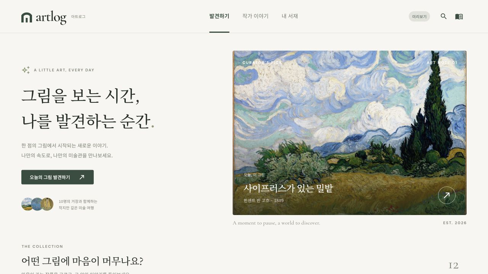
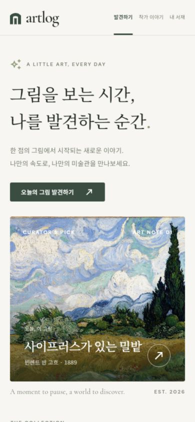
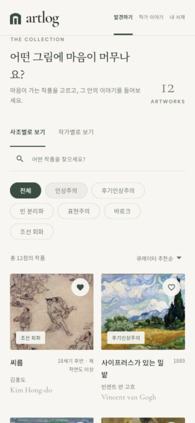

# Flutter Web 검증 기록

검증일: 2026-10-12 · Flutter 3.47.2 / Dart 3.13.2.

- `flutter analyze`: 이슈 없음.
- `flutter test`: 32개 통과. API 요청 경로·메서드·쿼리·JWT 헤더·챗 요청/출처·빈 204·401·500·잘못된 JSON·응답 지연, 상태 저장과 실패한 변경 처리 검증.
- 1440, 768, 390, 320px에서 발견하기·작가 목록·작품 상세·작가 상세·서재 레이아웃 검사 통과. 앱 폰트를 로드해 검사함.
- 실제 API 모드를 API 없는 로컬 서버에서 실행: `/api/artworks`, `/api/artists`, `/api/movements` 요청과 404 안내·재시도 표시 확인. 목업으로 대체되지 않음.
- 미리보기 및 `ARTLOG_DEMO=false` 실제 API 모드의 release 웹 빌드 성공.
- 브라우저에서 필터, 좋아요·팔로우, 도슨트 예시 질문·출처 창·범위 밖 질문, 감상 메모 저장 및 새로고침 후 유지 확인.
- 390 × 844 모바일 화면에서 홈·작품 카드·서재 확인. 기본 데스크톱 화면의 브라우저 콘솔 경고·오류 없음.
- `frontend/` 밖 기존 변경 사항의 diff는 작업 시작 시점과 동일. 현재 브랜치는 `lsh`이며 커밋·푸시는 수행하지 않음.

API 테스트는 문서 초안에 맞춘 MockClient 검사입니다. **실제 서버와의 통합 성공을 의미하지 않습니다.** 서버 라우터·응답 스키마가 아직 없으며 미확정 항목은 [엔드포인트 점검표](../docs/endpoints.md)에 있습니다.

