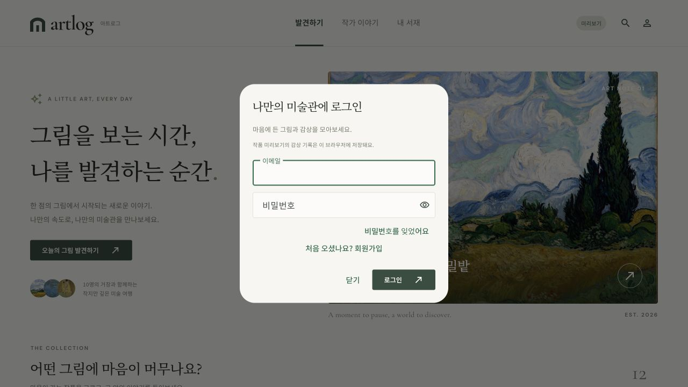
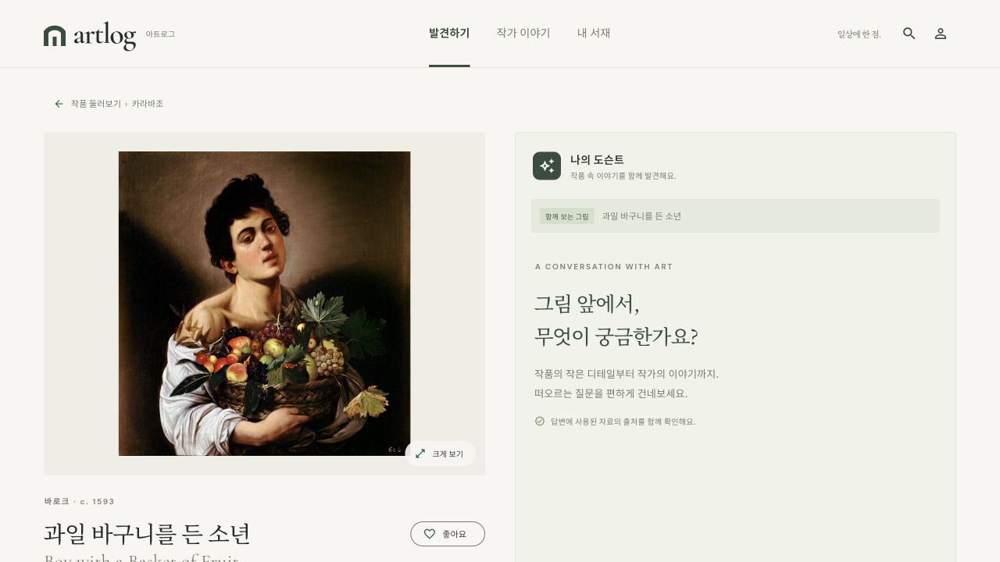
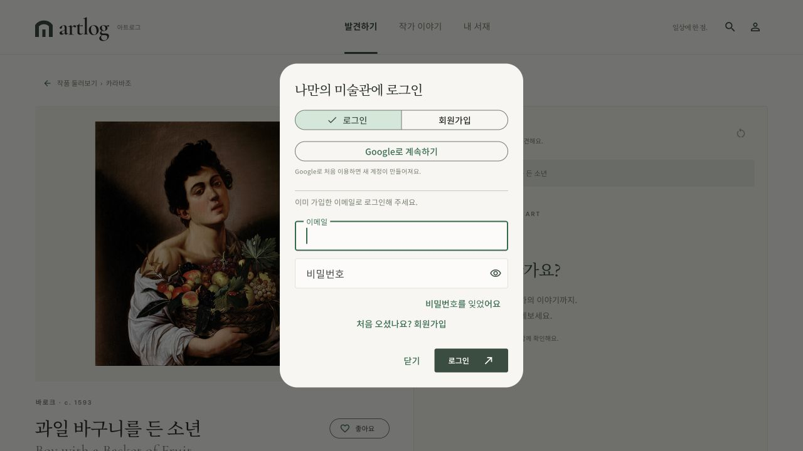
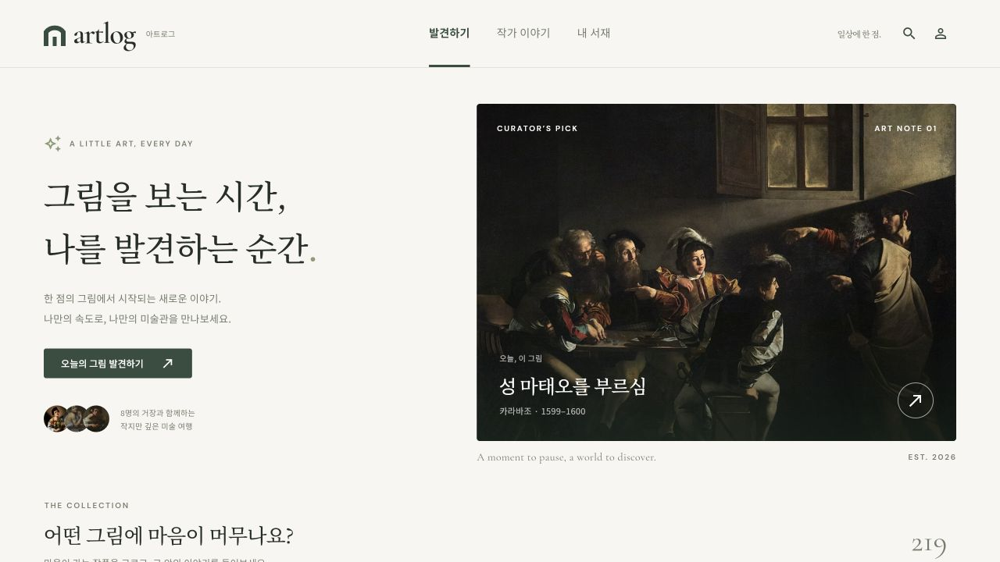

# Flutter Web 검증 기록

검증일: 2026-10-12 · Flutter 3.47.2 / Dart 3.13.2.

- `flutter analyze`: 이슈 없음.
- `flutter test`: 32개 통과. API 요청 경로·메서드·쿼리·JWT 헤더·챗 요청/출처·빈 204·401·500·잘못된 JSON·응답 지연, 상태 저장과 실패한 변경 처리 검증.
- 1440, 768, 390, 320px에서 발견하기·작가 목록·작품 상세·작가 상세·서재 레이아웃 검사 통과. 앱 폰트를 로드해 검사함.
- 실제 API 모드를 API 없는 로컬 서버에서 실행: `/api/artworks`, `/api/artists`, `/api/movements` 요청과 404 안내·재시도 표시 확인. 목업으로 대체되지 않음.
- 미리보기 및 `ARTLOG_DEMO=false` 실제 API 모드의 release 웹 빌드 성공.
- 브라우저에서 필터, 좋아요·팔로우, 도슨트 예시 질문·출처 창·범위 밖 질문, 감상 메모 저장 및 새로고침 후 유지 확인.
- 390 × 844 모바일 화면에서 홈·작품 카드·서재 확인. 기본 데스크톱 화면의 브라우저 콘솔 경고·오류 없음.
- 초기 Flutter 화면 검증 단계에서 `frontend/` 밖 파일은 수정하지 않음. 이후 Firebase·배포 작업의 Git 반영 내역은 아래 기록을 참고.

위 항목은 초기 목업 검증 당시의 기록입니다. 당시에는 서버가 없었으며, 최신 서버 연결 검증은 아래 실제 API 전환 항목을 참고하세요.

## Firebase·Vercel 추가 검증 (2026-10-12)

- `origin/dev`의 `9b39e6a`를 fast-forward 반영한 뒤, 작업 중 추가된 최신 `e604d10`까지 `lsh`에 병합. dev에서 가져온 파일 외 직접 수정은 `frontend/`로 제한.
- Flutter 정적 분석 이슈 없음, 기존 화면·API와 Firebase 인증 관련 테스트 총 42개 통과.
- 배포 설정의 공개 값 허용 목록·필수 설정·HTTPS API 및 SDK 캐시 복구 테스트 4개 통과.
- Firebase SDK를 포함한 로컬 release 빌드 성공.
- Vercel 원격 환경에서 Flutter 3.47.2 설치·lockfile 의존성 설치·웹 빌드·운영 배포 성공. SDK 캐시의 불완전한 Git 메타데이터 복구 후 재배포 성공. 상태 `READY`, 최종 빌드 약 3분.
- 운영 주소: https://artlog-skn35-1team.vercel.app
- 최종 배포 ID: `dpl_2ASeA6t6aXAcTfsYsY3xTLcLZz9E`.
- 운영 `main.dart.js`의 프로젝트 ID·웹앱 ID가 팀 Firebase 설정과 일치함을 확인. HTTP 200.
- 운영 브라우저에서 작품 화면, Firebase 로그인·회원가입 입력 화면, SDK 초기 로딩 확인. 콘솔 오류·경고 없음.
- 갱신된 운영 화면에서 존재하지 않는 계정으로 로그인하면 Firebase 응답 뒤 `이메일 또는 비밀번호를 확인해 주세요.` 안내 표시. 로그인 성공으로 처리되지 않으며 콘솔 오류·경고 없음.
- 팀 Firebase `skn35-3rd-1team`의 이메일/비밀번호 공급자 활성화, `Artlog Web` 등록, 운영 도메인 승인 완료. Vercel의 Production·Preview·Development 환경변수도 이 프로젝트로 교체.
- 실제 Firebase Auth REST API의 임시 계정 가입 → 비밀번호 로그인 → 계정 조회 성공. 테스트 계정은 같은 실행의 `finally`에서 즉시 삭제했으며 비밀번호·토큰을 저장하거나 출력하지 않음.
- 브라우저에서 실제 계정 로그인 후 새로고침하는 전체 흐름은 별도로 검증하지 않았음. 로그인 복원·계정별 기록 분리·401 갱신은 가짜 세션 자동 테스트로 검증.
- 이 배포 당시에는 작품·도슨트 미리보기 + Firebase 인증 연결이었음. 아래 작업에서 실제 API 모드로 전환.

## 실제 API 전환·서버 Firebase 검증 (2026-10-12)

- 최신 dev `0609244`를 lsh에 반영하고 Firebase Admin 토큰 검증 및 TiDB UID 매핑 구현.
- Flutter 분석 이슈 없음, Flutter 테스트 43개·배포 스크립트 4개·백엔드 테스트 153개 통과. Ruff 검사 통과.
- Vercel의 운영·미리보기·개발 설정: `ARTLOG_DEMO=false`, Railway `API_BASE_URL`, `AUTH_PROVIDER=firebase`.
- Railway health 200, 사조 4개·작가 8명·작품 219점. 실제 TiDB TLS 연결·동일 카탈로그 수·마이그레이션 `20261012_0005` 확인.
- 실제 Firebase 임시 계정 두 개 가입·비밀번호 로그인·ID 토큰 발급·Admin SDK 검증 성공. 로컬 FastAPI의 Firebase 모드에서 실제 TiDB에 사용자별 좋아요·팔로우·열람·캘린더 저장 및 계정 분리 확인. 변조/누락 토큰은 401.
- 실행 종료 시 임시 Firebase 계정·TiDB 사용자/활동 행 모두 정리. 비밀번호·ID 토큰을 저장하거나 출력하지 않음.
- Railway 담당자의 운영 설정은 변경하지 않음. 새 코드 병합·배포, 서버 서비스 계정 설정 및 `AUTH_MODE=firebase` 전환은 담당자에게 인계.
- 외부 이미지 중간 리디렉션의 CORS 헤더 부재를 확인하고 Flutter 웹 HTML 이미지 표시 fallback 적용. API 오류를 예시 작품으로 대체하지 않음.

자세한 인계 내용은 [Firebase·배포 안내](../docs/firebase-vercel.md)에 기록합니다.

최종 운영 배포: `dpl_9w8mf8ZQtZo4Vhqnh3YyXWAKBBMP` (READY). 운영 브라우저에서 숫자 ID의 작품 상세·실제 작품 이미지 표시와 도슨트 501의 준비 중 안내를 확인했습니다.

## 최신 dev 프론트 기능 연결 (2026-10-13)

- 기준 dev `a7a5fbe`, 직접 수정은 `frontend/`로 제한. Railway·Firebase 콘솔·백엔드 코드·DB 설정 변경 없음.
- 새 기능: 맞춤 작품/작가 추천 및 이유, 내 대화 목록, 작품 대화 복원·초기화, 출처 라이선스, 서버 기준 질문/history 제한.
- 계정 변경 중 늦은 대화/복원 응답, 이전 요청의 새 계정 재시도, 진행 중 좋아요 상태, 초기화 확인 창의 계정 변경을 차단.
- 작은 이미지 오류 표시·좁은 서재 탭 수정. 상세에서 로그인했을 때 열람 기록도 전송.
- `flutter analyze`: 이슈 없음. Flutter 테스트 **61개**, 배포 스크립트 **4개** 통과. 원격 release 웹 빌드 성공.
- 새 개인 화면은 MockClient·가짜 세션으로 검증. 320/1280px에서 대화 목록→복원→출처 라이선스와 추천 이유 표시 확인. 운영 개인 계정 통합 검증과 구분.
- 실제 공개 API: health 200, 사조 4·작가 8·작품 219, 유사 작품 200·3개. 비로그인 도슨트 POST 501 확인.
- Vercel `dpl_Adsx7224VDavxGVi6cCKnjJsJSys`: READY, Production, `catalog=API, auth=firebase`, 기존 운영 주소에 연결. 정적 프론트이며 AI 답변의 501은 Railway API 응답임.

상세 후속 작업·전달 문구: [프론트 인수인계](../docs/frontend-handoff.md).

## Google 로그인·온보딩 추가 (2026-10-13)

- 소스 수정은 `frontend/`에 한정. 사용자 승인 후 팀 Firebase `skn35-3rd-1team`의 Google 공급자를 활성화하고 콘솔에서 ‘사용 설정됨’을 확인했습니다. Railway·백엔드 코드·TiDB 설정은 변경하지 않았습니다.
- 로그인/회원가입을 분리한 선택 탭, Google 로그인, 첫 로그인 선택형 나이대·성별·설명 스타일 온보딩과 서재의 감상 프로필 수정 추가.
- 프로필은 Firebase UID별 현재 브라우저 저장입니다. Google에서 나이·성별을 조회하지 않으며 서버 저장·맞춤 말투는 아직 연결하지 않았습니다.
- Flutter 분석 이슈 없음, 전체 Flutter 테스트 **74개**, 배포 스크립트 **4개** 통과. Google SDK 공급자 호출·오류 안내, 프로필 저장·건너뛰기·계정 변경 및 320/390/1280px 레이아웃 검사 포함.
- 최종 운영 배포 `dpl_EmDXDJM59XGuVaYFz4s7oHRLquJS`: READY, Production, `catalog=API, auth=firebase`. 운영 주소 https://artlog-skn35-1team.vercel.app 에 연결. 배포 오류 로그 조회 결과 오류 레코드 없음.
- 운영 화면의 로그인/회원가입과 Google 버튼을 확인했습니다. Safari 비공개 창에서 Google 버튼을 눌러 Google 계정 인증 페이지 진입까지 확인하고 계정 입력 없이 닫았습니다. Codex 내장 브라우저에서는 팝업 확인이 되지 않아 Safari에서 확인했습니다.
- 실제 Google 계정 로그인 성공·운영 사용자별 TiDB 저장은 이번 검증 범위에 포함되지 않습니다. 프로필 UI 자동 검사와 운영 서버 인증·개인 기록 통합 검증을 구분합니다.

## 최신 ERD 대조·반영 (2026-10-13)

- 원격 dev `a7a5fbe`의 15테이블 ERD, 실제 모델·마이그레이션 `20261012_0005`, API·서비스를 대조. 소스 수정은 `frontend/` 한정.
- 같은 작품의 나중 재방문은 열람 POST를 다시 전송. 동시에 진행 중인 같은 요청만 중복 억제하며 재빌드는 추가 열람으로 세지 않음. 상세 실패 후 재시도 성공 때도 기록.
- `artwork_count`·`total_views`·날짜 상세 `view_count`를 구분. 320/1280px에서 작품 1점·감상 3회가 각각 표시되는지 검사.
- API `is_featured`로 대표 작품·큐레이터 순서를 정하고 같은 그룹 안 서버 순서 유지.
- 원격 `taemin`의 추가 선택 계약 `basis_sources` 지원. 필드 생략·NULL 호환, 링크 있는 근거·기관 이름만 있는 근거를 원문과 구분해 표시. 백엔드 브랜치 병합 없음.
- 재방문 검사에서 발견한 화면 전환의 스크롤 제약과 오류 재시도 Future 콜백 수정. 발견하기/서재 → 작품 재방문, 기존 화면·온보딩 회귀 검증.
- Flutter 분석 이슈 없음. 전체 Flutter 테스트 **81개 통과**. 기존 배포 스크립트 4개 검사 결과 유지(변경 없음).
- 나이·성별·설명 스타일은 ERD에 없어 UID별 브라우저 저장 유지. 운영 DB 변경·실제 개인 계정 통합 검증은 수행하지 않음.

전체 테이블별 대응과 과거 문서 불일치: [ERD 연결 점검](../docs/erd-mapping.md).

최종 운영 배포 `dpl_498qJbZrfSaBdFEXcdgqsWYapfpW`: READY, Production, 원격 release 빌드 성공(`catalog=API, auth=firebase`). 공개 작품 API의 219점 중 `is_featured=true` 49점을 확인했습니다. 운영 화면에서 대표 작품·큐레이터 목록에 ‘성 마태오를 부르심’이 반영되는 것을 확인했습니다.

최종 운영 브라우저에서 대표 작품 → 숫자 ID `377` 상세와 유사 작품 → 상단 발견하기 메뉴로 복귀를 확인했습니다. 상단 메뉴 접근성도 유지됩니다. 이 공개 화면 확인은 로그인 사용자의 실제 DB 열람 집계 검증과 구분합니다.

## 모든 팀 브랜치 dev 통합 (2026-10-13)

최신 ERD는 social_accounts·user_preferences를 포함한 17테이블이며 Alembic head는 20261013_0006입니다. 기존의 ‘15테이블/프로필 테이블 없음’ 기록은 통합 전 lsh 시점의 기록입니다. 통합 프론트 81개·백엔드 279개·배포 스크립트 4개 검사, Flutter 분석·Ruff·offline 마이그레이션 SQL 검증을 통과했습니다. 실제 운영 DB 쓰기나 신규 초안 적재는 하지 않았습니다.

통합 범위·검증의 한계·남은 디자인 및 프로필 연결 작업은 [통합·분담표](../../docs/integration-and-task-board-2026-10-13.md)를 참고하세요.

2026-10-14 현재 UI: [루브르 참고의 전시형 메인·SNS 피드·개인 서재 분리](editorial/). 반사광과 배경 블러를 제거한 후 114개 Flutter 테스트와 웹 빌드를 확인했습니다. 기존 liquid-glass·prism-glass 캡처는 이전 디자인 기록입니다.

2026-10-14 스크롤 인터랙션: [헤더 축소·메인 패널 확장·콘텐츠 등장 전후](motion/). 전체 Flutter 테스트 119개, 분석 이슈 없음, release 웹 빌드를 확인했습니다. 모바일의 안정된 헤더, 시스템 동작 줄이기·접근성 탐색, 페이지 변경 시 초기화와 애니메이션 종료 후 유휴 프레임 없는 상태를 회귀 검사했습니다. 캡처는 로컬 미리보기이며 운영 배포·실제 기기별 FPS 측정은 포함하지 않습니다.

2026-10-14 전시형 갤러리: [검은 배경·이미지 비율을 따른 3열 전시 벽](museum/). 전체 Flutter 테스트 123개와 분석·release 웹 빌드를 확인했습니다. 1280/390/320px의 3/2/1열 배치, 6점 초기 표시, 좋아요 실제 조작, 검은 필터의 글자 대비와 내 서재의 밝은 배경 유지를 검사했습니다. 스크롤·검색·상세 열기는 로컬 브라우저에서 확인했으며 운영 API·인증·DB 설정과 배포는 변경하지 않았습니다.
