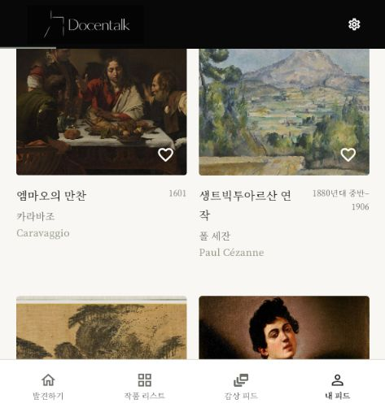
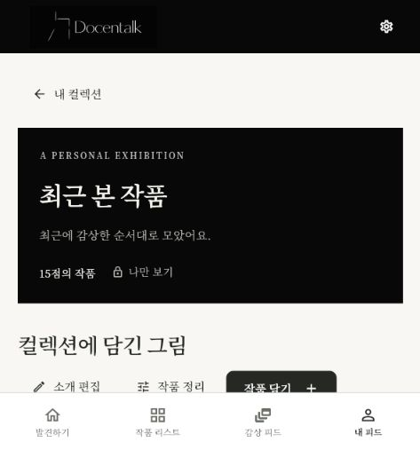

# 자동 컬렉션 진단 이력

문서 갱신: **2026-10-15 · dev `6f0b40a` 기준**. 아래 본문은 10/14에 수행한 실제 진단 기록입니다.

현재 최근·반복·작가·월별 모음과 AI 취향 모음은 별도 페이지 `/collection/auto/{key}`로 열립니다. 저장을 선택하면 일반 `/collection/{id}`로 이동하며 계정당 10개·모음당 30점 한도를 적용합니다. 좋아요 모음은 `/collection/likes`입니다.

현재 컬렉션 화면은 일반 모음·자동 모음·AI 테마의 오류를 별도로 안내합니다. AI 테마는 캐시와 신호 변경 조건을 사용합니다. 10/14 당시의 “로컬 수정 미배포” 문장은 현재 운영 전체 상태가 아니라 당시 결론이며, 확인된 10/15 배포는 [배포 안내](../../docs/firebase-vercel.md)에 정리했습니다.

이 문서 갱신에서는 당시 계정·DB 기록을 다시 조회하거나 생성·삭제하지 않았습니다. 과거 진단의 테스트·실패 수는 유지하며 현재 실행으로 재기재하지 않습니다.

<details>
<summary>이전 작업 시점의 원본 기록 펼치기</summary>

# 자동 컬렉션 진단 — 2026-10-14 (한국 시간)

## 결론

현재 운영 로그인 계정에서는 자동 컬렉션 미표시가 재현되지 않았다.
배포 누락이나 TiDB 집계 오류를 원인으로 확인하지 못했다.
실제 조회 기록 증가, 자동 상세, 일반 컬렉션 저장, 세 번째 질문의 제안 표시를 확인했다.

별도로 재현한 프론트 결함은 자동 조회 오류를 빈 배열로 숨기는 처리와
일반 컬렉션 조회가 실패하면 자동 조회까지 생략하는 구조다.
두 결함은 수정 전 실패하는 HTTP 모의 응답 회귀 테스트로 확인한 뒤 수정했다.
이 결함이 이번 운영 계정에서 실제 발생했다고 단정하지 않는다.

## 배포 확인 (읽기 전용)

- Railway `/openapi.json`: `/api/me/collections/auto`, `/api/me/collections/auto/{key}` 및 조회 기록 POST 경로 존재.
- 인증 없는 `GET /api/me/collections/auto`: HTTP 401, `{"detail":"로그인이 필요합니다."}`.
- Vercel `main.dart.js`: HTTP 200, 3,663,954바이트. `me/collections/auto`와 Railway 호스트 문자열 존재.
- 조직 원격 dev: `c488004239d8e970f1749fa364305ff14763ca8b`.
- `taemin1997` fork dev 및 로컬 HEAD: `3c88361598a02a0e8f0b64f527ba58c15bc0d89b`.
- GitHub compare 결과, 두 커밋 사이 변경은 로고 관련 파일뿐이다. 자동 컬렉션 코드 차이는 없다.
- 운영 배포의 정확한 Git SHA는 배포 콘솔에서 확인하지 않았다.

## 실제 로그인 계정 검증

사용자가 Codex 브라우저에서 직접 로그인했다. 비밀번호와 토큰은 추출하거나 출력하지 않았다.
인증된 원시 HTTP 응답을 직접 캡처한 검증과 구분하며, 아래 결과는 운영 UI와 TiDB 쿼리를 대조했다.

1. 로그인 직후 컬렉션 탭: 최근 14점, 자주 본 작품 4점, 작가 모음 3개, 이번 달 14점 표시.
2. 해당 계정의 TiDB ID `120001`: 조회 대상 14점, 누적 조회 21회.
3. 운영 작품 `/artwork/361`(엠마오의 만찬)을 열었다.
4. `artwork_views`: `user_id=120001`, `artwork_id=361`, `viewed_on=2026-10-14`, `view_count=1`, `last_viewed_at=2026-10-14 08:50:25`(UTC).
5. 재집계 및 운영 화면: 최근 15점, 작가 `artist-9` 6점, 이번 달 15점. 최근 카드 대표 작품은 `361`.
6. `/collection/auto/recent`: 작품 15점과 저장 버튼 표시.
7. 저장 후 `/collection/60002`로 이동. TiDB `collections.id=60002`, 소유자 `120001`, 작품 수 15점.
8. 저장된 대표 작품 순서의 첫 3점은 `[361, 297, 243]`.
9. 작품 361에서 질문 3개를 전송했다. DB 질문·답변은 각각 3개, 답변의 `refused=0`.
10. 세 번째 답변에 “카라바조의 작품을 6점 감상하셨네요. 지금까지 본 작품으로 ‘카라바조 모음’ 컬렉션을 만들어 드릴까요?”가 표시됐다. 이 제안은 수락하지 않았다.

검증으로 일반 컬렉션 60002와 작품 361의 조회·대화 기록이 실제 계정에 추가되었다.
저장한 컬렉션은 유지했다.

```sql
SELECT user_id, artwork_id, viewed_on, view_count, last_viewed_at
FROM artwork_views WHERE user_id = 120001 AND artwork_id = 361;

SELECT c.id, c.user_id, c.name, COUNT(i.artwork_id) AS artworks
FROM collections c JOIN collection_items i ON i.collection_id = c.id
WHERE c.id = 60002 GROUP BY c.id, c.user_id, c.name;
```

TiDB 버전은 `8.0.11-TiDB-v8.5.3-serverless`다. 최근 활동 계정 5개에서
현재 자동 집계를 실행해 모두 성공했다. 일반 컬렉션 소유 계정 5개의 목록 쿼리도 성공했다.
`artwork_views`에서 `users`에 없는 사용자 ID를 참조하는 행은 0개였다.

## 로컬 수정

- 일반·자동 컬렉션 요청과 로딩·오류 상태를 분리했다. 한쪽 실패가 다른 카드 표시를 막지 않는다.
- 자동 API 오류는 빈 목록 대신 오류 및 재시도 안내를 표시한다.
- 조회 기록이 없는 정상 응답은 별도의 빈 상태로 안내한다.
- 자동 카드 상세에서 돌아올 때 목록을 갱신한다.
- 컬렉션 생성 조건과 채팅 제안 조건을 화면에 안내한다.
- 실제 API 모드의 오류·복구 2개 및 조회→자동 카드→상세→저장 흐름 1개 회귀 테스트를 추가했다.

| 기능 | 현재 조건 |
| --- | --- |
| 최근 본 작품 | 로그인 후 상세 열람 1점 이상 |
| 자주 본 작품 | 같은 작품 누적 조회 2회 이상 |
| 작가 자동 카드 | 같은 작가의 서로 다른 작품 2점 이상, 상위 작가 3명 |
| 이번 달 | 한국 시간 기준 이번 달에 상세 열람 1점 이상 |
| 도슨트 제안 | 같은 작품 질문 3회 이상, 현재 답변 refused=false |
| 도슨트의 작가 모음 제안 | 위 조건 및 같은 작가 작품 3점 이상, 같은 이름의 저장 컬렉션 없음 |

질문이나 자동 카드 표시만으로 일반 컬렉션에 저장하지 않는다. 저장 버튼 또는 제안 수락이 필요하다.

## 검증 결과

- 백엔드 `cd backend; uv run pytest -q`: **391 passed, 2 failed**. 실패는 사전에 알려진 classifier 모네·세잔 비교 1건과 docent grounding 1건이다.
- Docker Flutter: `flutter pub get && flutter analyze && flutter test`: **분석 이슈 없음, 151개 통과**.
- `frontend/pubspec.lock`은 요청대로 `git checkout -- frontend/pubspec.lock`으로 원복.
- `git diff --check` 통과. 커밋·push·운영 재배포는 하지 않았다. 로컬 수정은 아직 운영에 반영되지 않았다.





</details>
